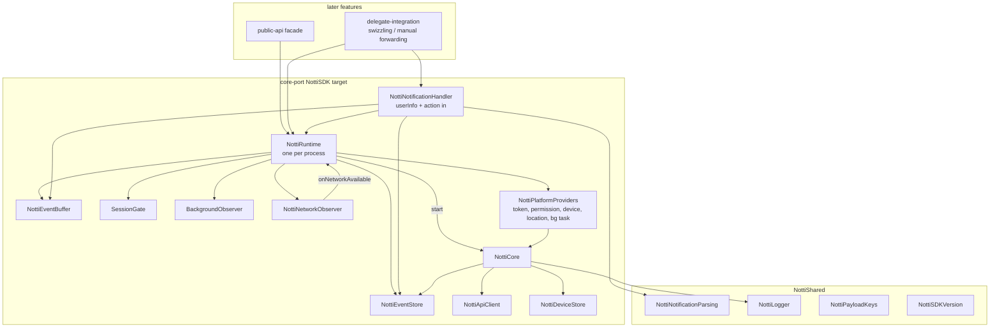

# Core Port Design

**Spec**: `.specs/features/core-port/spec.md`
**Status**: Approved (2026-10-09)
**Depends on**: `package-foundation` (targets, `NottiShared`, `NottiLogger`, `NottiSDKVersion`)
**Source baseline**: `../zeep-notti-react-native/ios` at `52e4b55` (main, v0.6.0 + docs)

---

## Architecture Overview

The port keeps the engine (`NottiCore` and its collaborators) byte-for-byte equivalent in behavior. It changes only three things:

1. The RN shell (`Notti.mm`, `@objc NottiImpl` forwarders and emit handlers) is dropped.
2. The six process-wide statics scattered across types become one owned container, `NottiRuntime`.
3. The notification-handling logic is split from the `UNUserNotificationCenterDelegate` conformance, so it can be driven by plain inputs (the conformance and swizzling come in `delegate-integration`).

Cold-start invariant (CORE-04): `NottiRuntime.shared` is created lazily on the first touch from either side (delegate callback or `initialize`). Its event store, buffer, gate and observers exist before any core. Events handled before `start` are persisted, and are flushed by the core once registration succeeds. This is the same guarantee RN got from `NottiImpl.eventStore` / `NottiPushDelegate.shared.init`.

---

## Static → Runtime mapping (CORE-03)

| RN static (file:line) | Purpose | Port |
| --- | --- | --- |
| `NottiImpl.activeInstance` (NottiImpl:24) | Expose the RN module to Obj-C | **Dropped** (RN-only) |
| `NottiImpl.activeCore` (:25) | APNs/network callbacks reach the live core | `NottiRuntime.core` (private(set), set by `start`, cleared by `stop`) |
| `NottiImpl.processSessionGate` (:32) | Session survives a JS reload | `NottiRuntime.sessionGate` (`let`) |
| `NottiImpl.processBackgroundObserver` (:47-59) | Close the gate on background even without a core | `NottiRuntime.backgroundObserver`, started in `NottiRuntime.init` |
| `NottiImpl.eventStore` (:68) | Cold-start event persistence | `NottiRuntime.eventStore` (`let`, suite `notti_prefs`) |
| `NottiEventBuffer.shared` (EventBuffer:35) | Buffer events until a listener exists | `NottiRuntime.eventBuffer` (`let`) |
| `NottiPushDelegate.shared` (PushDelegate:41) | Delegate singleton + "start once" hook | Delegate conformance → `delegate-integration`. The "start once" hook → `NottiRuntime.init` |
| `NottiNetworkObserver.shared` (NetworkObserver:58) | Flush on reconnect | `NottiRuntime.networkObserver`, started in `NottiRuntime.init` |

**Deliberate difference (documented, not a behavior change to the engine):** in RN the network observer only started if the host assigned `NottiPushDelegate.shared` (an RN-integration accident). Here it starts with the runtime, which always exists once the SDK is touched. The flush semantics (SDKCTR-13) are unchanged.

---

## Components

### NottiRuntime (new)

- **Purpose**: owns process-wide SDK state and builds and holds the live core.
- **Location**: `Sources/NottiSDK/Runtime/NottiRuntime.swift`
- **Interfaces** (all `internal`):
  - `static let shared: NottiRuntime`, default wiring (`UserDefaults(suiteName: "notti_prefs")`, real providers)
  - `init(defaults: UserDefaults, providers: NottiPlatformProviders, pathMonitor: NottiPathMonitoring, apiClientFactory: ..., sleeper: ..., startObservers: Bool = true)`: tests build isolated runtimes and never touch `.shared`
  - `let eventStore`, `let eventBuffer`, `let sessionGate`
  - `private(set) var core: NottiCore?` (lock-protected read/write)
  - `func start(appId: String, clientKey: String, baseUrl: String)`: if a core exists, `invalidate()` it first (RN JS-reload parity: the new core adopts the open session through `sessionGate`). Then build the core with the provider closures and `sdkVersion: NottiSDKVersion.current` (CORE-05), and call `core.initialize`.
  - `func stop()`: `core?.invalidate()`; `core = nil` (test and teardown hook)
  - `var onDeviceIdChanged: ((String) -> Void)?`, forwarded from the core's `onDeviceIdChanged`; `public-api` attaches observers
  - `func onNetworkAvailable()`: `core?.onNetworkAvailable()` (same as RN NottiNetworkObserver:59)
  - `func onApnsToken(_ data: Data)` / `onApnsRegistrationFailed(_ error: Error)`: hex conversion ported from `NottiBridge` (PushDelegate:17-26); calls `core?.onTokenRefreshed`. The token is never logged.
- **Reuses**: `NottiImpl` init body (:108-233) for wiring, minus the RN boxes (:111, :221, :231).

### NottiPlatformProviders (ported from NottiImpl wiring)

- **Purpose**: concrete OS-backed closures injected into `NottiCore`.
- **Location**: `Sources/NottiSDK/Platform/NottiPlatformProviders.swift`, `NottiLocationReader.swift` (from NottiImpl:389-462), `NottiBackgroundTask.swift` (from :274-302)
- **Interface**: a struct of closures that mirrors the `NottiCore.init` provider params: `tokenProvider`, `permissionRequester`, `versionProvider`, `hasLocationPermission`, `countryProvider`, `deviceOsProvider`, `deviceModelProvider`, `timezoneProvider`, `languageProvider`, `permissionStatusProvider`, `appStateProvider`, `beginBackgroundTask`. Plus `static func live() -> Self`.
- `live()` is `@available(iOSApplicationExtension, unavailable)` (uses `UIApplication.shared`).
- **Reuses**: verbatim closure bodies, including the main-thread `async` hops (NottiImpl:131, :208, :419-422, :452).
- **Also ported**: the string-only tag filter (NottiImpl:325-341) moves to `NottiRuntime` as `sanitizeTags(_:)`, so `public-api` reuses it.

### NottiNotificationHandler (split from NottiPushDelegate)

- **Purpose**: the reporting/emission decisions for a remote notification, given plain inputs.
- **Location**: `Sources/NottiSDK/Events/NottiNotificationHandler.swift`
- **Interfaces**:
  - `init(runtime: NottiRuntime)`
  - `func handleWillPresent(userInfo: [AnyHashable: Any], identifier: String) -> Bool` returns whether to present. It reports `received` and emits to the buffer, per RN `willPresent` (PushDelegate:52-77): only for remote pushes (`aps` present).
  - `func handleResponse(actionIdentifier: String, userInfo: [AnyHashable: Any], identifier: String)`: body tap → `opened` + `clicked` + buffer click; custom action → `clicked` only; dismiss → nothing (SDKOPEN-01..08, AD-003 option B, PushDelegate:79-133).
  - `private func enqueueIfReportable(...)`: requires `notification_id` and `delivery_id`; persists to `runtime.eventStore`; triggers `runtime.core?.onNetworkAvailable()` as an opportunistic flush.
- **Why split**: the RN tests had to build `UNNotification`/`UNNotificationResponse` through `class_createInstance` + KVC. Plain inputs make the core-logic tests direct (this closes the SDK-17 "emission wiring untested" gap at the core layer, CORE-08). The `UNUserNotificationCenterDelegate` adapter that extracts these inputs, plus the KVC-fixture tests, move to `delegate-integration`.

### Verbatim ports (behavior frozen)

| File (RN → here) | Target / folder | Changes allowed |
| --- | --- | --- |
| `NottiCore.swift` (1439) | `NottiSDK/Core/` | Logger call sites get a level (below); `public` → `internal`; `sdkVersion` param kept but always fed by the runtime |
| `NottiApiClient.swift` (405) | `NottiSDK/Network/` | Log `URLError` as `domain/code`, not `localizedDescription` (see PII); `public` → `internal` |
| `NottiDeviceStore.swift` (450) | `NottiSDK/Storage/` | Key strings frozen; `public` → `internal` |
| `NottiEventStore.swift` (138) | `NottiSDK/Storage/` | Add a `warn` log when the decode fails (still drops the queue, RN behavior) |
| `NottiEventBuffer.swift` (141) | `NottiSDK/Events/` | Remove the `static shared`; otherwise unchanged |
| `NottiNetworkObserver.swift` (116) | `NottiSDK/Network/` | Remove `static shared`; the callback targets the runtime |
| `NottiNotificationParsing.swift` (98) | `NottiShared/` | Key constants from `NottiPayloadKeys`; `package` access |

Not ported: `Notti.mm`, `Notti.h`, `NottiImpl` @objc forwarders (:304-386 except the tag filter), emit handlers (:70-104). The NSE file belongs to `nse-rich-media`.

Splitting `NottiCore.swift` (1439 lines) into smaller files is explicitly **deferred**: a verbatim port keeps the diff against RN reviewable line by line.

---

## Logging & PII (CORE-12/13)

- The core's `logger: (String) -> Void` init param becomes `logger: (NottiLogLevel, String) -> Void`. The runtime wires it to `NottiLogger.log`.
- The 24 `logger(` call sites in `NottiCore.swift` (lines listed in research) each get a level: failures and give-ups → `.error`; retries and degraded paths → `.warn`; lifecycle → `.debug`. Message text is unchanged.
- The RN audit found **no** PII interpolation (messages are field names, fixed descriptions, `HTTP <code>`).
- Residual risk: `error.localizedDescription` (NottiApiClient:248-289, PushDelegate:26). `URLError` descriptions can embed the failing URL, which contains appId/deviceId. The port logs `"\(error.domain)#\(error.code)"` instead. This is a logging-only change.
- Default level `.error` (CORE-13). `public-api` exposes the setter.
- **Test**: a full flow (initialize → token → register → login(sentinel) → setEmail(sentinel) → setPhone(sentinel) → addTags(sentinel) → event flush with failures) at `.verbose`, with the `NottiLogger.sink` capturing. The test asserts that no sentinel substring appears, including the token hex.

---

## Data Models / Persistence (CORE-09..11)

The UserDefaults suite `notti_prefs` is frozen. Keys come from `NottiDeviceStore.swift:88-117` and `NottiEventStore.swift:61` (`notti_pending_events`, JSON array of `PendingEvent` Codable). The full table is in the RN README:532-560.

- **Golden key test**: `NottiDeviceStoreKeysTests` asserts that the store's key constants equal a frozen list copied verbatim from RN (`52e4b55`). Any rename fails CI.
- **Continuity fixture**: `Tests/NottiSDKTests/Fixtures/rn-0.6.0-state.plist`. It is hand-authored from RN's key and encoding definitions with synthetic values (`device-fixture-id`, `test@example.invalid`, etc. No real PII). It covers: device id, token, tags, external id, subscribed, profile fields + acks + `notti_profile_field_ack_migrated`, session counters + `notti_session_last_seen_at_ms`, two `notti_pending_events`.
  - **Test**: load it into a per-test suite, start the runtime with the stub HTTP layer, and assert: no `POST /devices` when RN would not re-register (token unchanged and registration already succeeded); `getDeviceId()` returns the fixture id; the pending events flush with their original `delivery_id`s.
  - **Faithfulness guard**: the fixture's pending-events JSON is written by hand from RN's `PendingEvent` field names, not produced by the ported encoder, which would be circular.

---

## Test Port Plan (CORE-06..08)

- Location: `Tests/NottiSDKTests/` with `@testable import NottiSDK` (+ `NottiShared`). Helpers go in `Tests/NottiSDKTests/Support/`: `StubURLProtocol`, `FakePathMonitor`, `LogSink` and the core test doubles (`ThreadProbeApiClient`, `PatchHookApiClient`, `SlowEventApiClient`).
- Ported 1:1: Core (123), ApiClient (29), DeviceStore (18), EventBuffer (12), EventStore (6), Parsing (6 → `NottiSharedTests`), NetworkObserver (4).
- PushDelegate (15): the logic assertions are rewritten against `NottiNotificationHandler` with plain inputs here. The `UNNotification` KVC-fixture tests move to `delegate-integration`. Every one of the 15 is accounted for in `traceability.md` as "ported", "moved to delegate-integration" or "dropped (RN-only) + reason".
- Static-dependent tests (PushDelegateTests used `NottiImpl.eventStore` and `NottiEventBuffer.shared`) use an isolated `NottiRuntime` per test. This removes cross-test shared state.
- `traceability.md` (created in Tasks): RN ID → test(s) here, with N/A rows (Android-only) and their reasons.
- New direct tests for the RN iOS gaps: SDK-12/13 (iOS evidence was indirect) and SDK-17 (emission wiring) at the handler/runtime layer. SDK-04 (missing native prerequisite: no APNs entitlement means the token callback never arrives or the failure callback fires) is tested as `onApnsRegistrationFailed` → logged, non-fatal, no registration, with the core still usable.

---

## Error Handling Strategy

All existing handling is unchanged (retry 5x, 2/4/8/16s, 408/429/5xx transient; terminal 4xx; bounded semaphores 15s/20s; tolerant UserDefaults getters; http rejected in release).

| New-surface scenario | Handling | Impact |
| --- | --- | --- |
| Handler called before `start` | Persist to the event store; buffer the emission; no core call | Same as RN cold start |
| `start` called twice | Invalidate the old core, start a new one that adopts the open session | Same as RN JS reload (SEGTEL-08 notes) |
| APNs registration failed | `.error` log with domain/code; no crash; core unaffected | SDK-04 |
| Corrupt `notti_pending_events` | Dropped (RN behavior) + `.warn` log | Visible in debug logs only |

---

## Tech Decisions

| Decision | Choice | Rationale |
| --- | --- | --- |
| Container vs pure DI | One `NottiRuntime.shared` + injectable `init` | OS callbacks (APNs, UN delegate, swizzled methods) have no DI entry point; one explicit owner replaces six implicit statics |
| Handler split from UN delegate | Plain-input `NottiNotificationHandler` | Removes the KVC fixture hacks from core tests; the delegate layer becomes a thin adapter |
| Verbatim `NottiCore` | No refactor in M1 | AD-002 parity; a reviewable diff against RN |
| Threading | Unchanged (serial `app.notti.sdk.core` queue, `.utility`; semaphore HTTP) | Swift 5 mode chosen; a rewrite is out of scope |
| Access level | `internal` in `NottiSDK`; `package` in `NottiShared` | Nothing is public until `public-api` |

---

## Open Items

None. Privacy manifest scope resolved by AD-005.
