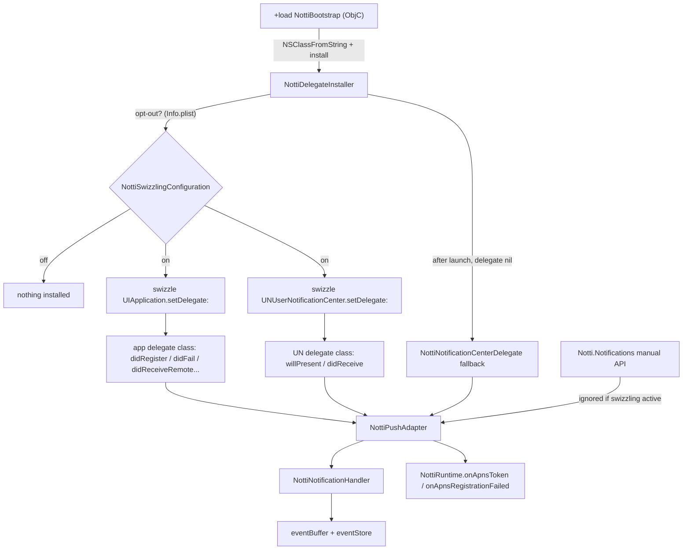

# Delegate Integration Design

**Spec**: `.specs/features/delegate-integration/spec.md`
**Status**: Approved (D2 confirmed 2026-10-11; open items 1-2 below do not block Tasks). Execute done, Verifier PASS (round 2).

---

## Spike results (2026-10-11)

Run before designing, on a throwaway consumer (an SPM `executableTarget` that depends on this package, built with `xcodebuild` for the iOS simulator and run with `xcrun simctl spawn`). Spike code was removed from the repo afterwards.

| Question | Result | Confidence |
| --- | --- | --- |
| Does an ObjC `+load` in a new SPM target run when linked statically? | Yes, in Debug and in Release (dead-strip on). The consumer referenced only `Notti.logLevel`, nothing that mentions the ObjC target | [Certo] for SPM executable linking. [Provável] for an Xcode app target, which links package objects the same way. The example app (`example-and-release`) re-checks it |
| Can ObjC (`NottiSDKBootstrap`) call Swift (`NottiSDK`) without a dependency cycle? | Yes: `+load` does `NSClassFromString(@"NottiDelegateInstaller")` and `objc_msgSend` of `install`, where `@objc(NottiDelegateInstaller) final class` lives in `NottiSDK`. It ran at `+load` time in Release | [Certo] |
| Does `pod lib lint` accept ObjC files in the `Core` subspec? | Yes with `source_files` extended to `Sources/NottiSDKBootstrap/**/*.{h,m}` and `public_header_files = Sources/NottiSDKBootstrap/include/*.h`. A Swift file that mentions the ObjC type needs `#if canImport(NottiSDKBootstrap)` (the pod is one module, there is no `NottiSDKBootstrap` module). Lint passed (all subspecs) | [Certo] for lint |
| Does the hook run in a CocoaPods app? | Not run. CocoaPods adds `-ObjC` for static pods, so members with an ObjC class are kept | [Provável]. Check: after `pod lib lint --no-clean`, `nm` the product for `_OBJC_CLASS_$_NottiBootstrap` (task) |

Consequence: the "only in `initialize`" fallback is not needed. The `+load` path stays.

---

## Architecture Overview

Three layers, all app-only (`@available(iOSApplicationExtension, unavailable)` on Swift types, never reachable from `NottiSDKExtension`):

1. **Launch hook (ObjC, new target `NottiSDKBootstrap`)**: `+load` only calls `NottiDelegateInstaller.install()` by name. No Foundation work beyond the lookup (DEL-14).
2. **Installer and swizzlers (Swift, `Sources/NottiSDK/Delegates/`)**: decide whether swizzling is on, then swizzle three surfaces: `UIApplication.setDelegate:` (to reach the app delegate class), `UNUserNotificationCenter.setDelegate:` (to reach the notification delegate class), and the delegate methods of the classes they hand over. A small `NottiMethodSwizzler` owns replace-and-chain and the idempotency registry.
3. **Push adapter (Swift)**: one place, `NottiPushAdapter`, turns OS callbacks into the plain inputs `NottiNotificationHandler` and `NottiRuntime` already take. The swizzled blocks and the manual API both call it, so the two paths cannot diverge.

`NottiDelegateInstaller.install()` is called from `+load` and again, cheaply, by `Notti.initialize` (idempotent, DEL-07). The second call is the safety net if a future OS change stops `+load` from running; it is not the primary path.

---

## Code Reuse Analysis

| Existing | Reuse |
| --- | --- |
| `NottiNotificationHandler` (`handleWillPresent`, `handleResponse`) | Unchanged. The adapter calls them. One new method `handleSilentPush(userInfo:)` is added next to them (new behavior, DEL-15) |
| `NottiRuntime.shared` (`eventBuffer`, `eventStore`, `onApnsToken`, `onApnsRegistrationFailed`) | Reused as is. The token path already exists and is unit-tested |
| `NottiPayloadKeys`, `parseUserInfo`, `ParsedNotification` | Reused for `aps`, `notification_id`, `delivery_id` and payload parsing |
| `NottiLogger` | All logging. Values never interpolated (`domain#code` only) |
| `NottiListenerHub`, `takeInitialClick` | Unchanged. A buffered click reaches them as today (API-10, API-11) |
| `check-public-surface.sh`, `check-package-graph.sh`, `check-extension-safety.sh` | Extended for the new target and public symbols (see Impact on guards) |
| `scripts/` + `NottiSDKObjCTests` | The ObjC test target already exists; the new `NottiNotifications` methods are exercised there |

Concerns check: no `CONCERNS.md` exists in `.specs/codebase/`. The risky areas are ObjC-runtime swizzling (fragile, hard to unit test) and the package-graph guard that fixes the exact podspec shape; both get explicit tasks and tests below.

---

## Components

### NottiBootstrap (ObjC)

- **Location**: `Sources/NottiSDKBootstrap/NottiBootstrap.m`, `include/NottiBootstrap.h`.
- **Purpose**: run `+load` at process launch and call the Swift installer by name.
- **Interface**: `@interface NottiBootstrap` with `+load`, plus read-only `loadCount` / `installCount` class properties (used only by the proof test and the build check; not documented API).
- **Rules**: no UIKit, no I/O, no logging, no `NottiRuntime` access (DEL-14). If the Swift class is missing it does nothing.
- **Linking**: SPM target `NottiSDKBootstrap`, a dependency of `NottiSDK` only. Podspec `Core` subspec only. Never in `Shared` or `Extension`.

### NottiSwizzlingConfiguration

- **Location**: `Sources/NottiSDK/Delegates/NottiSwizzlingConfiguration.swift`.
- **Purpose**: answer "is swizzling on?" from `Info.plist` key `NottiDisableSwizzling`.
- **Interface**: `init(infoDictionary: [String: Any]? = Bundle.main.infoDictionary)`, `var isEnabled: Bool`, `var invalidValueWarning: Bool`. A Boolean `true` disables. Missing, `false` or a non-Boolean means on (non-Boolean also reports one `.warn`, spec edge case).
- **Testing**: injected dictionary, never the real bundle.

### NottiMethodSwizzler

- **Location**: `Sources/NottiSDK/Delegates/NottiMethodSwizzler.swift`.
- **Purpose**: replace one instance method and chain to the previous implementation, at most once per (implementing class, selector).
- **How**:
  - Find the class that implements the selector by walking from the given class up the superclass chain (`class_copyMethodList` ownership, not `class_getInstanceMethod`, which hides inheritance). Swizzle that class. If no class in the chain implements it, add the method on the given class with the SDK's implementation (original = nil).
  - Use `class_replaceMethod` with an `imp_implementationWithBlock` block. The previous IMP it returns is stored in a registry keyed by (class, selector) and is what the block calls through.
  - Registry check before any replacement makes install idempotent and prevents a subclass layer from observing twice (DEL-07).
  - Another SDK that swizzles after Notti captures Notti's block as its "previous", so each original runs once (DEL-07, tested with two stacked fake swizzlers).
- **Interface**: `func swizzle(_ cls: AnyClass, _ selector: Selector, makeBlock: (IMP?) -> Any) -> Bool` (returns false and logs at `.error` without values when it cannot, DEL-13). The registry lives on an instance so tests build their own and never touch process-global state.
- **Why not `method_exchangeImplementations`**: it needs a method to exist, and its inherited-method behavior replaces the superclass method for every sibling class. `class_replaceMethod` + stored previous IMP handles "absent" and "inherited" cleanly.

### NottiAppDelegateSwizzler

- **Location**: `Sources/NottiSDK/Delegates/NottiAppDelegateSwizzler.swift`.
- **Purpose**: observe the three `UIApplicationDelegate` callbacks.
- **Hook point**: at `+load` there is no `UIApplication` yet, so it swizzles the instance method `-[UIApplication setDelegate:]` once (an instance method, not a class method). When the app sets its delegate, the swizzled setter first swizzles that delegate's class, then calls the original setter. If `UIApplication.shared.delegate` already exists at install time (late `initialize` path), it swizzles that class directly.
- **Selectors**:
  - `application:didRegisterForRemoteNotificationsWithDeviceToken:` → `adapter.didRegister(token)`, then original.
  - `application:didFailToRegisterForRemoteNotificationsWithError:` → `adapter.didFail(error)`, then original.
  - `application:didReceiveRemoteNotification:fetchCompletionHandler:` → silent-push path, then original (or `.noData` when there is no original).
- **Legacy guard (DEL-16)**: before adding `didReceiveRemoteNotification:fetchCompletionHandler:`, check whether the class chain implements it. If not, but it implements the legacy `application:didReceiveRemoteNotification:`, do not add it. Adding it would make UIKit stop calling the legacy method.
- **SwiftUI without `@UIApplicationDelegateAdaptor`**: the delegate is a SwiftUI-internal class. Swizzle only if it is not that type; otherwise log one `.warn` and rely on the manual API (spec edge case). The exact class check is an implementation detail verified in the task against a fake.
- **SwiftUI with `@UIApplicationDelegateAdaptor` (DEL-19, AD-016)**: the delegate is *still* the SwiftUI-internal class (`SwiftUI.AppDelegate`); it forwards every selector to the host's adaptor object through `forwardingTarget(for:)`, and its `responds(to:)` follows that object. `observe(delegate:)` asks the internal delegate for `forwardingTarget(for: tokenSelector)` and swizzles the target's class. SwiftUI's own class is never touched. Measured in the Example app on the iOS Simulator (Xcode 27.1, 2026-10-24): the target is already the adaptor object when `setDelegate:` runs, and the forwarding does not depend on the selector being implemented. Because the swizzle runs before the original `setDelegate:`, UIKit sees the added methods.

### NottiNotificationCenterSwizzler

- **Location**: `Sources/NottiSDK/Delegates/NottiNotificationCenterSwizzler.swift`.
- **Purpose**: observe `willPresent` and `didReceive`, and keep observing across delegate swaps.
- **Hook point**: swizzle `-[UNUserNotificationCenter setDelegate:]` once (an instance method). The swizzled setter swizzles the new delegate's class (idempotent by registry), then calls the original. Swaps never grow the chain (spec edge case).
- **`willPresent`**: `adapter.willPresent(userInfo, identifier)` first, then:
  - host implements it: call the host's original with the host's completion handler. The host's completion wins (DEL-04).
  - host does not implement it: the SDK implementation calls the completion. See the deviation below on what it passes.
- **`didReceive`**: `adapter.didReceive(action, userInfo, identifier)`, then original, or complete once if the host has none (DEL-05). If the host has an original it is the host's job to call its completion; the SDK never calls it a second time.

### NottiNotificationCenterDelegate (fallback)

- **Location**: `Sources/NottiSDK/Delegates/NottiNotificationCenterDelegate.swift`.
- **Purpose**: when swizzling is on and the host never sets `UNUserNotificationCenter.delegate`, the SDK becomes the delegate (DEL-06). It is a small `NSObject` implementing both methods through the adapter.
- **When**: the setter swizzle cannot detect "never set". So the installer observes `UIApplication.didFinishLaunchingNotification` and, once `application(_:didFinishLaunchingWithOptions:)` has returned, checks `center.delegate == nil` and assigns the fallback. A host that sets its delegate inside `didFinishLaunching` is therefore never overridden, and the OS holds a cold-start response until a delegate exists, so the click still arrives. This refines the spec wording "nil at install time" to "nil at the end of launch". A delegate the host sets later goes through the swizzled setter and the fallback is replaced in front of the host's (observation retained by the swizzle on the host's class).
- **Opt-out**: not installed.

### NottiPushAdapter

- **Location**: `Sources/NottiSDK/Delegates/NottiPushAdapter.swift`.
- **Purpose**: the single place that converts OS inputs to the handler and runtime calls.
- **Interface** (internal, plain inputs so tests need no `UNNotification`):
  - `didRegister(deviceToken: Data)`, `didFail(error: Error)`
  - `willPresent(userInfo:identifier:) -> UNNotificationPresentationOptions` (reports, returns the options the SDK would use when the host has no method)
  - `didReceive(actionIdentifier:userInfo:identifier:)`
  - `didReceiveRemoteNotification(userInfo:) -> UIBackgroundFetchResult` (silent path)
- **Manual guard**: `NottiPushAdapter.manual…` entry points check `NottiSwizzlingState.isActive`. When active they log one `.warn` (no values) and return without processing (DEL-09).
- **Depends on**: `NottiRuntime` (injected, `shared` in production).

### Silent push (`NottiNotificationHandler.handleSilentPush`)

- A payload is silent when it has `aps` and no `aps.alert` (DEL-15, DEL-17). Everything else returns immediately.
- Emits `received` with identifier = `delivery_id` when present (the buffer already de-duplicates by `received:<identifier>`; with `nil` it would use a random UUID and never dedupe), then `enqueueIfReportable(..., type: received)` through the existing path.
- A visible push with `content-available: 1` has `aps.alert`, so it is skipped here and reported once by `willPresent` (DEL-17).
- Returns nothing; the swizzler decides the `UIBackgroundFetchResult` (`.noData` by default).

### Manual API

- **Location**: new extension in `Sources/NottiSDK/Public/` on `Notti.Notifications`, and `NottiNotifications` in `Public/ObjC/NottiObjC.swift`.
- **Methods**: `didRegisterForRemoteNotifications(deviceToken:)`, `didFailToRegisterForRemoteNotifications(error:)`, `didReceiveRemoteNotification(_:) -> UIBackgroundFetchResult`, `willPresent(_:) -> UNNotificationPresentationOptions`, `didReceive(_:)`. The `UNNotification` / `UNNotificationResponse` overloads extract `request.content.userInfo`, `request.identifier` and `actionIdentifier`, then call the adapter's plain-input methods.
- **Return of `willPresent(_:)`**: the SDK's options, the host may combine or ignore them.
- Public symbols are added to `PUBLIC_SURFACE.txt` in the same task as the code.

---

## Decisions and deviations

### D1: Observation moves to "end of launch" for the fallback delegate

The spec says the SDK assumes the delegate "if nil at install time". At `+load` time `UNUserNotificationCenter.delegate` is nil for everyone, including hosts that set it a few milliseconds later. Assuming it then would override the host. The design checks at the end of launch instead. Same intent, safer. [Certo] on the problem, the end-of-launch notification is a design choice to prove with a test using a fake center.

### D2: Default presentation when the host has a delegate but no `willPresent` (confirmed by Julio, 2026-10-11)

The spec says: if the host has no `willPresent`, the SDK calls the completion with `[.banner, .list, .sound, .badge]`. Taken literally, the SDK adds `willPresent` to a host class that did not implement it, and from then on **every** foreground notification of the app (local, other SDKs) is displayed, where iOS would previously have shown nothing. That is a behavior change for the host.

Design proposal: with no host `willPresent`, the SDK passes `[.banner, .list, .sound, .badge]` only for a Notti push (a remote push with a non-empty `notification_id`), and passes `[]` (the OS default, "do not present") for anything else. Notti pushes keep RN parity; everything else is unchanged. Julio confirmed this narrowing on 2026-10-11; `spec.md` (assumption row, DEL-04 and DEL-08) now carries it.

### D3: Silent push is skipped when the host implements only the legacy method

Required by DEL-16. Consequence: a legacy-only host does not get silent-push events until it adds the modern method or uses the manual API. Documented, not worked around (adding a bridge would mean calling the host's legacy method ourselves, which is a deeper change than this feature).

### D4: Deep link needs no production code

The payload `data` already reaches `clicked` and `takeInitialClick()` untouched (API-10, API-11). The work is proof tests and a script check that bans URL-opening calls: a grep in `check-public-surface.sh`'s neighbor (new `scripts/check-no-url-open.sh`, or a section of the existing script; Tasks decides) for `UIApplication.shared.open`, `.open(_:options` and `openURL` under `Sources/NottiSDK`.

---

## Impact on guards and packaging

- `Package.swift`: new target `NottiSDKBootstrap`; `NottiSDK` depends on it. Products unchanged (two).
- `NottiSDK.podspec`: `Core` gets the ObjC source files and the public header glob. `Shared` and `Extension` are untouched.
- `check-package-graph.sh`: allowlist updated for the new target, the new `Core` `source_files` / `public_header_files`, and an assertion that neither `NottiShared` nor `NottiSDKExtension` (SPM) nor the `Extension` subspec (pod) reaches `NottiSDKBootstrap`. Per its own header, any new key fails on purpose until updated.
- `check-extension-safety.sh`: scans only `NottiShared` and `NottiSDKExtension`, which do not change. The new Swift types carry `@available(iOSApplicationExtension, unavailable)` and `check-public-surface.sh` already enforces it on public ones.
- `check-public-surface.sh` and `PUBLIC_SURFACE.txt`: 5 new manual methods (Swift) plus the ObjC mirror. `NottiBootstrap` has a public header but is an implementation detail: it is excluded from `PUBLIC_SURFACE.txt` by an allowlist entry with a comment (the script scans `.swift` today). Task confirms how the script treats the `.h`.
- `PrivacyInfo.xcprivacy`: no new required-reason API and no new collected type. Silent-push reporting sends the same fields as the visible one. No manifest change expected; the Verifier checks.
- Binary and launch cost: `+load` does a class lookup and one message send. No I/O.
- CI: the macOS job gets a step that builds the SPM consumer in Release and asserts the hook ran (`loadCount == 1`, `installCount == 1`); `pod lib lint --no-clean` plus an `nm` check proves the symbol is in the pod product.

---

## Test Strategy

All fakes are classes defined in the test target. Because swizzling mutates process-global class state, each test creates its own fake class with `objc_allocateClassPair` (unique name) and its own `NottiMethodSwizzler` registry. Nothing swizzles `UIApplication` or `UNUserNotificationCenter` themselves in unit tests, except the dedicated hook tests below.

| Area | How it is tested | Requirement |
| --- | --- | --- |
| `NottiSwizzlingConfiguration` | Dictionaries: missing, `false`, `true`, string, number | DEL-02 |
| `NottiMethodSwizzler` | Implemented / inherited / absent methods, repeated install, two stacked swizzlers, subclass of a swizzled class | DEL-07, DEL-13 |
| App delegate callbacks | Fake delegates: modern method, legacy only, none. Asserts runtime token call, original call count, `.noData`, no add on legacy | DEL-03, DEL-15, DEL-16 |
| UN delegate callbacks | Fake delegates with/without the methods. Asserts handler calls, store entries, exactly one completion, D2 options | DEL-04, DEL-05, DEL-11 |
| Silent vs visible | Payload matrix (silent, visible + `content-available`, no `aps`) asserts one `received` | DEL-15, DEL-17 |
| Empty `delivery_id` on `didReceive` | New test (closes F7) | DEL-05 |
| Cold start | Adapter driven with no core, then `takeInitialClick()` twice; store entries queued | DEL-10 |
| Deep link | Warm and cold tap with `https://example.invalid/fixture` in `data`; exact value, two reports, zero open calls | DEL-18 |
| Manual API | Swizzling disabled: same assertions as swizzled. Enabled: ignored plus one `.warn` | DEL-08, DEL-09 |
| Fallback delegate | Fake center: nil at end of launch → assigned; host set during launch → untouched; opt-out → untouched | DEL-06, DEL-02 |
| Hook runs | Consumer Release build + `loadCount`/`installCount` assertion in CI; `NottiBootstrap` count asserted in a package test too | DEL-01, DEL-14 |
| PII | Existing sentinel test extended over the new adapter paths at `.verbose`; no payload or token value in any line | DEL-13 |
| Surface and ObjC | `PUBLIC_SURFACE.txt` diff; `NottiObjCBridgeTests` call the ObjC manual API | DEL-12 |

Known test limits ([Certo]): the real `UIApplication` / `UNUserNotificationCenter` callbacks are not driven in unit tests. The real-delegate path (real app, real push) is the device validation in `example-and-release`.

---

## Requirement mapping

| Requirement | Component(s) |
| --- | --- |
| DEL-01, DEL-14 | `NottiBootstrap`, `NottiDelegateInstaller`, CI consumer build |
| DEL-02 | `NottiSwizzlingConfiguration`, installer |
| DEL-03 | `NottiAppDelegateSwizzler`, `NottiPushAdapter` |
| DEL-04, DEL-05, DEL-11 | `NottiNotificationCenterSwizzler`, `NottiPushAdapter`, existing handler |
| DEL-06 | `NottiNotificationCenterDelegate`, setter swizzle (D1) |
| DEL-07 | `NottiMethodSwizzler` registry |
| DEL-08, DEL-09, DEL-12 | Manual API, `NottiPushAdapter` guard, ObjC mirror, surface guard |
| DEL-10 | Handler + event buffer (existing), proof tests |
| DEL-13 | `NottiLogger` usage rules, sentinel test |
| DEL-15, DEL-16, DEL-17 | `NottiAppDelegateSwizzler`, `handleSilentPush` |
| DEL-18 | Proof tests, URL-open ban script |

---

## Risks

| Risk | Impact | Mitigation |
| --- | --- | --- |
| `UIApplication.setDelegate:` / `UNUserNotificationCenter.setDelegate:` swizzle behaves differently on a future iOS | Delegate not observed, events lost | Install failure logs at `.error`; `initialize` re-ensures; manual API stays; device validation matrix in `example-and-release` |
| Another SDK (Firebase, OneSignal) swizzles with a different technique (proxy / isa) | Order or double-call surprises | Chaining contract tested with stacked fakes; real-SDK check is device validation, out of scope here |
| D2 changes host presentation if implemented literally | Foreground banners appear for non-Notti notifications | Narrowed to Notti pushes only (confirmed) |
| `+load` not run in some integration (e.g. dynamic framework variants, future linker behavior) | Cold-start click before `initialize` missed | `initialize` calls `install()`; CI proves SPM Release; `nm` check for the pod; example app re-check |
| Swift code reached from `+load` runs before `main` | Swift runtime not fully ready | Installer does no I/O, no UIKit object creation, only runtime calls; spike ran it in Release |

---

## Open items for Julio

1. Name of the Info.plist key `NottiDisableSwizzling` (still a proposal, public contract).
2. Whether the deep link stays as pure passthrough until the backend defines a standard URL key (spec assumption, form differs from the option you picked).
