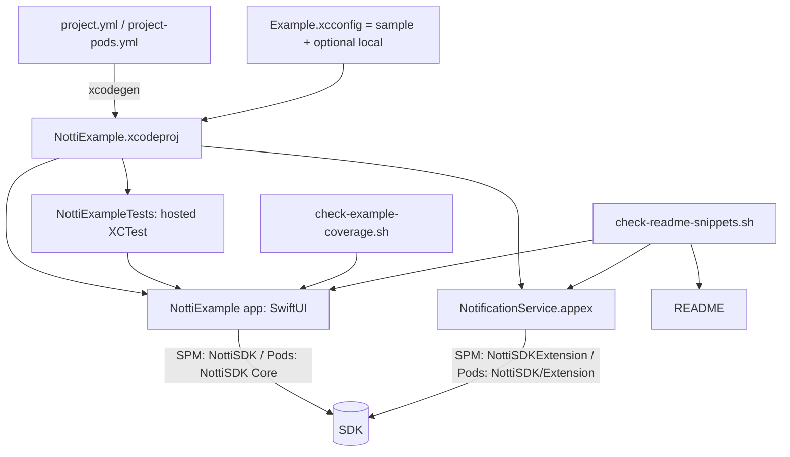

# Example App and Release 0.1.0 Design

**Spec**: `.specs/features/example-and-release/spec.md`
**Status**: Draft. Spikes (T1) done 2026-10-12, results below; one blocking finding (S6).

## Spike results (T1, 2026-10-12)

Scratch project outside the repo, XcodeGen 2.46.0, CocoaPods 1.17.0, Xcode 27 simulator `iPhone 17 Pro`.

| # | Question | Result |
| --- | --- | --- |
| S1 | Local package whose directory name differs from the package name, shared by an app and an appex | Works. `packages: NottiSDK: {path: <repo>}`, `{package: NottiSDK, product: NottiSDK}` on the app and `product: NottiSDKExtension` on the NSE. Built for the simulator. [Certo] |
| S2 | `INFOPLIST_FILE` per configuration | Works. `Debug-Manual` (`debug` type) built with `Info-Manual.plist`; `plutil -type NottiDisableSwizzling` on the built plist prints `bool`. [Certo] |
| S3 | Optional local xcconfig | Works. `#include?` with no local file gives `NottiAppId = fixture`; with a local file the value is overridden. [Certo] |
| S4 | SPM product layout | App contains `NottiSDK_NottiSDK.bundle`; the appex contains `NottiSDK_NottiSDKExtension.bundle` (not in the app). The integration test uses these two names. [Certo] |
| S5 | CocoaPods static frameworks and static libraries (`use_modular_headers!`) | Both pass: hosted test finds `NottiBootstrap.loadCount == installCount == 1` through `import NottiSDK`, and `NottiSDK_Privacy.bundle` plus `NottiSDKExtension_Privacy.bundle` in the product. The NSE imports `NottiSDK` (single module) and `NottiNotificationServiceExtension` resolves. [Certo] |
| S6 | CocoaPods **dynamic frameworks** (`use_frameworks!`) with the app on `NottiSDK` and the NSE on `NottiSDK/Extension` | **Fails.** CocoaPods builds two pod targets, `NottiSDK.default-Shared` and `NottiSDK-Extension-Shared`, both producing `NottiSDK.framework` with module `NottiSDK`. The app's `FRAMEWORK_SEARCH_PATHS` lists both, the extension one first, so `import NottiSDK` in the app finds the extension framework and `Notti` is "not found in scope". Not caused by embedding the NSE (same failure with the NSE not embedded). `pod lib lint` does not catch it. [Certo for this setup; cause inferred from the generated xcconfig] |
| S7 | Hosted test target needs `deploymentTarget` | Without it XcodeGen defaults to the SDK's 27.0 and the simulator (26.5) refuses to test. Set `deploymentTarget: "15.0"` on the test target. [Certo] |

S6 is a packaging defect in the M1 pod layout (AD-006 single module across subspecs), found by the PKG-06 independent test that earlier Verifier rounds asked for. It is out of this feature's scope to fix (rule 1) and needs a decision from Julio before `0.1.0`; see tasks T7.

---

## Architecture Overview

`Example/` is a standalone Xcode project, generated by XcodeGen from two committed specs, outside `Package.swift`. One set of sources builds three ways: SPM (local package), CocoaPods static, CocoaPods dynamic. A hosted XCTest target inside the example proves what unit tests in the package cannot (launch hook in the real product, resource bundles in the real product, the app's own Info.plist contract). Three textual scripts guard drift on the Linux `checks` job.



Why not inside `Package.swift`: the package would ship an app target and the product graph check (`check-package-graph.sh`) would need exceptions. Why XcodeGen over a hand-made `.xcodeproj`: reviewable diff (spec Assumptions, confirmed).

## Layout

```
Example/
  project.yml                 SPM variant (local package ..)
  project-pods.yml            CocoaPods variant (no packages; Podfile adds the pod)
  Podfile                     :path => '..'; NOTTI_LINKAGE=static|dynamic picks use_frameworks!
  Config/
    Example.xcconfig          #include "Example.xcconfig.sample", then #include? "Example.local.xcconfig"
    Example.xcconfig.sample   NOTTI_APP_ID=fixture, NOTTI_CLIENT_KEY=fixture, NOTTI_HOST= (empty = SDK default)
  App/                        SwiftUI sources, Info.plist, Info-Manual.plist, App.entitlements
  NotificationService/        NotificationService.swift, Info.plist
  Tests/                      NottiExampleTests (hosted)
docs/DEVICE_CHECKLIST.md
scripts/check-example-coverage.sh  scripts/check-readme-snippets.sh  scripts/check-example-config.sh
```

`.gitignore` adds `Example/*.xcodeproj`, `Example/*.xcworkspace`, `Example/Pods/`, `Example/Podfile.lock`, `Example/Config/Example.local.xcconfig`.

## Components

### Config (`Example.xcconfig`, `ExampleConfig`)
- `NOTTI_HOST` is a bare host (no scheme), because `//` starts a comment in an xcconfig. `ExampleConfig` builds `https://<host>` only when it is non-empty; otherwise `Options()` keeps the SDK default (AD-009).
- Info.plist keys `NottiAppId`, `NottiClientKey`, `NottiHost` read `$(NOTTI_*)`. `ExampleConfig.isConfigured` is false when a value is empty, still `fixture` or an unsubstituted `$(...)` (EXR-05). In that state the app never calls `Notti.initialize`.
- Local file absent: `#include?` makes the include optional, so the sample alone builds (EXR-01, EXR-05).

### Swizzling modes (EXR-04)
`NottiDisableSwizzling` must be a plist Boolean (a build-setting substitution would yield a string and trigger the SDK's non-Boolean warning). So there are two committed plists, `Info.plist` and `Info-Manual.plist` (only the key differs), selected by build configuration `Debug`/`Release` versus `Debug-Manual` through `INFOPLIST_FILE`. `scripts/check-example-config.sh` fails if the two plists differ by more than that key, and, after a build, asserts the built plist type with `plutil -type`.
The app forwards manually only when `Bundle.main` has the key (`ManualForwarding` adapter: `AppDelegate`/`UNUserNotificationCenterDelegate` calls the five forwarding methods). In default mode no forwarding code runs, so the double-observation limit stays visible, not masked.

### App (SwiftUI)
- `ExampleApp` with `@UIApplicationDelegateAdaptor(ExampleAppDelegate.self)` behind a build flag `USE_ADAPTOR` (default on); the same code compiled without it covers the SwiftUI-internal delegate check on a device (checklist item, `STATE.md` todo). A scheme per flag is enough; no runtime switch.
- `ExampleModel` (`@MainActor ObservableObject`) owns all SDK calls, one method per public member, and appends to `ExampleLog`.
- `ExampleLog` accepts a closed `LogEvent` enum (call name, outcome, payload keys). It has no API that takes a free string from SDK data, so values (token, email, phone, client key) cannot reach the UI or `print` (EXR-03, LGPD). Email and phone fields send typed input and never echo it.
- Screens (tabs): Setup (config state, initialize, log level, device id), Identity (login/logout, email, phone, subscription, location), Tags (add/remove one and many), Notifications (requestPermission async and completion, listeners add/remove, takeInitialClick, manual forwarding when enabled), Log.

### NotificationService (EXR-07)
Identical to the doc comment in `NottiNotificationServiceExtension.swift`. Imports with `#if canImport(NottiSDKExtension) import NottiSDKExtension #else import NottiSDK #endif`: under CocoaPods every subspec compiles into the single module `NottiSDK` (podspec comment, AD-006). The README snippet is the SPM region, marked `// README:begin nse` / `// README:end nse`, and the README states the pod import.

### NottiExampleTests (hosted XCTest, runs in all three legs)
- Hook (EXR-19): `NottiBootstrap.loadCount == 1` and `installCount == 1` in the app process (imports `NottiSDKBootstrap` under SPM; the pod exposes it through the `NottiSDK` module [Incerto]).
- Resources (EXR-18): the built products contain the manifests under the exact bundle names the helpers look up (`NottiSDK_Privacy` pod, `NottiSDK_NottiSDK` SPM, plus `NottiSDK_NottiSDKExtension` in the appex; `NottiSDKExtension_Privacy` inside `PlugIns/NotificationService.appex`), each with `PrivacyInfo.xcprivacy`. This proves the pod ships the bundle the CocoaPods branch looks for; it does **not** run `NottiSDKResources.bundle` itself (internal). Exercising that lookup code would need a podspec `test_spec`; recorded as a limitation, not scoped here.
- Config (EXR-05): sample values give `isConfigured == false`.
- Log privacy (EXR-03): drive `ExampleModel` with a sentinel email/phone/key and assert no log row contains them.

### Scripts (all textual, run on the Linux `checks` job)
- `check-example-coverage.sh` (EXR-02): from `PUBLIC_SURFACE.txt`, take the member names of `Notti`, `User`, `Notifications`, the delegate forwarding methods, `NottiSubscription.remove`, payload fields and the two NSE methods; fail when `\.<name>\b` is absent from `Example/App` and `Example/NotificationService`. The ObjC mirror is out of this check; `NottiSDKObjCTests` and `NottiSDKExtensionObjCTests` already compile it. Excluded names live in a short allowlist with a reason per line.
- `check-readme-snippets.sh` (EXR-13): each fenced block in the README preceded by `<!-- snippet:<id> -->` must equal the `README:begin/end <id>` region of the source file, byte for byte after stripping the markers. Missing source or a changed region fails, no warn path.
- `check-example-config.sh` (EXR-06, EXR-04): the two plists differ only by the key; no tracked file under `Example/`, README or docs matches `\b[cr]k_[0-9a-f]{64}\b` (client and REST key format: prefix `ck`/`rk` + `_` + 64 hex, `generateKey` in `saas/zeep-notti/internal/apps/repository.go:321` [Certo], checked 2026-10-12) or a UUID assigned to `NOTTI_APP_ID` (app ids are `gen_random_uuid()`, `0001_init.up.sql`); the sample must hold `fixture` for both.

### Docs
- `README.md`: rewritten per EXR-10..14; snippets come from `Example/` (blocks `init`, `identity`, `listeners`, `nse`, `manual-forwarding`). Data section lists fields from `NottiCore`/`NottiDeviceStore` and the `notti_prefs` keys; the writer reads them from code, not from memory of the RN README.
- `docs/DEVICE_CHECKLIST.md`: table per item with `STATE.md` todo reference, prerequisites, steps, expected result.
- `CHANGELOG.md`: `## [0.1.0] - <date set at release>`; `check-version.sh` gets an added check that the top dated section equals the version (EXR-21).

## CI (EXR-23, EXR-24)

New job `example` on `macos-26`, matrix `spm | pods-static | pods-libs` (and `pods-dynamic` once S6 has a decision), each leg: install `xcodegen` (and `pod` where needed), generate, `pod install` for pods, `xcodebuild test` on `$NOTTI_SIM`, then `xcodebuild build` for `generic/platform=iOS` with `CODE_SIGNING_ALLOWED=NO` and warnings as errors; the NSE with `APPLICATION_EXTENSION_API_ONLY=YES`; the SPM leg also builds the `Debug-Manual` configuration. The three scripts join the existing `checks` job. `brew install xcodegen` pins a version in the workflow (2.46.0 today) so the job is reproducible.

## Decisions and deviations

| # | Decision | Reason |
| --- | --- | --- |
| E1 | Hosted test target in the example, not an app `main` self-check like `hook-consumer` | Reuses the XCTest runner already proven on CI and checks the same product the app ships |
| E2 | Two Info plists instead of a build-setting Boolean | Contract is a plist Boolean; strings warn (DEL-02) |
| E3 | `LogEvent` enum, no free-string logging | Makes the privacy rule structural |
| E4 | README snippets are excerpts verified by byte comparison | Compile-checking snippets inside Markdown is heavier and still drifts |
| E5 | Resource check is file-level, not the lookup code | Helper is internal; a `test_spec` is the real fix and is out of scope (limitation) |
| E6 | Real device runs are Julio's, listed in the checklist | Needs signing, APNs and a physical phone |

## Test Strategy

| Layer | Type | Where |
| --- | --- | --- |
| `ExampleConfig`, `ExampleLog`, `ExampleModel` | unit (hosted XCTest) | `Example/Tests/` |
| Hook and resource presence in the real product | integration (hosted XCTest, 3 legs) | `Example/Tests/ProductIntegrationTests.swift` |
| The three scripts | each run against a passing and a failing tree (mutation: drop a call, edit a snippet, add a key) | `scripts/`, evidence in the task commit |
| UI screens | none automated; covered by the checklist | - |

## Requirement mapping

| Requirement | Design element |
| --- | --- |
| EXR-01, 05, 06 | Config, CI legs, `check-example-config.sh`, tests |
| EXR-02 | `ExampleModel` + `check-example-coverage.sh` |
| EXR-03 | `ExampleLog`, log privacy test |
| EXR-04 | Two plists, `ManualForwarding`, `Debug-Manual` build |
| EXR-07..09 | NotificationService, NSE build flags, checklist |
| EXR-10..14 | README, `check-readme-snippets.sh` |
| EXR-15, 16 | `docs/DEVICE_CHECKLIST.md` |
| EXR-17..19 | `project-pods.yml`, Podfile, hosted tests |
| EXR-20..22 | CHANGELOG, `check-version.sh`, release PR text |
| EXR-23, 24 | `example` job, `checks` additions |

## Risks and spikes (task T1)

- [Incerto] XcodeGen with a local package whose directory name (`zeep-notti-ios-sdk`) differs from the package name, and an app plus an extension sharing it.
- [Incerto] `NottiBootstrap` visible to Swift in the pod module; fallback is an `NSClassFromString` check.
- [Incerto] `INFOPLIST_FILE` per configuration through XcodeGen.
- [Incerto] `#include?` of the local xcconfig through XcodeGen `configFiles`.
- [Provável] The Extension subspec exposes `NottiNotificationServiceExtension` in module `NottiSDK` (single module).
- [Provável] Hosted tests on the simulator add about 3 to 5 min per leg on CI.
- Hosted tests run inside an app with the SDK swizzling live; the tests must not call `Notti.initialize` with the sample config (no network).

## Open items for Julio

None. Client key format confirmed in the backend (2026-10-12). A podspec `test_spec` is not in scope for `0.1.0` (Julio, 2026-10-12: follow the default).
