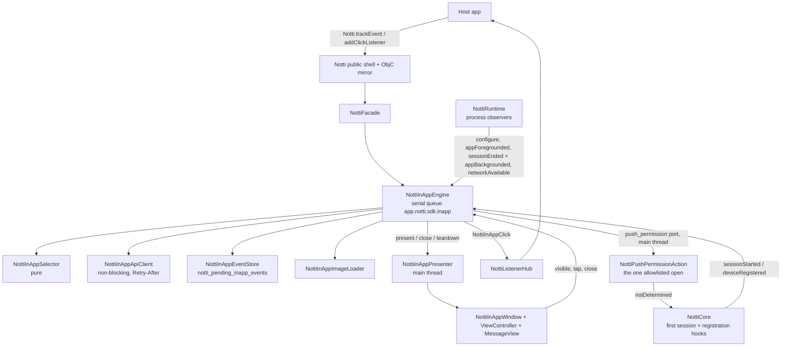
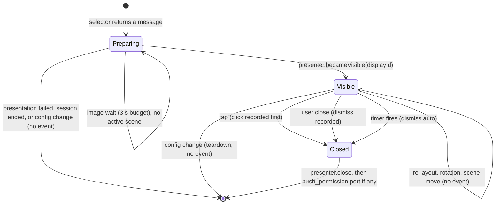

# In-App Messages Design

**Spec**: `.specs/features/in-app-messages/spec.md`
**Contract (server, source of truth)**: `zeep-notti/docs/en/sdks/in-app-messages.md` (v0.24.0); decisions in `zeep-notti/.specs/features/in-app-rich-messages/`
**Parity baseline**: `react-native-notti` 0.8.0 (tag `v0.8.0`, `291d5a7`): `ios/NottiInAppCoordinator.swift`, `NottiInAppSession.swift`, `NottiInAppEventStore.swift`, `NottiInAppModels.swift`, `NottiInAppStyle.swift`, `NottiInAppViews.swift`, `NottiInAppPresenter.swift`, `NottiInAppImageLoader.swift`, `NottiPushPermissionAction.swift`, `NottiApiClient.swift` (AD-017)
**Status**: Approved by Julio 2026-10-24 (scope and the four AD-019 decisions), reconciled with RN 0.8.0. Amended 2026-10-19 with the owner's review decisions and 2026-10-24 with AD-019. No spike run yet; every [Incerto] is a device or simulator proof in the tasks.

Evidence tags: [Certo] verified in the code or contract read for this design, [Provável] inference, [Incerto] needs a proof. iOS line numbers refer to branch `docs/in-app-reconcile` at `88e8a56`; RN line numbers to `v0.8.0`.

---

## Where this sits in the roadmap

- **Milestone**: M1, part of `0.1.0` (AD-017: 0.1.0 ships In-App the way RN 0.7.0/0.8.0 shipped it).
- **Requires**: a `zeep-notti` that serves the IARM payload, v0.23.0 or later (OQ-6 closed). It does **not** wait for a tagged `0.1.0`: T19 edits the existing `Example/` app and T20 the `[0.1.0]` release notes and `example-and-release/release-pr.md`. Does not require `queue-resilience` (the In-App queue is separate, D2), nor `privacy-consent`. The core fixes of AD-018 land before it and do not interact with it.
- **Dependency recorded, not a task**: the backend serves `push_permission` messages only to `sdk_version >= MinSDKVersionPushPermission`, empty today (`zeep-notti` `internal/inapp/sdkversion.go:11`, `eligibility.go:145-148`); a per-SDK minimum is a `zeep-notti` todo (AD-019 decision 4).
- **Rules that change with it**: AD-002 ("no actor or async rewrites of ported code") holds with the RN 0.8.0 baseline: this feature adds two hook calls in `NottiCore` (D4), two observers' calls in `NottiRuntime`, and otherwise only new files. AD-019 amends AD-013 and the AGENTS.md "never opens a URL" bullet with one fixed exception (D15, T22). AD-013 and AD-019 record the decisions.

---

## Architecture Overview



Everything new is app-only under `Sources/NottiSDK/InApp/`. `NottiShared` and `NottiSDKExtension` do not change (IAM-45). The engine owns all In-App state and decisions on one serial queue; the presenter owns views on the main thread; they talk through a small protocol so tests drive the engine with a fake presenter and the presenter with fake input. RN keeps its coordinator state on the main thread (RN DD-4); this SDK keeps it on the engine queue (D1). Behavior is the same; only the confinement differs.

---

## Facts found in the code (the reasons behind the design)

| Fact | Where | Consequence |
| --- | --- | --- |
| The SDK's "session" is a process-wide foreground session: `SessionGate.tryOpen()` flips only for the first core that sees a real background to foreground (or cold start); a repeat `didBecomeActive` or a replacement core only heartbeats/adopts; `didEnterBackground` closes it | `Sources/NottiSDK/Core/NottiCore.swift:97-123` (gate), `:998-1030` (`handleAppDidBecomeActive`, `tryOpen` at `:1020`, adopt branch after it), `:1046-1063` (`handleAppDidEnterBackground`, `gate.close()` at `:1060`), `NottiRuntime.swift:74-83` (process `didEnterBackground` observer closing the gate) [Certo] | The first In-App session is the core's `tryOpen() == true` edge. Later sessions and every session end come from the runtime's process observers (D4, D14) |
| The core's `tryOpen` and `close` run inside `workQueue.async`; the same queue runs blocking HTTP with 5 attempts, 15 s timeouts and 2/4/8/16 s backoff, so a retry can hold it about 105 s | `NottiCore.swift:1020`, `:1060`, `:25-39` (threading contract), `NottiApiClient.swift:60-82,247-298` [Certo] | A session opened only from the core can lag a return from background by up to ~105 s. RN fixed it before release (RN `5a3a1d3` design note, `NottiInAppCoordinator.swift:227-241`); AD-019 decision 3 adopts it (D14) |
| Registration runs on every launch; the persisted `notti_device_id` and `notti_last_token` are written together on `.success` | `NottiCore.swift:712-730` (`setDeviceId`, `setLastToken` at `:722` inside `registerDevice`), `NottiDeviceStore.swift:93-94,146-159` [Certo] | `device_id` and `token` come from `NottiDeviceStore` (same `notti_prefs` suite). The "registered" edge is the `.success` branch of `registerDevice`; the engine keeps `registeredInProcess` (D13) |
| `NottiApiClient` retries 408/429/5xx/network equally and ignores `Retry-After`; every other 4xx is terminal | `NottiApiClient.swift:264-293,323-325` [Certo] | The contract needs `Retry-After` for 429. It cannot be added to a ported file without breaking AD-002, and `queue-resilience` owns it for the CTR routes. New client (D5). RN added single-attempt methods to its shared client (`NottiApiClient.swift:266-311`); the result mapping is the same |
| The CTR queue `NottiEventStore`: fixed schema, cap 32, no TTL, key `notti_pending_events` | `NottiEventStore.swift:15-35,66-76`, `NottiCore.swift:1390-1412` [Certo] | Separate store (D2). The In-App store uses RN's key `notti_pending_inapp_events` and RN's Codable record (RN `NottiInAppEventStore.swift:15-31,140-157`) so pending events survive an RN-to-native swap (AD-019 decision 2) |
| At `didFinishLaunching` `UIApplication.applicationState` is `.inactive`; the platform provider reports `isActive` only for `.active`, so the core opens the first session at `didBecomeActive`, inside a `workQueue` block. A `trackEvent` that follows `Notti.initialize` on the same thread therefore reaches the engine **before** the first session opens | `NottiPlatformProviders.swift:155`, `NottiCore.swift:301-304` (provider read), `:1015-1022` (block, `tryOpen`), `NottiRuntime.swift:112-119` (`start`) [Certo for the code path; the launch ordering on a device is [Provável], checklist line 19] | `awaitingFirstSession` (D12), same as RN `NottiInAppSession.swift:98,137` |
| `NottiRuntime` already owns process-level collaborators (event store, buffer, gate, background observer) that exist before any core, and forwards the network-regain edge | `NottiRuntime.swift:29-31,64-83,145-147` [Certo] | The engine lives next to them, survives core replacement, gets `onNetworkAvailable`, and the runtime adds a `willEnterForeground` observer beside the `didEnterBackground` one (RN `NottiImpl.swift:46-85`) |
| Listeners are multiplexed and delivered on the main thread by `NottiListenerHub` over a source-specific attach/detach | `NottiListenerHub.swift:1-60`, `NottiFacade.swift:35-81` [Certo] | The click listener reuses the hub with the engine as the source (no new multiplexer) |
| The public shell pattern: `Notti.<Namespace>` enums forwarding to `NottiFacade.shared`; `@objc` mirror classes forwarding to the same facade and bridging payloads as `NSDictionary` | `Public/Notti.swift:124-162,167-187`, `Public/ObjC/NottiObjC.swift:117-200` [Certo] | `Notti.InAppMessages` and `NottiInAppMessages` (ObjC) follow it |
| `check-no-url-open.sh` bans the text `UIApplication.shared.open`, `.open(_:options` and `openURL` under `Sources/NottiSDK` and `Sources/NottiSDKBootstrap`, **comments included** (plain grep, no allowlist today) | `scripts/check-no-url-open.sh:11-27` [Certo] | The new sources must not contain those strings anywhere, except the one file of D15, which T22 allowlists by path. SwiftUI's `openURL` would trip it too (one more reason for UIKit) |
| `NottiCore.requestPermission(_:)` already requests authorization and keeps the subscribed PATCH and status refresh in the core | `NottiCore.swift:365` [Certo] | The `push_permission` "not determined" row calls it through the current core, as RN does (`NottiImpl.swift:384-394`) |
| `check-public-surface.sh` fails for a new top-level public type in `Sources/NottiSDK` without `@available(iOSApplicationExtension, unavailable)` unless named in `ext_safe_types` | `scripts/check-public-surface.sh:42` [Certo] | `NottiInAppClick` and `NottiInAppAction` are plain values: add them to the allowlist in the same task |
| `PrivacyInfo.xcprivacy` declares UserDefaults `CA92.1` and Product Interaction (analytics, linked); no boot-time or file-timestamp API in `NottiSDK` | `Sources/NottiSDK/Resources/PrivacyInfo.xcprivacy` [Certo] | No manifest key change if the new code stays off those APIs (IAM-46). RN times displays with `DispatchTime.uptimeNanoseconds`; this SDK keeps wall-clock `Date` (D8) to stay clear of the `systemUptime` / `mach_absolute_time` reasons |
| Resources are reached through `NottiSDKResources.bundle` | `Sources/NottiSDK/NottiSDKResources.swift:1-25` [Certo] | Not used by this feature: the close label is an in-code table (D11), so no resource, `Package.swift` or podspec change |

---

## Decisions

| ID | Decision | Why | Alternatives discarded |
| --- | --- | --- | --- |
| D1 | `NottiInAppEngine`: a final class confined to its own serial queue `app.notti.sdk.inapp`, owned by `NottiRuntime`. Inputs are methods that hop onto the queue; the presenter, the listener hub and the push permission port are called from it through the main dispatcher | Matches the ported style (serial queue plus injected dispatchers, deterministic drains in tests) and avoids the reentrancy hazards of an `actor` around the "impression exactly once" and "one visible" invariants. Swift 5 mode. New code follows `write-swift` | An `actor` (reentrant awaits would interleave `trackEvent`); running on `NottiCore.workQueue` (blocking stalls); main-thread state like RN (UI-thread work for every queue mutation; the engine queue gives the same ordering) |
| D2 | Own event queue `NottiInAppEventStore`, key `notti_pending_inapp_events` in the `notti_prefs` suite, RN's Codable record `{id, eventId, appId, messageId, type, buttonId?, reason?, occurredAtMs}` as JSON `Data`, strict FIFO, stop at the first transient failure | Pending events survive an RN-to-native swap (AD-019 decision 2); different schema and TTL from CTR; **strict FIFO is a correctness rule** (impression before click). Head-of-line blocking is bounded by the 7 day drop, the 100 cap and permanent 4xx dropping the head | Reuse `NottiEventStore`; the earlier native key `notti_inapp_pending_events` with snake-case keys (breaks continuity with RN); skip-ahead on failure (breaks ordering) |
| D3 | UIKit, one `UIWindow` per display, no SwiftUI | See the spec Assumptions and "Presentation details" | SwiftUI via `UIHostingController` (`Text(LocalizedStringKey)` renders Markdown, `Link`/`openURL` trip the guard); modal presentation over the host's top view controller; a subview of the host's key window |
| D4 | Two optional hooks on `NottiCore`: `onSessionStarted` (inside the `tryOpen() == true` branch, `NottiCore.swift:1020`) and `onDeviceRegistered` (after the `.success` bookkeeping in `registerDevice`, after `:722`). Passed as one `NottiInAppHooks` struct with a no-op default. Session **end** comes from the runtime's process `didEnterBackground` observer (`NottiRuntime.swift:74-83`), which also works with no live core; foreground comes from a new runtime `willEnterForeground` observer (D14). Amends AD-013 (D4: three core hooks) per AD-019 decision 3 | Same split as RN (`NottiCore.swift:763,1047` hooks; `NottiImpl.swift:46-85` observers). Smallest diff in a ported file. `NottiRuntime.makeCore()` wires the hooks | A third core hook after `gate.close()` (`:1060`, runs on the blocked `workQueue`); observing `UIApplication` in the engine (a second, divergent definition) |
| D5 | `NottiInAppApiClient`: new, non-blocking (`URLSession.dataTask` completions, delays through an injected scheduler), returns typed results with `retryAfter`. Reuses `NottiApiClient.validatedBaseUrl` (already `internal`, `:114`) and `percentEncodedPathComponent` (promoted from `private` to `internal`, `:142`) | The ported client blocks and has no `Retry-After`. Result mapping copied from RN `NottiApiClient.swift:266-311` | Extending `NottiApiClient` (touches ported retry code); duplicating the encoder |
| D6 | The click listener (`Notti.InAppMessages.addClickListener`) delivers `NottiInAppClick` with `action: NottiInAppAction?` (`type` `url`/`deeplink`, `value`); the SDK always reports `click`; a click closes the display after the listeners ran. A `push_permission` click reaches the listener with `action: nil` and then runs the platform port (D15) | The SDK cannot open an author URL (DEL-18). Same payload as RN (`NottiInAppCoordinator.swift:19-32,274-288`) | A delegate protocol; handing the host a `UIApplication` hook (banned); the SDK opening links (banned) |
| D7 | `NottiInAppMessageParser` is a pure function over `JSONSerialization` output, not `Codable`, mapping each message independently (port of RN `NottiInAppModels.swift:81-244`) | One malformed message must not fail the list (IAM-05); booleans and numbers are told apart as in RN (`jsonNumber`, `jsonBool`) | `Codable` with custom decoding |
| D8 | Timer by wall-clock remaining time (`Date`), paused and resumed by attachment and foreground, scheduled through the injected scheduler | `ProcessInfo.systemUptime` and `mach_absolute_time` are required-reason APIs. Same pause semantics as RN `NottiInAppDisplayClock` (`NottiInAppSession.swift:318-379`) | `systemUptime` (manifest change); a `Timer` without remaining-time bookkeeping |
| D9 | The engine, not the view, decides "impression": the presenter reports `becameVisible(displayId)` after the first layout pass while the app is active; the engine records `impression` on the first report for that display id and ignores repeats | "Exactly once" lives in one place, tested without UIKit. Same as RN `markVisible` | Reporting from `viewDidAppear` |
| D10 | Image preload before presentation with a 3 s budget; failure or timeout shows the message without the image | OQ-8; RN `NottiInAppPresenter.swift:251-273` | Show first and fill later (layout jump) |
| D11 | The close label from an in-code table (`Close`; `Fechar` for a primary subtag `pt`, so `pt-BR` and `pt-PT`; fallback English), no resources. The SDK owns no other string: the tappable image is labeled with the author's title | Same table as RN (`NottiInAppViews.swift:546-560`); removes the lproj-in-CocoaPods packaging risk | `.strings` files and `resource_bundles`; an SDK "Image link" label (removed to match RN) |
| D12 | `awaitingFirstSession`: an engine flag set by `configure` while no session has opened in this process and cleared by the first session open. While it is set, `trackEvent` names go to the selector's early names and survive the first session open. With the flag clear and no session open, `trackEvent` is a no-op. `configure` reaches the engine queue before a same-thread `trackEvent` (an `async` enqueue from the caller thread inside `NottiRuntime.start`, before `core.initialize`). A re-initialize after the first session never re-arms it | The first session opens at `didBecomeActive` (or later), after the usual launch-time `trackEvent`. Same as RN (`NottiInAppSession.swift:137,161`; `NottiImpl.swift:370-376`: `onInitialized` before `core.initialize`) | Opening the engine session at `initialize`; remembering names with no flag |
| D13 | Process-scoped engine flags with RN's lifetimes (`NottiInAppSession.swift:95-123`): `registeredInProcess` (set by `deviceRegistered`, survives session ends, reset by a config change), `keyRejected` and `inactiveWarned` (reset at session open and config change), `eligiblePauseUntil` and `eventsPauseUntil` (reset **only** by a config change). Queue records carry `appId`; a config change resets the engine (generation bump, selector reset, the flags above, visible display torn down without events) and purges other apps' records; every flush pass also purges them | The server routes events by the app id in the path; a stale response could show the old app's message; a `429` does not reset with the session (RN `14a4901`) | Clearing the `eligible` pause with the fetch (old iOS draft; a new session inside the pause would hit the limit again); keeping other apps' records until the 7 day drop |
| D14 | Foreground session open (AD-019 decision 3): the runtime's `willEnterForeground` observer (main thread) calls `engine.appForegrounded()`; on the engine queue it sets `appForeground = true`, and if a session has already opened in this process (`hasOpenedSession`) or a core report was deferred, the engine is configured and no session is open, it opens the session. `sessionStarted` from the core is idempotent (ignored when a session is open) and, when `appForeground` is false, sets `sessionReportDeferred` instead. `didEnterBackground` (runtime observer) calls `sessionEnded()` then `appBackgrounded()` | Port of RN `NottiInAppCoordinator.swift:192-245` and `NottiImpl.swift:46-85`. The trigger is the main-thread notification; the state change happens on the engine queue (D1), never on `workQueue` | Waiting for the core (up to ~105 s late); opening every session from the observer (the first session must keep the `initialize` ordering of D12) |
| D15 | `push_permission` platform action: `NottiPushPermissionAction` in `Sources/NottiSDK/InApp/Platform/NottiPushPermissionAction.swift`, a port of RN `NottiPushPermissionAction.swift` with injected `readState`, `requestPermission`, `openNotificationSettings` and `logger`. The runtime builds it at `start` and hands it to the engine as `pushPermissionPort` (an engine input, so it is set under the engine's confinement, the RN `396d320` fix); `requestPermission` goes to the runtime's current core. The production `openNotificationSettings` opens only `UIApplication.openNotificationSettingsURLString` (iOS 16+) or `openSettingsURLString`, on main. This is the only file `scripts/check-no-url-open.sh` allowlists | AD-019 decision 1. One allowlisted file keeps the guard meaningful; the constant cannot carry author data | A host callback for permission (RN ships it built in); allowlisting a directory; reading the URL from the payload |

---

## Components

### Model and parsing (new, pure)

- `Sources/NottiSDK/InApp/Model/NottiInAppMessage.swift`: `NottiInAppMessage` (`id`, `format`, `title`, `body`, `imageUrl: URL?`, `imageAction: NottiInAppLinkAction?`, `style: NottiInAppStyle`, `dismissAfterSeconds: Int?`, `trigger`, `buttons`, `renderable`), `NottiInAppFormat` (`top`, `center`, `bottom`, `full`), `NottiInAppTrigger` (`.sessionStart`, `.event(String)`, `.unsupported`), `NottiInAppButton` (`id`, `label`, `action: NottiInAppButtonAction?`), `NottiInAppButtonAction` (`.link(type, value)` or `.pushPermission`). The public `NottiInAppAction` (below) is built from `.link` only.
- `Sources/NottiSDK/InApp/Model/NottiInAppMessageParser.swift`: `static func parse(_ data: Data) -> [NottiInAppMessage]?` (nil when the body is not a JSON object or `messages` is not an array: transient for the caller). Rules of IAM-16, ported from RN `NottiInAppModels.swift:119-244`: non-empty `id`; title or body not blank; trigger `session_start`, or `event` with a non-empty `name`; a button needs a non-empty `id` and `label`, at most two; an action is `url`/`deeplink` with a non-empty string `value` (else nil) or `push_permission` on a button (no value); `image_url` must start with `https://` (any case) and be longer than the scheme, else dropped; `image_action` only as a link and only with an image; `dismiss_after_seconds` only a JSON number (not a boolean), integral, 1...300; `margin` only a JSON boolean (else `true`); unknown format is `center`. Server order is kept.
- `Sources/NottiSDK/InApp/Model/NottiInAppStyle.swift`: `NottiInAppStyle` (optional tokens, `textAlign` default `left`, `margin` default `true`) and `NottiInAppColor.parse(_ raw: Any?) -> UInt32?` (opaque `0xFFRRGGBB`): exactly `#` plus six hex digits checked byte by byte (no `+`/`-`), anything else nil. Resolution to `UIColor` happens in `NottiInAppAppearance`.

### Selector (new, pure)

`Sources/NottiSDK/InApp/Engine/NottiInAppSelector.swift`: a value type holding the session's `held: [NottiInAppMessage]` (event messages), `shown: Set<String>`, `earlyNames: [String]` (distinct, first 32 kept), `fetchDone: Bool`.

- `mutating func load(_ messages: [NottiInAppMessage], visibleId: String?) -> NottiInAppMessage?`: keeps renderable ones; holds `event` ones; picks the first `session_start` not in `shown` only when nothing is visible (IAM-12); then replays `earlyNames` in order (each replay can only pick when nothing is selected or visible), returning at most one message (IAM-11). Records the id in `shown` when it returns a message. RN `onFetched` (`NottiInAppSession.swift:207-230`).
- `mutating func track(_ name: String, isVisible: Bool) -> NottiInAppMessage?`: ignores when visible; picks the oldest held message with that exact name not in `shown`.
- `mutating func noteEarly(_ name: String)` (ignored when already present or when 32 names are held), `mutating func startSession(visibleId: String?)` (clears held and shown, inserts the visible id into `shown`, keeps early names), `mutating func endSession(wasOpen: Bool)` (clears held; clears early names only when a session was open, RN `:173-183`), `mutating func reset()` (everything, config change).

### Engine (new)

`Sources/NottiSDK/InApp/Engine/NottiInAppEngine.swift` (`final class`, internal, app-only).

State (all on `queue`), mirroring RN `NottiInAppSession`:

```text
config: (appId, clientKey, baseUrl)?      // set by runtime.start; a different value => resetForNewConfig()
fetchGeneration: Int                      // ++ at session open, session end and a config change
sessionOpen, hasOpenedSession, appForeground, sessionReportDeferred: Bool   // D14
awaitingFirstSession: Bool                // D12
registeredInProcess: Bool                 // D13: survives session ends, reset by config change
keyRejected: Bool, inactiveWarned: Set<route>   // reset at session open and config change
fetchState: idle | inFlight | done | gaveUp(transient: Bool)
eligiblePauseUntil: Date?, eventsPauseUntil: Date?   // D13: reset only by a config change
flushRunning, flushAgain: Bool
selector: NottiInAppSelector
display: NottiInAppDisplay?               // see state machine
pushPermissionPort: (() -> Void)?         // D15, set through an engine input
```

Inputs (each hops onto `queue`): `configure(appId:clientKey:baseUrl:)`, `sessionStarted()` (core hook), `deviceRegistered()` (core hook), `appForegrounded()`, `sessionEnded()`, `appBackgrounded()` (runtime observers), `networkAvailable()`, `trackEvent(_:)`, `setPushPermissionPort(_:)`, and from the presenter `displayAttached(displayId:attached:)`, `becameVisible(displayId:)`, `userTapped(displayId:buttonId:action:)`, `userDismissed(displayId:reason:)`, `displayFailed(displayId:)`.

Session rules (D14, IAM-51): `sessionStarted()` returns when a session is open; when `appForeground` is false it sets `sessionReportDeferred`; else `openSession()`. `appForegrounded()` sets `appForeground`, opens a session when `(hasOpenedSession || sessionReportDeferred) && config != nil && !sessionOpen`, resumes the display clock and requests a flush. `openSession()` clears `sessionReportDeferred`, bumps `fetchGeneration`, sets `sessionOpen` and `hasOpenedSession`, clears `awaitingFirstSession`, `keyRejected` and `inactiveWarned`, sets `fetchState = .idle`, calls `selector.startSession(visibleId:)`, then `maybeFetch(allowTransientRetry: false)`. `sessionEnded()` bumps the generation, `selector.endSession(wasOpen:)`, `sessionOpen = false`, `fetchState = .idle`, and drops (presenter `teardown`, no event) a display that never became visible; a visible one stays (OQ-9).

Fetch rule (IAM-01, IAM-03, IAM-04, IAM-52), port of RN `maybeFetch` (`NottiInAppCoordinator.swift:365-400`): return unless configured, `sessionOpen`, `!keyRejected` and `registeredInProcess`; without `allowTransientRetry` return unless `fetchState == .idle`; if `eligiblePauseUntil` is in the future, schedule `maybeFetch` for its end under the current generation and return; take the identity (skip if missing); `tryStartFetch` accepts `.idle`, or `.gaveUp(transient: true)` only on the network path. Then: if no events pause is active, run a single-attempt flush pass first (owning the running flag only if no flush holds it); a `401` there marks the fetch given up (non-transient) and stops; else send `eligible`. `deviceRegistered()` sets `registeredInProcess`, requests a flush and calls `maybeFetch(false)`; `networkAvailable()` requests a flush and calls `maybeFetch(true)` (at most one resume per edge, since the fetch moves to `inFlight`).

`trackEvent(name)` rule (IAM-11, D12), port of RN `NottiInAppSession.swift:232-242`: blank name or no config: no-op; no session open and not awaiting the first one: no-op; awaiting the first session or fetch not done: `selector.noteEarly(name)`; else `selector.track(name, isVisible:)` and present. Never logged, never persisted, no warning.

Config change (D13, IAM-06): `configure` with a different config calls `resetForNewConfig()`: bump the generation, `selector.reset()`, `fetchState = .idle`, clear both pause deadlines, `keyRejected`, `inactiveWarned` and `registeredInProcess`, set `awaitingFirstSession = !hasOpenedSession`, tear down a visible display **without recording any event**, rebuild the client, then `store.purgeOtherApps(appId)` on the queue. The first `configure` sets `awaitingFirstSession` when no session has opened and builds the client. A same-config `configure` changes nothing. Results of work issued under the old config only release their flags.

Fetch result policy (IAM-04), through the scheduler, never `Thread.sleep`; a result whose generation differs, or that arrives with no open session, is dropped:

| Result | Engine action |
| --- | --- |
| `.messages` | `selector.load(...)`, present the pick |
| `.rateLimited(seconds)` (429) | one fixed log code; `seconds > 60` or 3 waits done: give up (non-transient). Else store `eligiblePauseUntil = now + max(1, seconds ?? 60)` and retry then, `waits + 1` |
| `.unauthorized` (401) | one generic fixed code; `keyRejected = true`; give up (non-transient) |
| `.forbidden` (403) | fixed `.warn` once per session for `eligible`; give up (non-transient) |
| `.terminal(status)` (422, other 4xx) | one fixed code with the status; give up (non-transient) |
| `.transient` (5xx, 408, transport, unparseable 2xx) | backoff 2/4/8/16 s, 5 attempts, then give up (transient, resumable by IAM-52) |

Dependencies injected at init: the client factory, `NottiInAppEventStore`, `identity: () -> (deviceId: String, token: String)?` (reads `NottiDeviceStore`), `presenter: NottiInAppPresenting`, `scheduler: NottiInAppScheduling`, `now: () -> Date`, `uuid: () -> String`, `mainDispatcher: NottiMainDispatcher` (`NottiListenerHub.swift:6`), `emitClick: (NottiInAppClick) -> Bool` (false when no listener), `logger`.

### Display state machine



`NottiInAppDisplay`: `id` (display UUID, distinct from the message id), `message`, `state` (`preparing`, `visible`, `closed`), `impressed`, a clock (remaining time, started, attached, foreground). Transitions:

- `becameVisible(id)`: ignored unless `id` matches, the state is `preparing` and no impression exists; then `visible`, record `impression` (D9), start the clock, request a flush.
- `userTapped(id, buttonId, action)`: ignored if closing. `ensureImpression()` first (records `impression` if missing), then record `click` with `buttonId` (`image` for the image; the presenter resolves a bar body tap to the first button), set `closed`. If `action` is `push_permission`: emit the click with `action: nil` and no warning; else emit it with the link action (or nil) and, when `emitClick` returns false, log the fixed no-listener `.warn`. Then tell the presenter to `close`, then run `pushPermissionPort` on the main dispatcher for `push_permission` (nothing when the port is nil), then request a flush. No `dismiss` (RN `NottiInAppCoordinator.swift:274-288`).
- `userDismissed(id, reason)`: ignored if closing; `ensureImpression()`, record `dismiss`, set `closed`, close, flush.
- Timer fire: same as a dismiss with `auto`.
- `displayAttached(id, attached)`: clock attached or paused (scene gone).
- `displayFailed(id)`: drop a preparing display, no event.
- `resetForNewConfig()` (D13): from any state, `display = nil` and the presenter tears it down; nothing is recorded; a late callback for the old id is ignored.
- `sessionEnded()`: a visible display stays (OQ-9); a preparing one is dropped silently; `appBackgrounded()` pauses the clock.

Invariant checks (each has a test): at most one display; `impression` is always the first event of a display id in the queue; at most one of `click` / `dismiss` per display.

### Network client (new)

`Sources/NottiSDK/InApp/Network/NottiInAppApiClient.swift`

- `func eligible(deviceId:token:completion:)` and `func report(_ event: NottiInAppEventRecord, deviceId:token:completion:)`, one attempt each.
- Request: `URLRequest(url:timeoutInterval: 15)`, `POST`, `Authorization: Bearer <client key>`, `Content-Type: application/json; charset=utf-8`, body by `JSONSerialization` with exactly the contract fields (IAM-02, IAM-29): `button_id` only for `click`, `reason` only for `dismiss`, `occurred_at` as `yyyy-MM-dd'T'HH:mm:ss.SSS'Z'` UTC (RN `formatIsoUtc`). Paths: `/v1/apps/{appId}/in-app-messages/eligible` and `/v1/apps/{appId}/in-app-messages/{messageId}/events`, each segment through `NottiApiClient.percentEncodedPathComponent`.
- Results (RN `NottiApiClient.swift:29-56,269-311`): eligible `.messages`, `.rateLimited(retryAfterSeconds: Int?)`, `.unauthorized`, `.forbidden`, `.terminal(status)`, `.transient`; events `.recorded` (any 2xx), `.drop` (4xx other than 401, 403, 408, 429), `.rateLimited`, `.unauthorized`, `.forbidden`, `.transient` (5xx, 408, transport). `Retry-After` is parsed as ASCII digits only (trimmed; a sign, fraction, HTTP-date or blank is nil), capped at `Int32.max`, unclamped otherwise (RN `parseRetryAfter`, `:348-356`).
- The client does not retry; `URLSession` is injected (`StubURLProtocol`).

### Event store and flusher (new)

- `Sources/NottiSDK/InApp/Storage/NottiInAppEventStore.swift`: port of RN `NottiInAppEventStore.swift`: process-wide lock, the whole queue as JSON `Data` under `notti_pending_inapp_events`, rewritten per mutation. `NottiInAppEventRecord: Codable` with exactly `id`, `eventId`, `appId`, `messageId`, `type`, `buttonId?`, `reason?`, `occurredAtMs` (default synthesized camelCase keys). `enqueue(appId:messageId:type:buttonId:reason:)` (new lowercase UUID strings for `id` and `eventId`, `occurredAtMs` from the injected clock; drops expired records, then the oldest above 100), `all()`, `all(forApp:)`, `remove(id:)`, `expire(now:)` (drops records with `now - occurredAtMs > 7 days`, returns them), `purgeOtherApps(_:)`. A value that does not decode is removed (self-heal to empty); the native SDK also logs one fixed `.warn` without content. Never stores the token or device id; they are read at send time.
- `Sources/NottiSDK/InApp/Engine/NottiInAppEventFlusher.swift`: one pass loop, port of RN `runFlushPass` (`NottiInAppCoordinator.swift:568-603`): purge other apps, expire (one fixed log line when something expired), then oldest first for the current app; `.recorded` remove; `.drop` remove with one fixed log code; `.rateLimited` returns `paused(seconds)`; `.unauthorized`, `.forbidden` return; `.transient`: single-attempt mode returns `failed`, full mode returns `backoff(failures)` until 5 failures, then `failed`. The engine owns the outcome handling (RN `handleFlushOutcome`, `reportFlushOutcome`, `:510-566`): backoff reschedules the same head after 2/4/8/16 s; `paused` stores `eventsPauseUntil` = clamp(seconds ?? 60, 1...300) and schedules a flush request at its end; `unauthorized` sets `keyRejected` with one generic code; `forbidden` logs the `.warn` once per session for events; coalescing with `flushRunning` and `flushAgain`. No flush starts while `eventsPauseUntil` is in the future or `keyRejected` is set.

### Image loader (new)

`Sources/NottiSDK/InApp/Image/NottiInAppImageLoader.swift`, port of RN `NottiInAppImageLoader.swift`: ephemeral `URLSessionConfiguration` (`httpCookieStorage = nil`, `httpShouldSetCookies = false`, `httpCookieAcceptPolicy = .never`, `urlCache = nil`, `urlCredentialStorage = nil`), a delegate-based data task that ends exactly once: refuses a redirect to a non-`https` URL (an `https` redirect is followed without cookies), refuses a non-2xx or non-`https` response and a declared length above 5 MiB, aborts as soon as the body passes 5 MiB, and bounds the whole call to 10 s. Decode (`decode(_:maxSidePx:)`, RN `:120-147`): read the pixel size, `maxPixelSize = min(longest side, maxSidePx)` (never upscaled), always `CGImageSourceCreateThumbnailAtIndex` with `CreateThumbnailFromImageAlways`, `CreateThumbnailWithTransform` (EXIF orientation even for small images) and `ShouldCacheImmediately`. The caller passes `maxSidePx` = the screen's longest side times its scale (RN `NottiInAppPresenter.swift:263`). Cache: LRU of 5 entries under a lock, cleared on `didReceiveMemoryWarningNotification`. Its initializer takes no credentials (IAM-42 by construction, plus a test on the request).

### Presentation (new, main thread)

| File | Role |
| --- | --- |
| `UI/NottiInAppPresenter.swift` | Implements `NottiInAppPresenting` (`present(display)`, `close(displayId)`, `teardown(display)`, idempotent). Waits for the image (3 s), chooses the scene through an injected scene provider, builds the window, observes `didBecomeActive`, `UIScene.didActivateNotification` and `UIScene.didDisconnectNotification`, re-attaches the same display to another active scene, reports `displayAttached`, `becameVisible` (once per display, after a layout pass while the app is active), taps and closes to the engine (RN `NottiInAppPresenter.swift:166-359`) |
| `UI/NottiInAppWindow.swift` | `UIWindow` subclass; `canBecomeKey == false`; `windowLevel` just under `.alert` (see "Window, scene and level"); `hitTest` returns nil when the hit view is the window or the root view (pass-through for bars) |
| `UI/NottiInAppViewController.swift` | Root view controller: a clear container hosting the overlay, laid out on every pass; follows the host key window's root view controller for `supportedInterfaceOrientations`, `preferredStatusBarStyle` and `prefersStatusBarHidden` (RN `:65-109`); hosts entrance and exit animation, Reduce Motion, accessibility notifications and the `accessibilityPerformEscape()` override |
| `UI/NottiInAppMessageView.swift` | Builds the overlay, card and content for a `format` from the message, the resolved appearance and an optional image; every view has an `accessibilityIdentifier` (`notti.inapp.title`, `.body`, `.close`, `.image`, `.button.0`, `.button.1`, `.backdrop`, `.scroll`) for tests |
| `UI/NottiInAppLayout.swift` | Pure functions of (container size, safe area, margin, format), port of RN `computeFrame` (`NottiInAppStyle.swift:126-182`): metrics `margin 16`, bar max height `min(0.4 * height, safeHeight - 2m)`, card width `min(0.9 * width, 560, safeWidth)`, card max height `0.9 * safeHeight`, close target `44`, thumbnail `56`; insets measured from the safe-area edge |
| `UI/NottiInAppAppearance.swift` | Resolves `NottiInAppStyle` to concrete colors and fonts (RN `resolveStyle`, `NottiInAppStyle.swift:66-94`; semantic defaults; fonts `headline`, `subheadline`, bold `subheadline`) |

All of it is `@available(iOSApplicationExtension, unavailable)`.

### Push permission action (new)

`Sources/NottiSDK/InApp/Platform/NottiPushPermissionAction.swift` (D15): `State` (`notDetermined`, `denied`, `granted` for authorized/provisional/ephemeral, `unknown` for `@unknown default`), `run()` switching on the state read through `readState` (production: `UNUserNotificationCenter.current().getNotificationSettings`), `requestPermission` (production: the runtime's current core `requestPermission { _ in }`), `openNotificationSettings` (production: on main, `openNotificationSettingsURLString` on iOS 16+, else `openSettingsURLString`, then the open call), `logger` (one fixed line for `unknown`). App-only. The only file under `Sources/NottiSDK` that contains an open call; `scripts/check-no-url-open.sh` skips it by exact path and a unit test asserts the file references only those two constants as URL sources.

---

## Presentation details

**Window, scene and level.**

- The scene provider returns the first `UIWindowScene` with `activationState == .foregroundActive`; a scene-less app that is active gets `UIScreen.main.bounds`; with nothing active the display stays preparing until `didBecomeActive` or `didActivate` (RN `NottiInAppSceneProvider`). [Incerto] legacy no-scene apps on device (checklist).
- The window is shown with `isHidden = false`, never `makeKey()` (`canBecomeKey` false): the host keeps the key window and its first responder.
- `windowLevel = UIWindow.Level(rawValue: UIWindow.Level.alert.rawValue - 1)`: above the host's `.normal` windows (and a `UIAlertController`), below system alerts. RN uses `.alert` itself; the difference is recorded in the parity checklist (row 31) [Incerto] keyboard, Control Center and PiP interplay: device checklist.
- Multi-scene and iPad: one display on one scene. When its scene disconnects, the presenter removes the window, reports `displayAttached(false)` (clock paused), and attaches the **same display id** to the next active scene (no impression, no dismiss).
- Rotation: the overlay recomputes the frame on every layout pass from its own size and safe area; impression is an engine decision (D9).
- Keyboard: no keyboard layout guide; bars anchor to the safe area. [Incerto] on device.

**Layout (IAM-13..19), metrics of RN `NottiInAppViews.swift` and `NottiInAppStyle.swift`.**

- **Frame.** `top` and `bottom`: inset `safe + m` (m = 16 or 0) on the edge side and horizontally, width `safeWidth - 2m`, height the content height capped at the bar max. `center`: card centered in the safe area (not the screen; insets can be asymmetric), width `min(0.9 * width, 560, safeWidth)`, height capped at `0.9 * safeHeight`; `margin` ignored. `full`: inset `safe + m` on all sides, full remaining height. Card corner radius 12 pt (continuous), 0 for `full` with `margin: false`.
- **Card content.** Padding 16 pt. A scroll view holds the image and the text; the button row sits below it (12 pt gap), unless the buttons alone are taller than the card's room: then the row moves into the scroll view after the text and the scroll offset resets (IAM-17, RN `:155-205`). On `full` the scroll view takes all the height left by the buttons, which stay pinned at the bottom.
- **Image.** Bars: 56 x 56 pt leading thumbnail (trailing in right-to-left), 12 pt gap. `center`: full content width, height `min(180, width * aspect)`, aspect fill and clipped. `full`: same natural height, then grown to the free height the text leaves (aspect fit, never cropped), except when the buttons scroll.
- **Close control.** 44 x 44 pt, 8 pt from the card's top and trailing edges (leading in right-to-left), always on top and outside the scroll view; text keeps clear of it (`closeReserve = 44 - 16 + 8`). Over an image (`center`, `full`): white `xmark` on a black 40% capsule; else tinted from the text color.
- **Buttons.** Side by side (equal width, 8 pt spacing, reversed order in right-to-left) when every label fits half the width on one line, else stacked; each at least 44 pt tall; `UIButton.Configuration` plain with background color, 8 pt corner radius, multi-line title, insets 8/16.
- **Gestures.** Bars: a `UIPanGestureRecognizer` on the card that begins only when the velocity is mostly vertical, in the dismiss direction, and the text cannot scroll that way; the card follows the finger in the dismiss direction only; release at or past `min(cardHeight / 3, 44)` dismisses with `swipe`, else it snaps back (no animation under Reduce Motion); the text scroll's pan requires it to fail (RN `:425-475, 509-515`). Body tap (bars with buttons only) excludes the close control, the buttons and a tappable image. `center`: a backdrop tap outside the card gives `outside_tap`. `full`: no gesture. Each handler is a plain method the tests call directly.

**Style and text (IAM-20..23).**

- Title and body are `UILabel` (`numberOfLines = 0`, `text` set, `.byWordWrapping`, `adjustsFontForContentSizeCategory`), hidden when blank; title `headline`, body `subheadline`; alignment absolute (`.left`, `.center`, `.right`, never `.natural`). The new files must not contain `attributedText`, `AttributedString`, `NSAttributedString(data:` with HTML, `WKWebView`, `UITextView` with `dataDetectorTypes`, or `LocalizedStringKey` (a grep-based test over `Sources/NottiSDK/InApp/UI`). The button font goes through `titleTextAttributesTransformer` (no attributed string).
- Defaults and token application as the spec table (OQ-5). Colors come from `NottiInAppColor.parse`; nil falls back to the default of that token; no color is derived from another.

**Accessibility (IAM-38, IAM-39).**

- The title is its own element with `.header` added; the body is its own element; buttons carry `.button` and their title as label; the image is not an element unless it is tappable, then `[.button, .image]` labeled with the title (nil when the title is blank). No SDK string other than the close label (RN `NottiInAppViews.swift:546-580`).
- `center` and `full` set `accessibilityViewIsModal` on the overlay and post `.screenChanged` with the title (the card when the title is hidden); `top` and `bottom` post `.announcement` with the visible title and body joined by ". ". Posted once per display, after it is visible.
- Escape gesture: the overlay overrides `accessibilityPerformEscape()`. For `center` and `full` it calls the close path (`dismiss` with `close_button`) and returns `true`; for `top` and `bottom` it returns `false`. **Android Back (parity note only):** in RN on Android, Back is consumed as a no-op on `center` and `full` (the close control is the only way out, RN A19, SDKIAM-22) and not intercepted on `top` and `bottom`. iOS has no equivalent; nothing is added for sighted users, who have the close control.
- Close label: `NottiInAppStrings.closeLabel(languages:)`: primary subtag of the first preferred language, `pt` → `Fechar`, anything else (or an empty list) → `Close` (D11). No lproj, no `defaultLocalization`, no `resource_bundles`.
- Reduce Motion: cross-fade (0.15 s) for entrance and exit, no animated snap-back.
- Dark mode: default colors are semantic; server colors are fixed.

**Link and click (IAM-24..26, IAM-49).** The views report `userTapped(displayId, buttonId, action)`; the engine builds `NottiInAppClick(messageId:, buttonId:, action:)` with the link action or nil (always nil for `push_permission`), delivers it through `NottiListenerHub` on the main thread, closes the display, then runs the port for `push_permission`. The SDK never inspects `value`.

---

## Public API and public surface

Swift (all `@available(iOSApplicationExtension, unavailable)` except the two plain values):

```swift
extension Notti {
    /// Reports an app event. Shows the oldest waiting In-App message whose trigger names it. Matched locally, never sent.
    public static func trackEvent(_ name: String)

    public enum InAppMessages {
        /// Called on the main thread when the user taps a button, the image or the body of a message.
        /// The SDK never opens a `url` or `deeplink`; the host decides. A `push_permission` button arrives with `action == nil`.
        @discardableResult
        public static func addClickListener(_ handler: @escaping (NottiInAppClick) -> Void) -> NottiSubscription
    }
}

public struct NottiInAppClick: Equatable, Sendable { public let messageId: String; public let buttonId: String; public let action: NottiInAppAction? }
public struct NottiInAppAction: Equatable, Sendable {
    public enum ActionType: String, Sendable { case url, deeplink }
    public let type: ActionType
    public let value: String
}
```

Objective-C mirror (`NottiObjC.swift` precedent): `+[Notti trackEvent:]` on `NottiObjC` and a class `NottiInAppMessages` with `addClickListener:` taking `(NSDictionary) -> Void` with exactly the keys `messageId`, `buttonId` and `action`; `action` is `@{@"type": @"url"|@"deeplink", @"value": ...}` or `NSNull`, never absent (RN `InAppClick.payload`, `NottiInAppCoordinator.swift:19-32`). `NottiSDKObjCTests` gets the compile check and a smoke call.

`PUBLIC_SURFACE.txt` is regenerated (`check-public-surface.sh --update`) in the same commit as the declarations. `NottiInAppClick` and `NottiInAppAction` are added to `ext_safe_types` in `scripts/check-public-surface.sh`.

---

## Event queue ordering and the duplicate-impression risk

| Risk | Mitigation | Test |
| --- | --- | --- |
| Impression sent twice (rotation, re-layout, scene move, repeated layout) | `impressed` flag on the display, checked on the engine queue; views never write events (D9) | Call `becameVisible` 3 times, rotate in a hierarchy test, assert one record |
| Click before impression | `ensureImpression()` in every tap and dismiss path | Fake presenter taps first; queue order asserted |
| Same event sent twice after a timeout | `eventId` fixed at record time; the retry reuses it; the server answers `200 duplicate` (success) | A stub that times out once then `201`: one id across both bodies |
| Event lost on kill | Write-ahead: persisted before the first send | New store over the same suite after "kill" has the record |
| Event lost on an RN-to-native swap | Same key and Codable schema as RN (D2) | An RN-format JSON fixture decodes and is sent |
| Impression lost when the queue is flushed with a stale head | FIFO with stop-on-transient failure; permanent errors drop the head | Table of statuses |
| Repeated session starts hammer `eligible` (30/min) | Once per session, `429` pause that outlives the session (D13) | 429 test across a session turn |

---

## Impact on guards and packaging

- `Package.swift` and the podspecs: no change (the label table is code). New test files only in existing targets (`NottiSDKTests`, `NottiSDKObjCTests`).
- `NottiSDKExtension.podspec` is not touched; `NottiSDK.podspec` already globs `Sources/NottiSDK/**/*.swift`.
- `scripts/check-public-surface.sh`: allowlist (above).
- `scripts/check-no-url-open.sh`: gains an exact-path allowlist of one file, `Sources/NottiSDK/InApp/Platform/NottiPushPermissionAction.swift` (T22), proved on a passing tree and on a failing fixture with an open call in another file; AGENTS.md "Delegate integration and the launch hook" states the exception in the same commit.
- `PrivacyInfo.xcprivacy`: comment text only (T18). `PrivacyManifestTests` unchanged.
- SwiftLint: the engine is split by responsibility (selector, flusher, client, store, display extension) so no file approaches `file_length`.

---

## Test Strategy

XCTest only, no NSE simulator, no network, no real scene. Layers match `TESTING.md` plus the new ones.

| Layer | What the tests prove (behavior, not wiring) | Reqs |
| --- | --- | --- |
| Parser and style | Contract fixture maps field by field; unknown fields ignored; one bad message skipped; unknown format is `center`; blank title and body not renderable; `event` without name unsupported; action narrowing (`url`/`deeplink` with non-empty value, else nil; `push_permission` on buttons only, dropped as `image_action`); booleans not read as numbers; colors table | IAM-05, 16, 20..22, 49 |
| Selector | First `session_start` only; event match exact and case-sensitive; oldest first; once per session; ignored while visible; early names replay once, first 32 kept; session start keeps early names, config reset clears them; visible-across-sessions rule | IAM-07..12 |
| Event store | RN key and Codable schema (an RN JSON fixture decodes; the stored JSON has exactly the RN keys), persist and reload with `appId`, cap 100, 7 day boundary (exactly 7 days kept), order, self-heal on decode failure, `purgeOtherApps`, no token or device id stored | IAM-29, 30 |
| Flusher | Every status row (any 2xx, other 4xx drop, `408` transient, `401` key rejected, `403` once), strict FIFO, same `eventId` across retries, other-app purge, expiry, single-attempt vs full | IAM-30..32 |
| API client | Request shape, path encoding, headers, body keys exactly, `occurred_at` format, `Retry-After` parse, status mapping | IAM-02, 04, 29, 31 |
| Engine | Fetch once per session in both orders; no fetch before this process registered; registered survives session end, reset on config change; token refresh does not refetch; late response dropped; flush-before-fetch and its skip during an events pause; `403` once, `401` silent stop; `eligible` `429` (120 gives up, 2 waits 2 s, absent 60 s, 3 waits, pause outlives the session, only config clears it); network regain resumes a transient give-up once; foreground opens later sessions, core report idempotent and deferred in background; cold-start window; events `429` pause and coalescing; display machine (impression once, order, click closes without dismiss, `push_permission` click with nil action, no warning, port after close, nil port only reports and closes; auto dismiss; pause and resume); config change resets and tears down silently | IAM-01, 03, 04, 06, 09..11, 25..28, 30, 31, 33..35, 49, 51, 52 |
| Image loader | PNG decoded; never upscaled; capped at `maxSidePx`; EXIF orientation applied to a small image; 6 MiB declared and by bytes; redirect to `http`; non-2xx; 10 s bound; LRU of 5 and memory-warning clear; no `Authorization` header | IAM-40..42 |
| View hierarchy (UIKit in the test host) | Frames per layout at portrait, landscape and iPad sizes (16 pt from the safe-area edge or touching it, card width cap 560, card height 90% of the safe height), close control 44 pt at 8 pt inset and its chip over an image, thumbnail 56, image cap 180 and aspect modes, buttons side by side or stacked, buttons into the scroll view, pan threshold, verbatim text, absolute alignment under right-to-left, header trait, image label, largest Dynamic Type | IAM-13..23, 38, 39 |
| Presenter and window | Scene provider fake; window not key; pass-through `hitTest` for bars; backdrop blocks for center; host orientation followed; scene move keeps the display id and creates no event; `becameVisible` once after layout while active; Reduce Motion path; `accessibilityPerformEscape` | IAM-18, 36..38 |
| Runtime wiring | Two core hooks reach the engine; adopt does not; `willEnterForeground` opens a later session while the core `workQueue` is blocked; `didEnterBackground` ends it with no core; `configure` before a same-thread `trackEvent`; port set through the engine | IAM-01, 06, 11, 33, 51 |
| Push permission action | One test per state row; settings opener called only for denied; unknown logs one fixed line; the allowlisted file references only the two system constants | IAM-50 |
| Public shell, facade, ObjC | `trackEvent` reaches the engine; listener multiplexing and main-thread delivery; ObjC `action` dictionary or `NSNull`; `PUBLIC_SURFACE.txt` guard | IAM-24, 44 |
| Privacy sweep | Sentinels never in a captured `NottiLogger` line on every path (including `push_permission`); source greps for the banned open and markup APIs outside the allowlisted file | IAM-23, 24, 43, 45 |
| Scripts | Public surface, extension safety, package graph, no URL open with its one allowlisted file, on passing and failing fixtures | IAM-44, 45, 50 |
| Device (manual) | The checklist in `tasks.md` | IAM-36..39, 48, 50, 51 |

Mutants for the Verifier: drop the `impressed` flag; clear the early names on the first session open; keep the newest 32 names instead of the first 32; log on a blank `trackEvent`; remember names with no `awaitingFirstSession`; fetch before `registeredInProcess`; keep `registeredInProcess` after a config change; clear the `eligible` pause at session end; run the pre-fetch flush during an events pause; resume a `403` give-up on network regain; open later sessions only from the core; wait on `eligible` `429` with `Retry-After` 120; log the registration text on `401`; keep another app's records; keep a visible display after a config change; anchor the inset to the window edge; swap impression and click; regenerate `event_id` on retry; rename the queue key or a record key; skip the 7 day drop; case-insensitive event match; allow two displays; use `attributedText`; make the close control optional; deliver a `push_permission` action to the listener; warn on a `push_permission` tap with no listener; run the port before the close; open a URL outside the allowlisted file; log the title; send the event name; hold the queue on `404`.

---

## Parity checklist with the React Native SDK

Status after Julio's decisions (2026-10-18, 2026-10-19) and the reconciliation with RN 0.8.0 code (AD-019, 2026-10-24). Every row is **aligned** unless it says otherwise. Rows 1 to 23 were aligned by decision with the RN spec; rows 24 to 32 come from the RN 0.8.0 code review.

| # | Item | iOS spec | Status |
| --- | --- | --- | --- |
| 1 | Session definition and fetch trigger | SDK foreground session; fetch when a session is open AND this process registered | Aligned (RN A5, A6, `registeredInProcess`) |
| 2 | `trackEvent` before the fetch completes | Remember distinct names of the session, **first 32 kept**, re-evaluate on arrival | Aligned (RN SDKIAM-13, `NottiInAppSession.swift:236`) |
| 3 | Extra `session_start` messages | Only the first; the others generate no impression and stay eligible | Aligned (RN edge case) |
| 4 | Visible message when a new session starts (OQ-9) | Display kept, id skipped next session, `session_start` candidates dropped | Aligned (RN SDKIAM-15) |
| 5 | Link delivery | `Notti.InAppMessages.addClickListener` -> `NottiInAppClick` (`messageId`, `buttonId`, `action` `{type, value}` or nil; ObjC `NSNull`); SDK never opens author links; click always reported; click closes without `dismiss`; no listener: click reported, one `.warn` (not for `push_permission`) | Aligned (RN SDKIAM-32, 67, 68, A8, A9, `11541d1`) |
| 6 | `trackEvent` name and location | `Notti.trackEvent(_:)` at the top level | Aligned (RN SDKIAM-58) |
| 7 | Default palette, fonts, secondary button style, thumbnail, close look | Semantic system colors; `headline`/`subheadline`/bold `subheadline`; tinted secondary; 56 pt thumbnail; scrim chip over images | Aligned (RN `NottiInAppStyle.swift`, `NottiInAppViews.swift`); visual check on device |
| 8 | Image budget, fallback, size cap, decode, cache | 3 s then no image and no image action; 5 MiB; 10 s; downsample to the screen's long side in pixels, never upscale, thumbnail path with transform; LRU 5 | Aligned (RN A11, `60f2e3f`, `6660fb4`) |
| 9 | Retry constants | 5 attempts, 2/4/8/16 s for 5xx, 408, transport; events `429`: clamp 1...300 s, 60 s default, stored pause, **no wait count**; `eligible` `429`: give up above 60 s, else wait max(1, value), at most 3 waits; queue cap 100, 7 day drop | Aligned (RN SDKIAM-05, 06, 49, `InAppTiming`) |
| 10 | Pre-fetch flush failure | Single-attempt flush, then `eligible` even if it failed (except `401`) | Aligned (RN SDKIAM-04) |
| 11 | `401/403/404/422` | `401`/`403` stop and keep the queue; `403` warns once per session per route; `401` generic code only; other 4xx drop on events, terminal on `eligible` | Aligned (RN mirrors the wording, the 401 rule and the CHANGELOG note) |
| 12 | Body tap on bars with no buttons; unknown action | Not tappable; unknown or empty-value action: `action` nil | Aligned (RN SDKIAM-34, `34d4368`) |
| 13 | Renderable rules and the 100 / 500 limits | IAM-16 (blank title and body, `event` without name unsupported), no truncation | Aligned (RN `NottiInAppModels.swift:119-140`) |
| 14 | Link safety allowlist | Value delivered untouched; integrator decides | Aligned (RN SDKIAM-32) |
| 15 | Scene and window rules | iOS window per display, scene re-attach without a new impression | Aligned with RN iOS presenter except row 31 |
| 16 | Close control label | In-code table in both: `Close`, `Fechar` for primary subtag `pt` (so `pt-PT` too), fallback English, no resources. The old note that RN A18 expected iOS resource bundles is stale | Aligned (RN `NottiInAppViews.swift:546-560`) |
| 17 | Margin | 16 pt from the safe-area edge; `false` touches the safe-area edges; `center` ignores it | Aligned (RN `computeFrame`) |
| 18 | `trackEvent` cold-start window | Names after `initialize` and before the first session are remembered for it; before `initialize` or in background after a session ignored | Aligned (RN DD-13, A14) [Provável, checklist line 19] |
| 19 | `eligible` `429` and `408` | As row 9 | Aligned |
| 20 | Re-initialize and queue `appId` | Different config resets the session state, `registeredInProcess`, both pauses; tears down silently; purges other apps' records | Aligned (RN SDKIAM-70, `onInitialized`) |
| 21 | Closing by assistive gesture and Android Back | VoiceOver escape on `center`/`full` closes with `close_button`; Android Back (RN only) is **consumed as a no-op** on `center`/`full`, not intercepted on bars | Aligned (RN SDKIAM-63, A19, SDKIAM-22) |
| 22 | `401` in the pre-fetch flush | Ends all In-App requests of the session; `403` in the flush still calls `eligible` | Aligned (RN SDKIAM-04, 49) |
| 23 | Late `eligible` response | Discarded after session end, newer session or config change | Aligned (RN SDKIAM-15) |
| 24 | `push_permission` button | Buttons only, no value; click with `action: nil`, no warning, close, then state table; settings URL constant from one allowlisted file | Aligned (RN `8640894`, `2b2a1c3`, `396d320`, `e9a5bb2`; AD-019 decision 1) |
| 25 | Event queue key and schema | `notti_pending_inapp_events`, RN Codable camelCase record, lowercase UUIDs, 7 day boundary inclusive | Aligned (RN `NottiInAppEventStore.swift`; AD-019 decision 2) |
| 26 | Session open after the first | Main-thread foreground edge, idempotent core report, deferred in background; end from the process observer | Aligned (RN `5a3a1d3`; AD-019 decision 3) |
| 27 | `registered` reset and cross-session `eligible` `429` pause | `registeredInProcess` reset only by a config change; `eligible` pause outlives the session | Aligned (RN `14a4901`) |
| 28 | Network regain | Resumes a transient give-up once per reconnect | Aligned (RN spec edge case, `tryStartFetch`) |
| 29 | Layout refinements | Card width cap 560, height 90% of the safe height, close 8 pt inset and chip, image 180 pt cap and aspect modes, buttons into the scroll view, pan swipe threshold min(1/3, 44 pt), host orientation followed | Aligned (RN `ae47972`, `1265833`) |
| 30 | Accessibility refinements | Title `.header` separate from the body; tappable image labeled with the title; no SDK image string | Aligned (RN `NottiInAppViews.swift:563-580`) |
| 31 | Window level | iOS just under `.alert`; RN `.alert` | Differs on purpose (keeps system alerts above); confirm on device, checklist line 5 |
| 32 | Display clock source | iOS wall clock (`Date`); RN `DispatchTime` uptime | Differs on purpose (privacy manifest, D8); same pause semantics |

---

## Alternatives discarded

| Alternative | Why not |
| --- | --- |
| Reuse the CTR `NottiEventStore` | Schema and cap do not fit; sharing would let an In-App outage block push events |
| A native-only queue key and schema | An RN-to-native swap would lose pending impressions (AD-019 decision 2) |
| Add `Retry-After` and non-blocking I/O to `NottiApiClient` | Ported file (AD-002); `queue-resilience` owns the CTR routes |
| SwiftUI rendering | See D3 |
| A web view for the content | The contract forbids markup interpretation |
| Persisting "shown" to avoid showing again | The contract forbids it |
| Showing every `session_start` message in sequence | The contract says the first one |
| Sending the event name to the server | The contract forbids it |
| Skip-ahead in the event queue on a failing head | Breaks "impression before click" |
| `actor` for the engine | D1 |
| Opening author links behind a protocol in the SDK | `check-no-url-open.sh` would have to be weakened for author data; the listener is simpler and safer. Only the fixed settings constant is allowed (D15) |
| Opening every session from the core | A retrying core holds `workQueue` up to ~105 s (D14) |

---

## Risks

| Risk | Impact | Mitigation |
| --- | --- | --- |
| Window level interplay with the keyboard, Control Center, PiP, host system alerts | A bar could be covered or cover a host dialog | [Incerto]: device checklist; the level is one constant |
| Legacy app without `UIScene` | No `connectedScenes` | Screen-sized window fallback; device checklist |
| Session granularity (OQ-3, closed: keep) | `eligible` on every resume | Server limits and frequency; `429` pause across sessions |
| Hooks in `NottiCore` and observers in `NottiRuntime` | Ported files change | Two call lines with a no-op default in the core; existing core and runtime tests stay green |
| A listener-less host | Links never open | README states it first; one `.warn`; the Example registers a listener |
| Event queue head blocked by a persistent 5xx | Later events wait | Accepted for ordering; bounded by the 7 day drop and the cap |
| The settings-URL exception grows | The no-URL guard loses meaning | One exact-path allowlist entry; a unit test pins the file to the two system constants; any new entry needs an AD |
| `push_permission` messages never served | Feature invisible in production | Backend per-SDK minimum is a `zeep-notti` todo (AD-019 decision 4); the SDK side is tested with fixtures |
| `ProcessInfo.systemUptime` or timestamp APIs creeping in | Privacy manifest rejection | D8; the privacy task greps for them |
| Server serves `modal` / `banner` (pre-v0.23.0) | Rendered as `center` | Unknown-format rule; README names v0.23.0 as the minimum |
| Launch ordering of `Notti.initialize`, `trackEvent` and the first session differs from the code reading | A launch-time event name is lost | [Provável] D12; engine and runtime tests; device checklist line 19 |

---

## Open items for Julio

None blocking. Decisions are recorded in AD-013 and AD-019. Proofs owed on a device: the launch ordering (checklist line 19), the window level (row 31), the `push_permission` settings jump (line 21) and the foreground session while the core is busy (line 22). Dependency: the `zeep-notti` per-SDK minimum for `push_permission` (AD-019 decision 4).
