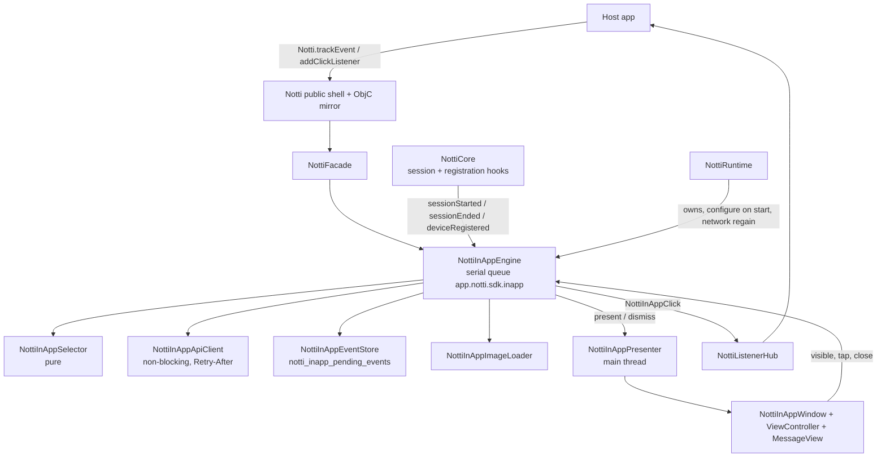
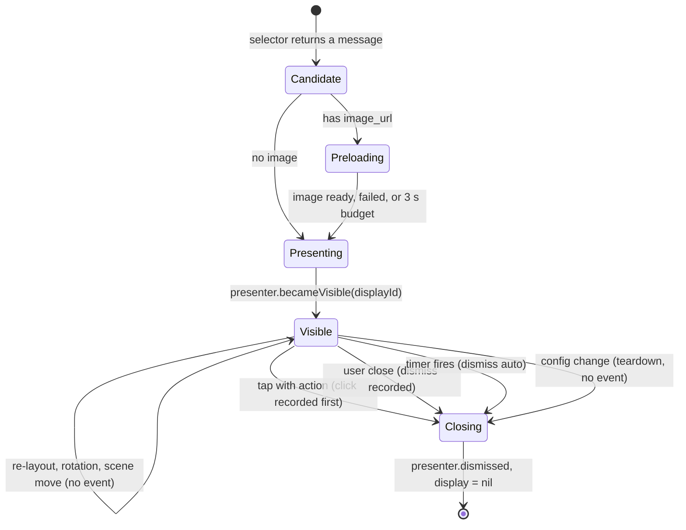

# In-App Messages Design

**Spec**: `.specs/features/in-app-messages/spec.md`
**Contract (server, source of truth)**: `zeep-notti/docs/content/sdks/in-app-messages.mdx`; decisions in `zeep-notti/.specs/features/in-app-rich-messages/`
**Status**: Draft for approval (no spike run yet; every [Incerto] is a device or simulator proof in the tasks). Amended 2026-10-19 with the owner's review decisions (margin standard, 401 vs 403, escape gesture, `trackEvent` cold-start window, `eligible` 429 cap, re-initialize and queue `app_id`, 408)

Evidence tags: [Certo] verified in the code or contract read for this design, [Provável] inference, [Incerto] needs a proof. Line numbers refer to `main` at the time of writing (feature branch, after nse-rich-media and the two-pod split).

---

## Where this sits in the roadmap

- **Milestone**: M3 "Beyond parity" (new item in `ROADMAP.md`). Not M1 (`PROJECT.md`: In-App is out of scope for v1; AD-002: M1 is a port), not M2.
- **Requires done**: `example-and-release` (the `Example/` app and the `0.1.0` tag; `Example/App/ExampleApp.swift` gets a button) and a `zeep-notti` release that serves the IARM payload (OQ-6). Does **not** require `queue-resilience` (the In-App queue is separate, D2), nor `privacy-consent`.
- **Rules that change with it**: AD-002 ("no actor or async rewrites of ported code") still holds for ported files: this feature adds three small hook calls in `NottiCore` (D4) and otherwise only new files. `PROJECT.md` "Explicitly out of scope" loses the In-App line (task T20). AD-013 records the decisions.

---

## Architecture Overview



Everything new is app-only under `Sources/NottiSDK/InApp/`. `NottiShared` and `NottiSDKExtension` do not change (IAM-45). The engine owns all In-App state and decisions on one serial queue; the presenter owns views on the main thread; they talk through a small protocol so tests drive the engine with a fake presenter and the presenter with fake input.

---

## Facts found in the code (the reasons behind the design)

| Fact | Where | Consequence |
| --- | --- | --- |
| The SDK's "session" is a process-wide foreground session: `SessionGate.tryOpen()` flips only for the first core that sees a real background to foreground (or cold start); a repeat `didBecomeActive` or a replacement core only heartbeats/adopts; `didEnterBackground` closes it | `Sources/NottiSDK/Core/NottiCore.swift:97-123` (gate), `:983-1015` (`handleAppDidBecomeActive`, `tryOpen` at `:1005`, adopt at `:1011`), `:1031-1048` (`handleAppDidEnterBackground`, `gate.close()` at `:1045`), `NottiRuntime.swift:74-84` (process observer) [Certo] | The In-App session is exactly this. The engine needs three edges from the core: session started (only the `tryOpen() == true` branch), session ended, device registered |
| Registration runs on every launch; the persisted `notti_device_id` and `notti_last_token` are written together on `.success` | `NottiCore.swift:697-722` (`setDeviceId` / `setLastToken` inside `registerDevice`), `NottiDeviceStore.swift:93-94,146-159` [Certo] | `device_id` and `token` come from `NottiDeviceStore` (same `notti_prefs` suite). The "registered" edge is the `.success` branch of `registerDevice` |
| All core work, including blocking HTTP with 5 attempts, 2/4/8/16 s backoff and 15 s timeouts, runs on one serial `workQueue` | `NottiCore.swift:125`, `:25-39` (threading contract), `NottiApiClient.swift:60-82,247-298` [Certo] | In-App must not use `workQueue` or the blocking client (a fetch during a 5xx storm would freeze `login`, tags and CTR). New non-blocking client and own queue (D1) |
| `NottiApiClient` retries 408/429/5xx/network equally and ignores `Retry-After`; every other 4xx is terminal | `NottiApiClient.swift:264-293,323-325` [Certo] | The contract needs `Retry-After` for 429. It cannot be added to a ported file without breaking AD-002 until M1 ships, and `queue-resilience` owns it for the CTR routes. New client (D5) |
| The CTR queue `NottiEventStore`: fixed schema (`notificationId`, `deliveryId`, `type`, `createdAtMs`), cap 32, no TTL, key `notti_pending_events`; the flush stops at the first transient failure (head-of-line) | `NottiEventStore.swift:15-35,66-76`, `NottiCore.swift:1390-1412` [Certo] | The In-App record needs `event_id`, `message_id`, `button_id`, `reason`, `occurred_at`, and a 7 day TTL. The CTR key is part of the RN continuity contract. Separate store and key (D2). Head-of-line behavior is kept on purpose for ordering (D2) |
| At `didFinishLaunching` `UIApplication.applicationState` is `.inactive`; the platform provider reports `isActive` only for `.active`, so the core opens the session at `didBecomeActive`; and `tryOpen()` runs inside a block on the core queue. A `trackEvent` that follows `Notti.initialize` on the same thread therefore reaches the engine **before** the first session opens | `NottiPlatformProviders.swift:155`, `NottiCore.swift:301-304` (provider read), `:997-1007` (block, `tryOpen`), `NottiRuntime.swift:112-119` (`start`) [Certo for the code path; the launch ordering on a device is [Provável], checklist line 19] | The old rule "remember only if a session is open" drops that name. The engine needs a flag set at `configure` and cleared by the first `sessionStarted` (`awaitingFirstSession`, D12) |
| `NottiRuntime` already owns process-level collaborators (event store, buffer, gate, observers) that exist before any core, and forwards the network-regain edge | `NottiRuntime.swift:29-31,45-46,145-147` [Certo] | The engine lives next to them, survives core replacement, and gets `onNetworkAvailable` forwarded |
| Listeners are multiplexed and delivered on the main thread by `NottiListenerHub` over a source-specific attach/detach | `NottiListenerHub.swift:1-60`, `NottiFacade.swift:35-81` [Certo] | The click listener reuses the hub with the engine as the source (no new multiplexer) |
| The public shell pattern: `Notti.<Namespace>` enums forwarding to `NottiFacade.shared`; `@objc` mirror classes forwarding to the same facade and bridging payloads as `NSDictionary` | `Public/Notti.swift:124-162,167-187`, `Public/ObjC/NottiObjC.swift:117-200` [Certo] | `Notti.InAppMessages` and `NottiInAppMessages` (ObjC) follow it |
| `check-no-url-open.sh` bans the text `UIApplication.shared.open`, `.open(_:options` and `openURL` under `Sources/NottiSDK`, **comments included** (plain grep) | `scripts/check-no-url-open.sh:13,24-27` [Certo] | The new sources must not contain those strings anywhere, also in doc comments. SwiftUI's `openURL` environment value would trip it too (one more reason for UIKit) |
| `check-public-surface.sh` fails for a new top-level public type in `Sources/NottiSDK` without `@available(iOSApplicationExtension, unavailable)` unless named in `ext_safe_types` | `scripts/check-public-surface.sh:36-41` [Certo] | `NottiInAppClick` and `NottiInAppAction` are plain values: add them to the allowlist in the same task |
| `PrivacyInfo.xcprivacy` declares UserDefaults `CA92.1` and Product Interaction (analytics, linked); no boot-time or file-timestamp API in `NottiSDK` | `Sources/NottiSDK/Resources/PrivacyInfo.xcprivacy` [Certo] | No manifest key change if the new code stays off those APIs (IAM-46). `ProcessInfo.systemUptime` is a required-reason API [Provável, Apple's list]: use `Date` |
| Resources are reached through `NottiSDKResources.bundle` (SPM `.module`; CocoaPods bundle `NottiSDK_Privacy`) | `Sources/NottiSDK/NottiSDKResources.swift:1-25` [Certo] | Not used by this feature: the close label is an in-code table (D11), so no resource, `Package.swift` or podspec change |

---

## Decisions

| ID | Decision | Why | Alternatives discarded |
| --- | --- | --- | --- |
| D1 | `NottiInAppEngine`: a final class confined to its own serial queue `app.notti.sdk.inapp`, owned by `NottiRuntime`. Inputs are methods that hop onto the queue; the presenter and the listener hub are called from it through the main dispatcher | Matches the ported style (serial queue plus injected dispatchers, deterministic `waitForPendingWork`-style drains in tests) and avoids the reentrancy hazards of an `actor` around the "impression exactly once" and "one visible" invariants. Swift 5 mode, so no strict-concurrency migration. New code still follows `write-swift` (value types for state, small types) | An `actor` (reentrant awaits during the fetch would interleave `trackEvent`; AD-002 spirit); running on `NottiCore.workQueue` (blocking stalls) |
| D2 | Own event queue `NottiInAppEventStore`, key `notti_inapp_pending_events` in the `notti_prefs` suite, strict FIFO, stop at the first transient failure | Different schema and TTL; the CTR key must stay RN-compatible; **strict FIFO is a correctness rule here** (impression before click), so skipping a failed head is not allowed. The cost is head-of-line blocking by a persistently failing head (a server 5xx on one event). It is bounded by the 7 day drop, the 100 cap, and the fact that permanent 4xx (404, 422) drop the head instead of blocking | Reuse `NottiEventStore` (schema, key, cap, no TTL); skip-ahead on failure (breaks ordering); one queue for both (an In-App outage would block CTR) |
| D3 | UIKit, one `UIWindow` per display, no SwiftUI | See the table in the spec Assumptions and the section "Presentation" | SwiftUI via `UIHostingController` (needs the same window anyway; `Text(LocalizedStringKey)` renders Markdown, `Link`/`openURL` trip the guard, no inspection without a third-party library); modal presentation over the host's top view controller (fights the host's own presentations, cannot pass touches through for bars); adding a subview to the host's key window (breaks under host modals, rotation, multi-scene) |
| D4 | Three optional hooks on `NottiCore`: `onSessionStarted` (inside the `tryOpen() == true` branch, `NottiCore.swift:1005-1007`), `onSessionEnded` (after `sessionGate.close()`, `:1045`), `onDeviceRegistered` (after the `.success` bookkeeping in `registerDevice`, `:722`). Passed as one `NottiInAppHooks` struct with a no-op default | Reuses the one session definition (OQ-3) with the smallest diff in a ported file. `NottiRuntime.makeCore()` (`NottiRuntime.swift:196-217`) wires them to the engine | Observing `UIApplication` notifications in the engine (a second, divergent session definition); a polling check of `sessionGate.isOpen` (no edge, wasteful) |
| D5 | `NottiInAppApiClient`: new, non-blocking (`URLSession.dataTask` completions, delays through an injected scheduler), returns typed results with `retryAfter`. Only helper reused from `NottiApiClient`: `validatedBaseUrl` (already `internal`, `:114`) and `percentEncodedPathComponent` (promoted from `private` to `internal`, `:142`, a one-word change) | The ported client blocks and has no `Retry-After`. Keeping the two clients apart leaves AD-002 intact | Extending `NottiApiClient` (touches ported retry code); duplicating the encoder (drift) |
| D6 | The click listener (`Notti.InAppMessages.addClickListener`) delivers `NottiInAppClick`; the SDK always reports `click`; a click closes the display after the listeners ran | The SDK cannot open a URL (DEL-18). Analogous to `addClickedListener` for pushes (`Notti.swift:147-155`) | A delegate protocol (new concept); handing the host a `UIApplication` hook (banned); the SDK opening links (banned) |
| D7 | `NottiInAppMessageParser` is a pure function over `JSONSerialization` output, not `Codable`, mapping each message independently | One malformed message must not fail the list (IAM-05); unknown fields and unknown values are ignored by construction; no `Codable` strictness to relax | `Codable` with custom decoding (more code for the same tolerance) |
| D8 | Timer by wall-clock remaining time (`Date`), paused and resumed by lifecycle events, scheduled through the injected scheduler | `ProcessInfo.systemUptime` and `mach_absolute_time` are required-reason APIs (privacy manifest). A wall-clock jump during a few seconds of countdown is acceptable | `systemUptime` (manifest change), a `Timer` with no remaining-time bookkeeping (cannot pause) |
| D9 | The engine, not the view, decides "impression": the presenter reports `becameVisible(displayId)` once per presentation; the engine records `impression` on the first report for that display id and ignores repeats | The "exactly once" invariant lives in one place and is tested without UIKit. Rotation or re-layout cannot create an impression because views never write events | Reporting from `viewDidAppear` (can be called again on scene re-attachment) |
| D10 | Image preload before presentation with a 3 s budget; failure or timeout shows the message without the image | OQ-8 | Show first and fill later (layout jump, tap target moves) |
| D11 | Accessibility labels from an in-code table (`en`, `pt-BR`, fallback English), no resources | Removes the packaging risk of lproj resolution inside CocoaPods resource bundles and the `defaultLocalization` change. Two short strings do not justify a resource pipeline | `.strings` files and `resource_bundles` |
| D12 | `awaitingFirstSession`: an engine flag set by the first `configure` of the process and cleared by the first `sessionStarted`. While it is set, `trackEvent` names go to the selector's early names and survive the first `sessionStarted` (the only reset that keeps them). With the flag clear and no session open, `trackEvent` is a no-op. `configure` must reach the engine queue synchronously inside `NottiRuntime.start` (an `async` enqueue from the caller thread, before `core.initialize`), so a `trackEvent` from the same thread is ordered after it on the serial queue. A re-initialize after the first session never re-arms the flag | The session opens at `didBecomeActive` (or later), after the usual launch-time `trackEvent`. A flag is smaller than a second session notion and keeps IAM-11 testable without UIKit (owner decision, 2026-10-19) | Opening the engine session at `initialize` (a second, divergent session definition, D4); remembering names with no flag (would keep names from background periods, against the owner's rule) |
| D13 | Queue records carry `appId`; `configure` with a different config resets the engine (generation bump, selector reset, fetch and pause deadlines cleared, visible display torn down without events) and purges records of other apps; the flusher also skips records whose `appId` differs from the current one | The server routes events by the app id in the path; a record of another app can only `404` and a stale response could show the old app's message (owner decision, 2026-10-19). The field is required, no migration (unreleased) | Keeping other apps' records until the 7 day drop (they never succeed and eat the 100 cap); a migration for records without `app_id` (nothing is released) |

---

## Components

### Model and parsing (new, pure)

- `Sources/NottiSDK/InApp/Model/NottiInAppMessage.swift`: `NottiInAppMessage` (`id`, `format`, `title`, `body`, `imageUrl: URL?`, `imageAction: NottiInAppAction?`, `style: NottiInAppStyle`, `dismissAfterSeconds: Int?`, `trigger`, `buttons`), `NottiInAppFormat` (`top`, `center`, `bottom`, `full`), `NottiInAppTrigger` (`.sessionStart`, `.event(String)`), `NottiInAppButton` (`id`, `label`, `action`), `NottiInAppAction` (`kind: url | deeplink`, `value`).
- `Sources/NottiSDK/InApp/Model/NottiInAppMessageParser.swift`: `static func parse(_ data: Data) -> NottiInAppParseResult` (`messages`, `skipped: Int`, or `.malformed`). Rules of IAM-16: non-empty `id`; title or body non-empty; known trigger type; a button needs a non-empty `id` and `label` and at most two are kept; `image_url` must parse and have scheme `https` (any case) and a host, else the image is dropped; `image_action` without image dropped; `dismiss_after_seconds` only an integer 1...300; unknown format is `center`. Order of the array is kept (the server sorts oldest first).
- `Sources/NottiSDK/InApp/Model/NottiInAppStyle.swift`: `NottiInAppStyle` (optional tokens, `textAlign` default `left`, `margin` default `true`) and `NottiInAppColor.parse(_ raw: Any?) -> UIColor?`: exactly `#` plus six hex digits (either case), anything else nil. No alpha form. Resolution of defaults to concrete `UIColor` happens in the view layer (`NottiInAppAppearance`, below), so the model stays free of UIKit and testable.

### Selector (new, pure)

`Sources/NottiSDK/InApp/Engine/NottiInAppSelector.swift`: a value type holding the session's `held: [NottiInAppMessage]` (event messages), `shown: Set<String>`, `earlyNames: [String]` (bounded 32 distinct), `visibleId: String?`.

- `mutating func load(_ messages: [NottiInAppMessage], visibleId: String?) -> NottiInAppMessage?`: skips the visible id; picks the first `session_start` unless something is visible (then drops them, IAM-12); holds `event` ones; then replays `earlyNames` in order, returning at most one message (IAM-11). Records the id in `shown` when it returns a message.
- `mutating func track(_ name: String, isVisible: Bool) -> NottiInAppMessage?`: ignores when visible; picks the oldest held message with that exact name not in `shown`.
- `mutating func noteEarly(_ name: String)` (distinct, at most 32, oldest dropped), `mutating func reset(keepingEarlyNames: Bool = false)`. The engine calls `reset(keepingEarlyNames: true)` only on the first `sessionStarted` while `awaitingFirstSession` (D12); every other reset clears the early names.

No clock, no queue, no I/O: the whole selection contract is table tests.

### Engine (new)

`Sources/NottiSDK/InApp/Engine/NottiInAppEngine.swift` (`final class`, internal, app-only).

State (all on `queue`):

```text
config: (appId, clientKey, baseUrl)?      // set by runtime.start, a different value => resetForNewConfig()
sessionGeneration: Int                    // ++ at sessionStarted, sessionEnded and a config change
sessionOpen: Bool, registered: Bool, fetchState: idle | inFlight | done | failed
awaitingFirstSession: Bool                // D12: set by the first configure, cleared by the first sessionStarted
eligibleWaits: Int, eligiblePauseUntil    // 429 waits of the current fetch (IAM-04), cleared with the fetch
selector: NottiInAppSelector
display: NottiInAppDisplay?               // see state machine
```

Inputs (each hops onto `queue`): `configure(appId:clientKey:baseUrl:)`, `sessionStarted()`, `sessionEnded()`, `deviceRegistered()`, `trackEvent(_:)`, `networkAvailable()`, `appBecameActive()` (flush trigger), and from the presenter `becameVisible(displayId:)`, `userTapped(displayId:target:)`, `userDismissed(displayId:reason:)`, `sceneAvailabilityChanged(isAvailable:)`, `appStateChanged(isBackground:)` (timer pause).

Fetch rule: `maybeFetch()` runs after `sessionStarted` and after `deviceRegistered`; it fetches iff `sessionOpen && registered && fetchState == .idle && config != nil`. `sessionStarted` resets `fetchState = .idle`, clears the selector (`reset(keepingEarlyNames: awaitingFirstSession)`), clears `awaitingFirstSession`, bumps `sessionGeneration`. `deviceRegistered` after the fetch is a no-op (token refresh). A response, and every scheduled retry or wait, carries the generation it was issued under and is dropped if it differs (IAM-06): a **late response** that arrives after `sessionEnded`, after a newer `sessionStarted` or after a config change creates no held message, presents nothing and leaves no timer behind.

`trackEvent(name)` rule (IAM-11, D12): empty name is rejected by the facade. On the engine queue: if `sessionOpen` or `awaitingFirstSession` then `selector.track(...)` when the held messages are already loaded, otherwise `selector.noteEarly(name)`; else (no session open and not awaiting the first one: before `configure`, or in the background after a session ran) it returns with no state change and no log. The name is never logged or persisted.

Config change (D13, IAM-06): `configure` with a config different from the stored one calls `resetForNewConfig()`: bump `sessionGeneration`, `selector.reset()` (early names included), `fetchState = .idle`, clear `eligibleWaits`, `eligiblePauseUntil` and the flusher's `429` deadline and 401/403 session halts, cancel scheduled retries, tear down a visible display **without recording any event** (`display = nil`, presenter `dismiss`, no `impression`, no `dismiss`, no `click`), then `store.purge(keepingAppId:)`. The first `configure` of the process also purges records of other apps and sets `awaitingFirstSession` unless a session has already opened. `configure` with the same config changes nothing (a re-initialize never re-arms `awaitingFirstSession`). When the session is still open and the device registers again under the new config, `maybeFetch()` fetches for the new app.

Fetch sequence: `flush(mode: .singleAttempt)` then `client.eligible(...)`. Failure policy as IAM-04 through the scheduler (`schedule(after:)`), never `Thread.sleep`:

| Result | Engine action |
| --- | --- |
| `.success` | parse (IAM-05), select |
| `.retryAfter(seconds)` (429) | `seconds` parsed and `> 60`: give up for the session, one generic fixed log code, no second request. Else wait `max(1, seconds)` s (`60` when nil), retry, at most 3 waits (then give up) |
| `.permanent(401)` | stop for the session, no retry, the queue is kept, no re-registration, one generic fixed log code (no registration text) |
| `.permanent(403)` | stop for the session, no retry, one fixed `.warn` per session (the registration text of IAM-04) |
| `.permanent(422 or other 4xx)` | stop for the session, no retry |
| `.transient` (5xx, 408, transport) | backoff 2/4/8/16 s, 5 attempts, then stop for the session |

Dependencies injected at init (so tests need no network, no UIKit, no clock): `NottiInAppApiClient`, `NottiInAppEventStore`, `identity: () -> (deviceId: String, token: String)?` (reads `NottiDeviceStore`, which needs no core), `presenter: NottiInAppPresenting`, `scheduler: NottiInAppScheduling`, `now: () -> Date`, `uuid: () -> UUID`, `mainDispatcher: NottiMainDispatcher` (existing typealias, `NottiListenerHub.swift:6`), `emitClick: (NottiInAppClick) -> Void`.

Public-ish surface of the engine for the facade: `trackEvent(_:)`, `setClickHandler(_:)` (the hub's attach/detach point).

### Display state machine



`NottiInAppDisplay` is a value: `id` (display UUID, distinct from the message id), `message`, `impressed: Bool`, `closing: Bool`, `remaining: TimeInterval?`, `timerHandle`. Transitions:

- `becameVisible(id)`: ignored if `id` does not match or `impressed`; otherwise set `impressed`, record `impression` (D9), start the timer.
- `userTapped(id, target)`: ignored if `closing`. `ensureImpression()` first (records `impression` if missing), then record `click` (`target` is `.button(id)`, `.image`, or `.body` resolved to the first button's id by the engine), set `closing`, call `emitClick` on the main dispatcher, tell the presenter to dismiss. No `dismiss` is recorded.
- `userDismissed(id, reason)`: ignored if `closing`; `ensureImpression()`, record `dismiss`, set `closing`, dismiss.
- Timer fire: same as a dismiss with `auto`.
- `resetForNewConfig()` (D13): from any state, `display = nil` and the presenter dismisses it; nothing is recorded (not even a missing `impression`), a late `becameVisible`, tap or close for the old display id is ignored because the id no longer matches.
- `sessionEnded()`: the display stays (D, OQ-9); the timer is paused by `appStateChanged(isBackground: true)`, which the presenter wiring sends on `didEnterBackground` and `didBecomeActive`.

Invariant checks (each has a test): at most one display; `impression` is always the first event of a display id in the queue; at most one of `click` / `dismiss` per display.

### Network client (new)

`Sources/NottiSDK/InApp/Network/NottiInAppApiClient.swift`

- `func eligible(deviceId:token:completion:)` and `func report(_ event: NottiInAppEventRecord, deviceId:token:completion:)`.
- Request: `URLRequest(url:timeoutInterval: 15)`, `POST`, `Authorization: Bearer <client key>`, `Content-Type: application/json; charset=utf-8`, body by `JSONSerialization` with exactly the contract fields (IAM-02, IAM-29). Paths: `/v1/apps/{appId}/in-app-messages/eligible` and `/v1/apps/{appId}/in-app-messages/{id}/events`, components through `NottiApiClient.percentEncodedPathComponent`.
- `NottiInAppHTTPResult`: `.success(Data, statusCode)`, `.retryAfter(seconds: Int?)` for 429 (header `Retry-After` in whole seconds, returned unclamped; `nil` when absent, negative, non-numeric or an HTTP-date, which the contract does not specify, so the caller uses 60 s) [Provável]; the policy (the 60 s give-up cap for `eligible`, the 1...300 s clamp for events) lives in the engine and the flusher, `.permanent(status)` for 401, 403, 404, 422, other 4xx, `.transient(code)` for 5xx, **408** and transport errors (`domain#code`); 408 gets the same retry policy as 5xx on both routes.
- The client does not retry: the engine and flusher own the policy (so the test clock controls it).
- `URLSession` is injected (`StubURLProtocol`, as `NottiApiClientTests`).

### Event store and flusher (new)

- `Sources/NottiSDK/InApp/Storage/NottiInAppEventStore.swift`: modeled on `NottiEventStore` (lock, whole queue as JSON under one key, rewritten per mutation) with `NottiInAppEventRecord` (`eventId`, `appId` (required), `messageId`, `type`, `buttonId?`, `reason?`, `occurredAtMs`; stored as `app_id` and the other snake-case keys). `enqueue(...)` (takes the current app id, drops the oldest above 100), `all()`, `remove(eventId:)`, `dropOlderThan(days:now:)`, `purge(keepingAppId:)`. A stored record without `app_id` fails to decode, which takes the existing decode-failure path (one `.warn`, queue dropped): no migration, the feature is unreleased. A decode failure logs one `.warn` and drops the queue (same as the CTR store, `NottiEventStore.swift:136-139`). Never stores the token or device id; they are read at send time (a record outliving a re-registration is sent for the current device, which is the device the user is on).
- `Sources/NottiSDK/InApp/Engine/NottiInAppEventFlusher.swift`: one pass loop, `flush(mode: .full | .singleAttempt, completion:)`. Rules of IAM-30..33: `dropOlderThan(7 days)` first; records whose `appId` differs from the current app id are skipped (never sent, never blocking the rest; `configure` purges them); then oldest first; `201/200` remove; `404/422` remove with a fixed log code; `429` pause until `Retry-After` (clamped 1...300 s, 60 s default) and keep; transient (5xx, **408**, transport): `.full` retries the same record with backoff (same `eventId`) up to 5 attempts then stops, `.singleAttempt` stops at the first failure; `401` stops the flush **for the session** (flag cleared by `sessionStarted`; the queue is kept; one generic fixed log code, no registration text); `403` stops the flush, keeps the queue and logs the fixed `.warn` at most once per session for this route. Coalescing: `isRunning` and `rerunRequested` flags, so concurrent triggers collapse. The `429` pause is a deadline stored in memory, shared by later triggers.

### Image loader (new)

`Sources/NottiSDK/InApp/Image/NottiInAppImageLoader.swift`: ephemeral `URLSessionConfiguration` (`urlCache = nil`, `httpCookieStorage = nil`, `requestCachePolicy = .reloadIgnoringLocalCacheData`), a delegate-based data task so it can cancel on the declared length or the received bytes above 5 MiB and refuse a redirect to a non-`https` URL (same technique as the NSE job, `nse-rich-media/design.md` D4), 10 s timeout, a 3 s budget enforced by the engine through the scheduler. Decodes with ImageIO (`CGImageSourceCreateThumbnailAtIndex`, `kCGImageSourceThumbnailMaxPixelSize` from the layout) to bound memory; an `NSCache` with `countLimit = 8`. No header other than the system defaults. It cannot import the client key: its initializer takes no credentials (IAM-42 by construction, plus a test on the request).

### Presentation (new, main thread)

| File | Role |
| --- | --- |
| `UI/NottiInAppPresenter.swift` | Implements `NottiInAppPresenting` (`present(_ message, image, displayId)`, `dismiss(displayId)`, `setPaused`). Chooses the scene (below), builds the window, observes scene and app lifecycle, reports to the engine |
| `UI/NottiInAppWindow.swift` | `UIWindow` subclass; `windowLevel` just under `.alert`; `hitTest` returns nil when the hit view is the root view (pass-through for bars) |
| `UI/NottiInAppViewController.swift` | Root view controller of the window: hosts the backdrop (center), the message view, gesture recognizers, the entrance and exit animation, accessibility focus and notifications; `supportedInterfaceOrientations = .all` |
| `UI/NottiInAppMessageView.swift` | Builds the card or bar hierarchy for a `format`, from the message, the resolved appearance and an optional image; every view has an `accessibilityIdentifier` (`notti.inapp.title`, `.body`, `.close`, `.image`, `.button.0`, `.button.1`, `.backdrop`, `.scroll`) for tests |
| `UI/NottiInAppLayout.swift` | Pure functions of (container size, safe area, margin, format): max bar height `0.4 * height`, max card width `0.9 * width`, inset `16` or `0` **measured from the safe-area edge** on every side the layout uses; used by the constraints and by the tests |
| `UI/NottiInAppAppearance.swift` | Resolves `NottiInAppStyle` to concrete colors and fonts (defaults of OQ-5, semantic colors, `UIFontMetrics`) |

All of it is `@available(iOSApplicationExtension, unavailable)`.

---

## Presentation details

**Window, scene and level.**

- The presenter picks `UIApplication.shared.connectedScenes` as `UIWindowScene` with `activationState == .foregroundActive`, preferring the scene of the host's key window. A scene provider closure is injected so tests do not need a real scene. [Certo] the API; [Incerto] behavior for a legacy app with no scene manifest: `connectedScenes` may be empty, so the fallback is `UIWindow(frame: UIScreen.main.bounds)` (device checklist).
- The window is `isHidden = false`, never `makeKey()`: the host keeps the key window and its first responder (a focused text field stays focused, the keyboard stays). A non-key window still receives touches for its own views.
- `windowLevel = UIWindow.Level(rawValue: UIWindow.Level.alert.rawValue - 1)`: above the host's `.normal` windows (and above a `UIAlertController`, which presents inside the host's window), below system alerts. [Incerto] its interplay with the keyboard window, Control Center and Picture in Picture: device checklist (a bottom bar must stay tappable above the keyboard, or be explicitly hidden by it; record the result).
- Multi-scene and iPad: one display on one scene. If that scene stops being `foregroundActive` or disconnects, the presenter removes the window, tells the engine `sceneAvailabilityChanged(false)` (timer paused), and when a scene becomes active it rebuilds the window for the **same display id** (no impression, no dismiss). If the app never regains a scene before the process dies, the queued `impression` stays and no `dismiss` exists (spec Edge Cases).
- Rotation: the root view controller is layout-driven (Auto Layout with `safeAreaLayoutGuide` and `layoutMarginsGuide`), so `viewWillTransition` needs no code except invalidating the max-size constraints. Impression is an engine decision (D9), so layout passes cannot duplicate it.
- Keyboard: no keyboard layout guide use; bars anchor to the window's safe area. [Incerto] on device (above).

**Layout (IAM-13..19).**

- **Margin constraints (IAM-21, all layouts but `center`).** Every inset is a constant on the `safeAreaLayoutGuide` edge, never on the window edge: `m = margin ? 16 : 0`. `top`: top, leading and trailing anchors at `safeAreaLayoutGuide + m` (top anchor to the guide's top). `bottom`: bottom, leading and trailing likewise. `full`: all four. So `margin: false` touches the safe-area edges (horizontally too) and never goes under the notch, Dynamic Island, status bar or home indicator, and in landscape the leading and trailing anchors follow the left and right safe-area insets (the guide includes them). `center` has no inset constraint.
- `top` and `bottom`: a container pinned to the safe area edge (above), height constrained `<= 0.4 * windowHeight` (required priority), content = `[thumbnail] [title + body scroll view] [close]` over a buttons row. The text region is a `UIScrollView` (`isScrollEnabled` follows the content) so a long body never exceeds the bound; the close control and buttons sit outside the scroll view. Two buttons: a horizontal `UIStackView` that becomes vertical when `UIStackView` cannot fit them: measured with `systemLayoutSizeFitting` against the available width in `viewDidLayoutSubviews`, switching the axis once per layout change (never creating events).
- `center`: the backdrop (`black` at 0.5 alpha, full window) with a card centered, `width <= 0.9 * windowWidth`, `height <= safe area height` minus 32, image above the text, buttons below, text region scrolls. `margin` is ignored. A tap recognizer on the backdrop fires `outside_tap` only when the tap point is outside the card (`gestureRecognizer(_:shouldReceive:)`).
- `full`: edge to edge inside the safe area (inset by `m`, above), scrolling content (image above, text), the buttons pinned to the bottom of the safe area, close control top trailing. No gesture dismissal.
- Gestures: `UISwipeGestureRecognizer` (`.up` for `top`, `.down` for `bottom`) maps to `swipe`; the handler is a plain method the tests call directly. The body `UITapGestureRecognizer` (bars only, IAM-19) excludes the close control, buttons and a tappable image, and is `isAccessibilityElement = false` (the first button is already reachable, so VoiceOver does not get a duplicate).
- Close control: a 44 x 44 pt button with an `xmark` SF Symbol tinted from `text_color` (or `label`), always last in the z-order and outside any scroll view.

**Style and text (IAM-20..23).**

- Title and body are `UILabel` (`numberOfLines = 0`, `text` set, `lineBreakMode = .byWordWrapping`) inside the scroll content. `UILabel.text` is plain by definition. The new files must not contain `attributedText`, `AttributedString`, `NSAttributedString(data:` with HTML, `WKWebView`, `UITextView` with `dataDetectorTypes`, or `LocalizedStringKey` (a grep-based test over `Sources/NottiSDK/InApp/UI` asserts it).
- Buttons are `UIButton` with `UIButton.Configuration` (iOS 15): `baseBackgroundColor`, `baseForegroundColor`, multi-line title (`titleLineBreakMode = .byWordWrapping`), minimum height 44. The label is the server's string, set as `title` (plain, same rule).
- Defaults and token application as the spec table (OQ-5). Colors come from `NottiInAppColor.parse`; `nil` falls back to the default of that token.

**Accessibility (IAM-38, IAM-39).**

- Title and body are one `accessibilityLabel` on a container element (`title. body`), `accessibilityTraits = .staticText`, so VoiceOver reads them in order in one swipe; buttons are individual `.button` elements; the image is `isAccessibilityElement = false` unless it has an `image_action` (then `.button` with the label from the strings table, "Image link" / "Link da imagem", since the contract has no alt text) [Provável: the contract has no alt-text field; recorded as a limitation].
- `center` and `full` set `accessibilityViewIsModal = true` on the card container and post `UIAccessibility.post(notification: .screenChanged, argument: titleElement)`; `top` and `bottom` do not trap focus and post `.announcement` with the title and body.
- Escape gesture (IAM-38): `NottiInAppViewController` overrides `accessibilityPerformEscape()` (the VoiceOver two-finger Z walks up the responder chain from the focused element to it). For `center` and `full` it calls the same engine path as the close control (`userDismissed(displayId, .closeButton)`, so `dismiss` with `close_button`, ignored when the display is already closing) and returns `true`; for `top` and `bottom` it returns `false` (not consumed, the gesture reaches the host). The handler is a plain method the presenter test calls directly. **Android Back (parity note only):** iOS has no equivalent of the Android Back button; in React Native on Android, Back is consumed on `center` and `full` (closes) and not intercepted on `top` and `bottom`. The escape gesture is the iOS counterpart for VoiceOver only; nothing is added for sighted users, who have the close control.
- Close control and image-link labels come from an in-code table (`NottiInAppStrings`: `en` and `pt-BR` dictionaries, selected by the primary subtag of `Locale.preferredLanguages`, fallback English; D11, Julio 2026-10-18). No `Localizable.strings`, no lproj, no `defaultLocalization`, no `resource_bundles`, so nothing depends on CocoaPods resolving a resource bundle on any linkage.
- Dynamic Type: `UIFont.preferredFont(forTextStyle:)` with `adjustsFontForContentSizeCategory = true` (title `headline`, body `body`, buttons `body` semibold); layouts rely on the scroll region, so the largest accessibility sizes cannot clip content.
- Reduce Motion: `UIAccessibility.isReduceMotionEnabled` selects a 0.15 s cross-fade for entrance and exit and removes the swipe slide-out (the dismissal still happens).
- Dark mode: default colors are semantic, so they follow `traitCollection`; the window does not override the user interface style. Server colors are fixed.

**Link and click (IAM-24..26).** The presenter reports `userTapped(displayId, target)`; the engine resolves `body` to the first button; the listener payload `NottiInAppClick(messageId:, buttonId:, action:)` goes through `NottiListenerHub` on the main thread. With no listener the hub drops it, the engine logs one `.warn` (fixed text). The SDK never inspects `value`.

---

## Public API and public surface

Swift (all `@available(iOSApplicationExtension, unavailable)` except the two plain values):

```swift
extension Notti {
    /// Reports an app event. Shows the oldest waiting In-App message whose trigger names it. Matched locally, never sent.
    public static func trackEvent(_ name: String)

    public enum InAppMessages {
        /// Called on the main thread when the user taps a button, the image or the body of a message.
        /// The SDK never opens the action; the host decides.
        @discardableResult
        public static func addClickListener(_ handler: @escaping (NottiInAppClick) -> Void) -> NottiSubscription
    }
}

public struct NottiInAppClick: Equatable, Sendable { public let messageId: String; public let buttonId: String; public let action: NottiInAppAction? }
public struct NottiInAppAction: Equatable, Sendable { public enum Kind { case url, deeplink }; public let kind: Kind; public let value: String }
```

Objective-C mirror (API-12/13 precedent, `NottiObjC.swift`): `+[Notti trackEvent:]` on `NottiObjC` and a class `NottiInAppMessages` with `addClickListener:` taking `(NSDictionary) -> Void` with keys `messageId`, `buttonId`, and, when present, `actionType` (`url` or `deeplink`) and `actionValue`. `NottiSDKObjCTests` gets the compile check and a smoke call.

`PUBLIC_SURFACE.txt` is regenerated (`check-public-surface.sh --update`) in the same commit as the declarations. `NottiInAppClick` and `NottiInAppAction` are added to `ext_safe_types` in `scripts/check-public-surface.sh` (plain value types, like `NottiNotificationPayload`). `Notti.trackEvent` lives in a file under `Public/` with the attribute on the extension.

---

## Event queue ordering and the duplicate-impression risk

| Risk | Mitigation | Test |
| --- | --- | --- |
| Impression sent twice (rotation, re-layout, scene move, repeated `viewDidAppear`) | `impressed` flag on the display, checked on the engine queue; views never write events (D9) | Call `becameVisible` 3 times, rotate in a hierarchy test, assert one record |
| Click before impression (a fast tap before `becameVisible` is processed) | `ensureImpression()` in every tap and dismiss path | Fake presenter taps first; queue order asserted |
| Same event sent twice after a timeout | `event_id` is fixed at record time; the retry reuses it; the server answers `200 duplicate` (success) | A stub that times out once then `201`: one id across both bodies |
| Event lost on kill | Write-ahead: persisted before the first send | New store over the same suite after "kill" has the record |
| Impression lost when the queue is flushed with a stale head | FIFO with stop-on-transient failure; permanent errors drop the head | Table of statuses |
| Repeated session starts hammer `eligible` (30/min) | Once per session plus `429` handling; sessions are foreground transitions, not screens | 429 test with `Retry-After` |

---

## Impact on guards and packaging

- `Package.swift` and the podspecs: no change (the label table is code). New test files only in existing targets (`NottiSDKTests`, `NottiSDKObjCTests`).
- `NottiSDKExtension.podspec` is not touched (no new file under `NottiShared`); `NottiSDK.podspec` already globs `Sources/NottiSDK/**/*.swift`.
- `scripts/check-public-surface.sh`: allowlist (above). `scripts/check-no-url-open.sh`: unchanged (the new sources comply). A new script is not needed; the privacy and plain-text greps are unit tests over the sources (T18), so they run in the normal test gate.
- `PrivacyInfo.xcprivacy`: comment text only (T18). `PrivacyManifestTests` unchanged.
- SwiftLint: new files stay under the default limits; the engine is split by responsibility (selector, flusher, client, store) so no file approaches `file_length`.

---

## Test Strategy

XCTest only, no NSE simulator, no network, no real scene. Layers match `TESTING.md` plus the new ones.

| Layer | What the tests prove (behavior, not wiring) | Reqs |
| --- | --- | --- |
| Parser and style | Contract fixture (the example payload of the contract page, synthetic ids) maps field by field; unknown fields ignored; one bad message skipped; unknown format is `center`; colors table (valid upper and lower, 3-digit, alpha, missing `#`, non-string, empty); defaults | IAM-05, 16, 20..22 |
| Selector | First `session_start` only; event match exact and case-sensitive; oldest first; once per session; ignored while visible; early names replay once, 32 distinct cap, oldest dropped; `reset(keepingEarlyNames:)`; visible-across-sessions rule | IAM-07..12 |
| Event store | Persist and reload (with `app_id`), cap 100, TTL 7 d, order, decode failure, a record without `app_id` is corrupt, `purge(keepingAppId:)`, no token or device id in the stored JSON | IAM-29, 30 |
| Flusher | Every row of the status table (including `408` transient and `401` halting the session with no registration text, `403` warning once), strict FIFO, same `event_id` across retries, `Retry-After` clamp and pause, other-app records never sent, coalescing, `singleAttempt` mode, fake scheduler | IAM-30..33 |
| API client | Request shape (method, path encoding, headers, body keys exactly), `Retry-After` parse (unclamped, `nil` when invalid), status mapping (408 transient), transport error code only | IAM-02, 04, 29 |
| Engine | Fetch once per session in both signal orders; token refresh does not refetch; late response dropped (after `sessionEnded`, after a newer session, after a config change); flush-before-fetch; `403` warns once, `401` stops with no registration text; `eligible` `429` (Retry-After 120: no retry and no second request; 2: retry after 2 s on the fake clock; absent: 60 s; at most 3 waits); `408` retried; cold-start window (`configure` then `trackEvent` on the same thread keeps the name for the first session, a `didFinishLaunching`-style sequence with the app inactive, names before `configure` or after a session ended ignored, never logged); display state machine with a fake presenter (impression once, order, click closes without dismiss, auto dismiss with a fake clock, pause and resume); config change resets, tears down a visible display without events and purges other apps' records, same config preserves; no persisted shown state across a new engine | IAM-01, 03, 04, 06, 09, 10, 11, 25..28, 30, 34, 35 |
| Image loader | PNG decoded and downsampled; 11 MiB declared and by bytes; redirect to `http`; never finishes within budget; no `Authorization` header | IAM-40..42 |
| View hierarchy (UIKit in the test host) | For each layout at portrait and landscape sizes (with notch and landscape side insets): frames within the bounds (40%, 90%), insets of 16 from the safe-area edge or touching it for `margin: false`, never under the notch or home indicator, close control present, 44 pt, gesture recognizers per layout, buttons pinned in `full`, two buttons wrap, verbatim text (Markdown and HTML sentinel), `attributedText` has no markup attributes, accessibility traits and modal flag, largest Dynamic Type category does not clip (scroll content size) | IAM-13..23, 38, 39 |
| Presenter and window | Scene provider fake; window is not key; pass-through `hitTest` for bars; backdrop blocks for center; scene move keeps the display id and creates no event; Reduce Motion path; `accessibilityPerformEscape` closes `center` and `full` with `close_button` and is not handled on bars | IAM-36..38 |
| Public shell, facade, ObjC | `trackEvent` reaches the engine; listener multiplexing and main-thread delivery; ObjC dictionary keys; `PUBLIC_SURFACE.txt` guard | IAM-24, 44 |
| Privacy sweep | Sentinels in token, device id, message id, title, body, label, URL, event name, never in a captured `NottiLogger` line on every path; source greps for the banned open APIs and markup APIs | IAM-23, 24, 43 |
| Scripts | Public surface, extension safety, package graph, no URL open, on passing and failing fixtures as before | IAM-44, 45 |
| Device (manual) | The checklist in `tasks.md` | IAM-36..39, 48 |

Mutants for the Verifier: drop the `impressed` flag; clear the early names on the first `sessionStarted`; remember names with no `awaitingFirstSession` (or after a session ended); wait on `eligible` `429` with `Retry-After` 120; log the registration text on `401`; keep another app's records in the flush; keep a visible display after a config change (or record an event for it); anchor the inset to the window edge instead of the safe area; swap the order of impression and click; regenerate `event_id` on retry; ignore `Retry-After`; skip the 7 day drop; case-insensitive event match; allow two displays; show twice per session; use `attributedText` for the body; make the close control optional; open a URL; log the title; send the event name; hold the queue on `404`.

---

## Parity checklist with the React Native spec

Status after Julio's decisions (2026-10-18, including the retry, flush and 403 rules, and OQ-3, OQ-4, OQ-7, OQ-9 closed and aligned with RN), a read of `zeep-notti-react-native/.specs/features/in-app-messages/spec.md` (same day), and the review decisions of 2026-10-19 (items 17 to 21 and the amended rows 2, 9, 11 and 13), applied to both SDKs. **Aligned by decision**: items 1 to 4, 6, 9 to 11 and 17 to 21, and the decided parts of 5, 7 and 8. The RN spec is edited in parallel by another agent with the same 2026-10-19 decisions; where a row still says RN "is to adopt", compare the RN text before either ships.

| # | Item | iOS spec | Status |
| --- | --- | --- | --- |
| 1 | Session definition and fetch trigger (registered in this process AND session open) | SDK foreground session, `tryOpen()` | Aligned (RN A5, A6); OQ-3 closed: every foreground is a session in both SDKs; a background-time threshold is a future change for both together |
| 2 | `trackEvent` before the fetch completes | Remember distinct names of the session, limit **32**, re-evaluate on arrival (OQ-2 closed); the cold-start window before the first session is item 18 | Aligned (RN SDKIAM-13 says 32) |
| 3 | Extra `session_start` messages | Only the first, not queued; the others generate no impression and stay eligible next session (OQ-4 closed) | Aligned (RN edge case) |
| 4 | Visible message when a new session starts (OQ-9 closed) | Display kept, id skipped next session, `session_start` candidates dropped | Aligned (RN SDKIAM-15) |
| 5 | Link delivery | The integrator handles `url` / `deeplink` through `Notti.InAppMessages.addClickListener` -> `NottiInAppClick` (`messageId`, `buttonId`, `action.type`, `action.value`); SDK never opens; click always reported; click closes without `dismiss`; no listener: click reported, nothing opens, one `.warn`, README warning (OQ-1 closed) | **Diverges today**: RN spec A9/OQ-1/SDKIAM-32 has the native layer open links via the OS and A8 has no JS callbacks. RN must add a JS listener mirroring this name and payload (Julio: RN adopts the same model); the iOS SDK cannot open URLs (DEL-18) |
| 6 | `trackEvent` name and location | `Notti.trackEvent(_:)` at the top level in both SDKs (OQ-7 closed) | Aligned (RN SDKIAM-58) |
| 7 | Default palette (OQ-5 closed), fonts, secondary button style, thumbnail, close look | Semantic system colors | Palette aligned by decision; visual details to compare on device |
| 8 | Image budget, fallback, size cap | 3 s then no image and no image action; **5 MiB**; no credentials | **Diverges today**: RN A11 says 2 MiB; Julio: RN aligns to 5 MiB. 3 s agrees |
| 9 | Retry constants | 5 attempts, 2/4/8/16 s for 5xx, **408** and transport; events `429`: clamp 1...300 s, 60 s default, stored pause deadline, up to 3 waits; `eligible` `429`: `Retry-After` over 60 s gives up for the session, otherwise wait max(1, value) s (60 s when absent or invalid), at most 3 waits (item 19); queue cap 100, 7 day drop. Decided by Julio 2026-10-18 and 2026-10-19; constants are tunable (one place in the code) | Aligned by decision (RN adopts; RN already has 408; its current text of a 30 s single wait for `eligible` is to be replaced) |
| 10 | Pre-fetch flush failure | Single-attempt flush, then call `eligible` even if it failed. Decided by Julio 2026-10-18 | Aligned by decision (RN adopts; its current OQ-4 text is to be replaced) |
| 11 | `401/403/404/422` | `401`/`403` stop and keep the queue, no forced re-registration; on `403` (eligible and events) one fixed `.warn` without ids or values saying In-App is inactive on this device until the next registration (at most once per session per route); on `401` **no** registration text: stop for the session, keep the queue, one generic fixed code (Julio 2026-10-19); the CHANGELOG records the divergence from the contract's "re-register" (Julio 2026-10-18); `404`/`422` drop | Aligned by decision (RN mirrors the warning wording, the 401 rule and the CHANGELOG note) |
| 16 | Close control label | In-code table `en`, `pt-BR`, fallback English, no resource bundle | Aligned by decision (RN: per-platform table, no resources) |
| 12 | Body tap on bars with no buttons; unknown action type | Not tappable; unknown type: `action` nil in the callback | RN has the first part (SDKIAM-34); the second is new in iOS because the SDK does not open links |
| 13 | Renderable rules and the 100 / 500 character limits | IAM-16 is the reference and stays as is (non-empty `id`, a non-empty `title` or `body`, a known trigger type, buttons need `id` and `label`, `https` image only, unknown `format` is `center`), no truncation (Julio 2026-10-19) | RN SDKIAM-14 is being aligned to IAM-16; compare the final RN text |
| 14 | Link safety allowlist | iOS delivers the value untouched and the integrator decides; RN SDKIAM-32 validates before opening | Revisit when RN adopts the listener: the allowlist rules (https, custom scheme) would move to the integrator docs |
| 15 | Scene and window rules | iOS-only | Not compared |
| 17 | Margin (IAM-21) | `true` or absent: 16 pt inset measured from the safe-area edge on `top`, `bottom`, `full`; `false`: touches the safe-area edges on all sides, horizontally too, never under the notch, Dynamic Island, status bar or home indicator; landscape stays inside the left and right safe-area insets; `center` ignores it | Aligned by decision (Julio 2026-10-19, same standard on both platforms; RN text edited in parallel) |
| 18 | `trackEvent` cold-start window (IAM-11) | Names after `Notti.initialize` and before the first session of the process are remembered (memory only, 32 cap) and belong to that first session; names before `initialize`, or in the background after a session ran, are ignored and never logged; engine flag `awaitingFirstSession` (D12) [Provável, device checklist line 19] | Aligned by decision (Julio 2026-10-19, same rule on both platforms; RN text edited in parallel; the iOS ordering evidence is `didFinishLaunching` inactive plus the `tryOpen()` block) |
| 19 | `eligible` `429` and `408` (IAM-04, IAM-31) | `eligible`: `Retry-After` over 60 s gives up for the session with no wait; otherwise wait max(1, value) s (60 s when absent or invalid), at most 3 waits. Events keep the 1...300 s clamp and the stored deadline. `408` is transient like 5xx on both routes | Aligned by decision (RN already has 408) |
| 20 | Re-initialize and queue `app_id` (IAM-06, IAM-30) | A different app id, client key or base URL resets the session state (held messages, names, fetch, backoff and 429 deadlines), invalidates an in-flight response and tears a visible display down with no event; same config preserves everything. Records carry a required `app_id`, the flush sends only the current app's records, a config change purges the others; late response after the session ended is discarded (IAM-06) | Aligned by decision (RN gains the same rules) |
| 21 | Closing by assistive gesture and Android Back (IAM-38) | VoiceOver escape (`accessibilityPerformEscape`, two-finger Z) on `center` and `full` acts as the close control and reports `close_button`; `top` and `bottom` do not handle it. **Android (RN) Back is consumed on `center` and `full` and not intercepted on `top` and `bottom`; iOS has no equivalent path** | Aligned by decision (RN SDKIAM-63 already has the escape gesture; the iOS spec lacked it and gains it here) |

---

## Alternatives discarded

| Alternative | Why not |
| --- | --- |
| Reuse the CTR `NottiEventStore` | Schema and cap do not fit; the key is a continuity contract with RN 0.6.0; sharing would let an In-App outage block push events |
| Add `Retry-After` and non-blocking I/O to `NottiApiClient` | Ported file (AD-002); `queue-resilience` owns the CTR routes; a clean client is smaller than a refactor of a ported blocking one |
| SwiftUI rendering | See D3 |
| A web view for the content | The contract forbids markup interpretation |
| Persisting "shown" to avoid showing again | The contract forbids it; the server is the authority |
| Showing every `session_start` message in sequence | The contract says the first one |
| Sending the event name to the server | The contract forbids it |
| Skip-ahead in the event queue on a failing head | Breaks "impression before click" |
| `actor` for the engine | D1 |
| Calling `UIApplication` open APIs behind a protocol in the SDK | `check-no-url-open.sh` would have to be weakened; the listener is simpler and safer |

---

## Risks

| Risk | Impact | Mitigation |
| --- | --- | --- |
| Window level interplay with the keyboard, Control Center, PiP, host system alerts | A bar could be covered or cover a host dialog | [Incerto]: device checklist records it; the level is one constant |
| Legacy app without `UIScene` | No `connectedScenes`, nothing shown | Screen-sized window fallback; device checklist with a non-scene app |
| Session granularity (OQ-3, closed: keep) | `eligible` on every resume, more traffic | Server limits and frequency; a background threshold is future work for both SDKs. Originally: the decision belongs to the owner and both SDKs |
| Default palette (OQ-5) | Visual mismatch with RN or the dashboard preview | Owner review per layout on device, as the server spec's success criterion asks |
| Hooks in `NottiCore` | A ported file changes | Three call sites with a no-op default; existing `NottiCoreTests` stay untouched and green |
| A listener-less host | Links never open | README states it first; the engine logs a `.warn` once; the Example registers a listener |
| Event queue head blocked by a persistent 5xx | Later events wait (bounded by the 7 day drop and the cap) | Accepted for ordering; documented as a known limit; metrics lost are bounded by the cap |
| `ProcessInfo.systemUptime` or timestamp APIs creeping in | Privacy manifest rejection | D8; the privacy task greps for them |
| A close label missing for an unsupported language | VoiceOver reads the English label | Fallback to English in the table; unit test per language and for an unknown language |
| Server serves `modal` / `banner` (older release) | Rendered as `center` | By the unknown-format rule; OQ-6 |
| Launch ordering of `Notti.initialize`, `trackEvent` and the first session differs from the code reading (for example a SwiftUI `App` `init`, or `didBecomeActive` before `initialize`) | A launch-time event name is lost (message never matches) or attributed to the wrong session | [Provável] D12 covers `initialize` before the first session; the engine test runs the sequence with the app inactive and active; device checklist line 19 (`didFinishLaunching` and a SwiftUI `App` init). In a late init (app already active) the core opens the session right after `configure`, so names are remembered the same way |

---

## Open items for Julio

None. All open questions were closed by Julio on 2026-10-18 (OQ-1 to OQ-5, OQ-7 to OQ-9) and the review decisions were recorded on 2026-10-19. OQ-6 (the `zeep-notti` release that serves the IARM payload) stays only as a dependency. One proof is still owed on a device: the launch ordering of `initialize`, `trackEvent` and the first session (checklist line 19, [Provável]).
