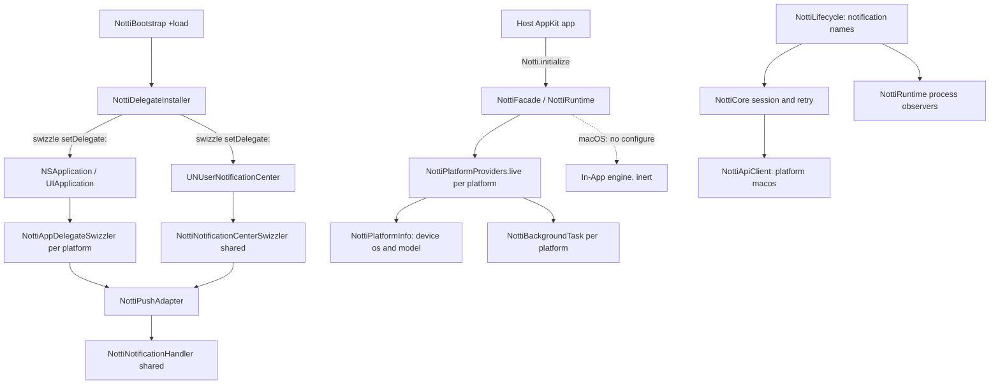

# macOS Support Design

**Spec**: `.specs/features/macos-support/spec.md` (MAC-01..26)
**Decision**: AD-025 (`.specs/project/STATE.md`)
**Status**: Draft (approval is the owner's)

Confidence tags: [Certo] verified in the code, in a build or in an SDK header on this machine (Xcode 27.2, macOS SDK 27.2, macOS 27.0.1, 2026-11-14). [Provável] reasonable inference from memory of Apple behavior, not verified here. [Incerto] unknown, a spike decides. Anything tagged [Provável] or [Incerto] is listed in "Spikes" with what to verify on a real Mac.

---

## Research notes

### Verified in the code and in builds

- [Certo] `NottiShared`, `NottiSDKExtension` and `NottiSDKBootstrap` compile for macOS with no change once `.macOS(.v12)` is in `Package.swift`. `xcodebuild build -scheme NottiSDKExtension -destination 'generic/platform=macOS' CODE_SIGNING_ALLOWED=NO SWIFT_TREAT_WARNINGS_AS_ERRORS=YES GCC_TREAT_WARNINGS_AS_ERRORS=YES APPLICATION_EXTENSION_API_ONLY=YES` exits 0. So MAC-19 and MAC-20 need no source change, only tests and guards.
- [Certo] `pod lib lint NottiSDKExtension.podspec --platforms=osx --allow-warnings` passes with `s.osx.deployment_target = '12.0'` added (CocoaPods 1.17.0). The only notes are Xcode 27 linker notes about a missing Metal toolchain search path, unrelated to the pod. `NottiSDK.podspec` was not linted for macOS (it cannot compile yet).
- [Certo] `NottiSDKBootstrap.m` imports only Foundation, `objc/message.h` and `stdatomic.h`. It already builds for macOS and its `+load` finds `NottiDelegateInstaller` by name, so the launch hook needs no change (DEL-14 holds). `+load` runs before `main`, so a `setDelegate:` swizzle installed there precedes `NSApplicationMain` assigning the delegate [Provável for AppKit ordering, same mechanism as UIKit, spike S3 checks it].
- [Certo] `Sources/NottiSDK/Core/NottiCore.swift` already wraps its two lifecycle observers in `#if canImport(UIKit)` with no `#else`. On macOS that compiles to nothing: no session start, no foreground retry, no session end, and no compiler error. This is the most dangerous silent gap of the port; it must become `#if canImport(UIKit) ... #elseif canImport(AppKit) ...` and a macOS test must fail if an observer is missing.
- [Certo] The `NottiRuntime` process observers use `UIApplication.didEnterBackgroundNotification` and `willEnterForegroundNotification` (lines 130 and 141). They close the session gate and drive the In-App engine.
- [Certo] The public manual-forwarding API returns `UIBackgroundFetchResult` (`NottiNotifications+Delegate.swift:26`, `NottiObjC.swift:216`, `PUBLIC_SURFACE.txt` lines 50 and 67). That type does not exist on macOS, so the macOS signature must differ (see decision D4, it touches MAC-22).
- [Certo] `NottiCore.init` has `platform: String = "ios"`; `NottiRuntime.makeCore` does not pass it, so the wire value comes from that default. `NottiSDKVersion.name` is the literal `"ios"`. Tests assert both (`NottiRuntimeTests.swift:128`, `NottiApiClientTests.swift:99`).
- [Certo] `deviceModelProvider` uses `uname().machine`. On this Mac `uname -m` prints `arm64` while `sysctl -n hw.model` prints `Mac14,9`. Copying the iOS closure to macOS would send `arm64` as `device_model`. macOS must read `hw.model` (MAC-17).
- [Certo] The In-App engine, model, parser, selector, queue, flusher and API client compile for macOS. Only `InApp/UI/*` (8 files), `InApp/Image/NottiInAppImageLoader.swift` and the `.system` factories of `InApp/Platform/*` use UIKit. `NottiInAppEngine.handleTrackEvent` returns at once when `config == nil`, and `maybeFetch` and `startFlush` guard on `config`, so an engine that is never `configure`d is inert (design D8).
- [Certo] `NottiPushPermissionAction` and `NottiInAppURLOpener` are pure logic except their `.system` members; `NottiInAppEngine+Display` uses `NottiInAppURLOpener.openableURL` and `refusedLog`, which must keep compiling on macOS.
- [Certo] `NottiNotificationCenterDelegate`, `NottiNotificationCenterSwizzler`, `NottiNotificationHandler` and `NottiMethodSwizzler` use only Foundation, ObjectiveC and UserNotifications. They compiled with no error in the survey and are shared. `UNNotificationPresentationOptions.banner` and `.list` exist on macOS 11+ (SDK header).
- [Certo] `NottiNotificationHandler.handleSilentPush` returns early when `aps.alert` exists, so a visible push is reported once by `handleWillPresent` even if macOS also calls `application(_:didReceiveRemoteNotification:)` for it [Provável that macOS calls both; the guard makes it harmless either way].
- [Certo] `NottiCore.handleSessionEndOnQueue` persists the session counters before the PATCH and returns at once when no session start is stored. A second session end (resign active, then terminate) is therefore idempotent.
- [Certo] The surface script keeps attributes on their own lines out of `PUBLIC_SURFACE.txt` (0 lines contain `iOSApplicationExtension`), so a second attribute line costs no surface diff. `@available(iOSApplicationExtension, unavailable, macOSApplicationExtension, unavailable)` in one attribute does not compile (verified with `swiftc`); two attributes are needed. 56 sites carry the iOS attribute in 31 files.
- [Certo] `.swiftlint.yml` warns at 1500 lines per file; `NottiCore.swift` is about 1439 lines. New macOS logic must live in new files, not in `NottiCore`.
- [Certo] The tests use UIKit symbols in 25 files (list under "Test survey"). `NottiRuntimeTests.swift:128` asserts `NottiSDKVersion.name == "ios"`.
- [Certo] `xcodebuild -destination 'platform=macOS'` matches two destinations here (`Any Mac` and `Mac Catalyst`); xcodebuild takes the first. CI and the gates must pin one (`arch=arm64` or `generic/platform=macOS`), checked in T14.

### Verified in Apple SDK headers (macOS SDK 27.2)

- [Certo] `NSApplicationDelegate` has `application:didRegisterForRemoteNotificationsWithDeviceToken:(NSData*)`, `application:didFailToRegisterForRemoteNotificationsWithError:` and `application:didReceiveRemoteNotification:(NSDictionary*)`, all `API_AVAILABLE(macos(10.7))`. There is no fetch-completion variant and no completion handler on macOS.
- [Certo] `-[NSApplication registerForRemoteNotifications]` is macOS 10.14+; `isRegisteredForRemoteNotifications` exists.
- [Certo] Notification names: `NSApplicationDidBecomeActiveNotification`, `DidResignActive`, `DidHide`, `DidFinishLaunching`, `WillTerminate`. There is no `didEnterBackground` or `willEnterForeground`. `NSApplication.isRunning` exists.
- [Certo] `NSApplicationDidFinishLaunchingNotification.userInfo` can carry `NSApplicationLaunchUserNotificationKey`, an `NSUserNotification` (the legacy API), not a `UNNotificationResponse`.
- [Certo] `-[NSProcessInfo performExpiringActivityWithReason:usingBlock:]` is `API_UNAVAILABLE(macos)`. `beginActivityWithOptions:reason:` is available, with `NSActivitySuddenTerminationDisabled` and `NSActivityAutomaticTerminationDisabled`. This closes the spec question: the background wrapper on macOS is `beginActivity`.
- [Certo] `UNAuthorizationStatusEphemeral` is `API_UNAVAILABLE(macos)`. Two switches use it (`NottiPlatformProviders`, `NottiPushPermissionAction.State`); the compiler hid them behind the first-order errors, so they are not in the compile survey counts.
- [Certo] `UNNotificationServiceExtension` and attachments are available from macOS 10.14.
- [Certo] `CLAuthorizationStatus.authorizedWhenInUse` is unavailable on macOS (build error at `NottiLocationReader.swift:55`).

### Not verified

- [Incerto] Cold-start click delivery on macOS, session end on terminate, SwiftUI `@NSApplicationDelegateAdaptor` shape, `didReceiveRemoteNotification` for visible pushes, App Store privacy report for macOS, NSE rendering on macOS. All in "Spikes".
- [Provável] A macOS APNs token is hex-encoded like iOS (`data.map { String(format: "%02x", $0) }`), and `aps-environment` plus a provisioning profile are required for Developer ID builds. Device checklist verifies it.
- [Provável] Apple's required-reason API categories (file timestamp, system boot time, disk space, active keyboard, UserDefaults) do not include `sysctl hw.model` or `ProcessInfo.operatingSystemVersion`. Not re-checked against an Apple page; the Xcode privacy report of a macOS archive is the check (T18, T27).

---

## Compile survey (experiment, scratch worktree, reverted)

Four passes on this worktree with temporary edits (all reverted; only `.specs/` changed):

| Pass | Edit | Result |
| --- | --- | --- |
| 0 | `.macOS(.v12)` in `Package.swift`, `xcodebuild build -scheme NottiSDK-Package -destination 'platform=macOS'` | `NottiShared`, `NottiSDKExtension`, `NottiSDKBootstrap` compile. `NottiSDK` stops at its first file with 1 error: `Unable to resolve module dependency: 'UIKit'` (`NottiAppDelegateSwizzler.swift:3`). The module-resolution error hides every other error |
| 1 | pass 0 plus every `import UIKit` replaced by `import AppKit` | 230 distinct located errors in 20 files (table below) |
| 2 | pass 1 plus the 8 `InApp/UI` files and `InApp/Image/NottiInAppImageLoader.swift` wrapped in `#if canImport(UIKit)` | 22 located errors in 14 files (second table) |
| ext | `NottiSDKExtension` strict, `APPLICATION_EXTENSION_API_ONLY=YES`, `generic/platform=macOS` | exit 0 |

Pass 1, located errors by file (`file:line:col: error`, deduplicated):

| File (under `Sources/NottiSDK`) | Errors | Class |
| --- | --- | --- |
| `InApp/UI/NottiInAppMessageView.swift` | 76 | UIKit view types and constants (`cannot find type`, `cannot find`, `no member`) |
| `InApp/UI/NottiInAppBarLayout.swift` | 44 | same |
| `InApp/UI/NottiInAppCardLayout.swift` | 28 | same |
| `InApp/UI/NottiInAppAppearance.swift` | 18 | same |
| `InApp/UI/NottiInAppPresenter.swift` | 15 | same (windows, scenes) |
| `InApp/UI/NottiInAppWindow.swift` | 11 | same |
| `InApp/UI/NottiInAppViewController.swift` | 9 | same (`no superclass`, `does not override`) |
| `InApp/UI/NottiInAppLayout.swift` | 1 | same |
| `InApp/Image/NottiInAppImageLoader.swift` | 5 | `cannot find type 'UIImage'` |
| `Platform/NottiBackgroundTask.swift` | 5 | `UIBackgroundTaskIdentifier`, `UIApplication` |
| `Delegates/NottiDelegateInstaller.swift` | 4 | `UIApplication` (lines 68, 186, 231, 235) |
| `Platform/NottiPlatformProviders.swift` | 3 | `UIApplication` x2, `UIDevice` |
| `InApp/Platform/NottiPushPermissionAction.swift` | 2 | `UIApplication` |
| `Delegates/NottiPushAdapter.swift` | 2 | `UIBackgroundFetchResult` |
| `Delegates/NottiAppDelegateSwizzler.swift` | 2 | `UIBackgroundFetchResult`, `@escaping` on a non-function type |
| `InApp/Platform/NottiInAppURLOpener.swift` | 1 | `UIApplication` |
| `Runtime/NottiRuntime.swift` | 1 | `UIApplication` (line 130) |
| `Public/ObjC/NottiObjC.swift` | 1 | `UIBackgroundFetchResult` |
| `Public/NottiNotifications+Delegate.swift` | 1 | `UIBackgroundFetchResult` |
| `Platform/NottiLocationReader.swift` | 1 | `authorizedWhenInUse` unavailable on macOS |

Of the 230, 202 are in the In-App UI layer and 5 in the image loader, which this feature compiles out. The raw diagnostic text is dominated by `cannot find type X in scope` and `cannot find X in scope` (about 300 of the roughly 430 compiler error lines before deduplication of continuation lines; treat the class split as approximate).

Pass 2, what remains after the In-App UI is out (22 errors, 14 files): `NottiAppDelegateSwizzler` (2), `NottiDelegateInstaller` (1, `UIApplication.self` at line 68), `NottiPushAdapter` (2), `NottiInAppHooks` (1, `NottiInAppPresenter` in `live`), `NottiInAppURLOpener` (1), `NottiPushPermissionAction` (2), `NottiBackgroundTask` (5), `NottiLocationReader` (1), `NottiPlatformProviders` (3), `NottiNotifications+Delegate` (1), `NottiObjC` (1), `NottiRuntime` (2: line 30 `NottiInAppPresenter`, line 130 `UIApplication`).

Hidden until the first-order errors are fixed (not counted above): `.ephemeral` (2 sites, header-verified), and any later availability diagnostics. Treat 22 as a lower bound; T14 is the task that reaches zero.

The silent hazard (no error at all): `NottiCore.observeAppForeground` and `observeAppBackground` compile to nothing on macOS.

### Test survey (macOS test target)

The test target cannot be built on macOS until `NottiSDK` compiles. Files that mention UIKit symbols (counts of matching lines): `NottiCoreTests` 19, `InAppPresenterTests` 18, `InAppViewFixtures` 14, `InAppWiringTests` 11, `DelegateInstallerTests` 9, `InAppPresenterFakes` 9, `AppDelegateSwizzlerTests` 8, `InAppImageLoaderTests` 8, `InAppPrivacyTests` 8, `InAppMessageViewTests` 6, `DelegateFixtures` 6, `RuntimeTests` 5, `PushPermissionActionTests` 5, `NotificationCenterSwizzlerTests` 5, `InAppBarLayoutTests` 4, `InAppURLOpenerTests` 4, `InAppCardLayoutTests` 3, `NottiObjCTests.m` 3, `LoggingPrivacyTests` 2, and one line each in `PublicApiTests`, `DeepLinkTests`, `MethodSwizzlerTests`, `PushAdapterTests`, `ObjCBridgeTests`, `FacadeInitializeTests`.

---

## Architecture Overview

Strategy: one source tree, no copied core file. Every difference is a small seam:

1. **Names seam** (`NottiLifecycle`): one internal enum that maps the five lifecycle events the SDK uses to `UIApplication.*` constants on iOS and `NSApplication.*` on macOS. Core, runtime and installer read the seam, never a platform class. On iOS the seam returns the same constants, so every iOS observer and test is byte-for-byte unchanged in behavior.
2. **Info seam** (`NottiPlatformInfo`): device OS string, device model, platform wire name. Pure helpers (version formatting) are platform-neutral so iOS tests run them.
3. **Adapter files**: macOS-only code in new files whole-file wrapped in `#if os(macOS)`. iOS-only code that must not compile on macOS stays in its file, wrapped in `#if canImport(UIKit)`. Where one declaration differs by a few tokens (selectors, return type) the file uses an inline `#if os(iOS) ... #else ... #endif` around the member.
4. **In-App**: the UIKit layer is compiled out with a file-level `#if canImport(UIKit)` (the wrapped body keeps its indentation, so the diff of each file is two lines). The engine stays shared and is never configured on macOS.

Conditions used: `canImport(UIKit)` for "the UIKit path" (iOS and Mac Catalyst, so Catalyst keeps compiling the iOS path as before) and `os(macOS)` for "the AppKit path". Both are true exclusive on the two supported platforms.

---

## Code Reuse Analysis

### Existing components to leverage

| Component | Location | How to use |
| --- | --- | --- |
| `NottiPlatformProviders` seam | `Platform/NottiPlatformProviders.swift` | `live()` gains a macOS body; the struct, defaults and `NottiCore.init` parameters stay |
| `NottiCore` provider injection | `Core/NottiCore.swift` | Tests drive it with fakes; only the two observers change (via `NottiLifecycle`) |
| `NottiMethodSwizzler` | `Delegates/NottiMethodSwizzler.swift` | Reused as is (ObjC runtime only) |
| `NottiNotificationCenterSwizzler`, `NottiNotificationCenterDelegate`, `NottiFallbackDelegateAssigner` | `Delegates/` | Shared. Only the launch notification name goes through the seam |
| `NottiPushAdapter`, `NottiNotificationHandler`, `NottiEventBuffer` | `Delegates/`, `Events/` | Shared; the adapter's silent-push method differs only by return type |
| `NottiSwizzlingConfiguration` (`NottiDisableSwizzling`) | `Delegates/` | Shared; reads `Info.plist` identically |
| `NottiBootstrap` `+load` | `Sources/NottiSDKBootstrap` | Unchanged |
| `NottiInAppEngine` | `InApp/Engine` | Shared, never configured on macOS |
| `NottiInAppPlaceholderPresenter` | `InApp/Engine/NottiInAppHooks.swift` | Presenter of the macOS runtime |
| `NottiCore.waitForPendingWork(timeout:)` | `Core/NottiCore.swift` | Basis of the bounded terminate flush (a new internal method wraps it; the doc says "test hook only", updated) |
| Fake delegate classes (`objc_allocateClassPair`, unique names), `DelegateFixtures` | `Tests/NottiSDKTests/Support` | macOS delegate tests reuse the pattern |
| `scripts/check-*.sh` | `scripts/` | Extended in place, each with a passing and a failing fixture proof as before |

### Integration points

| System | Integration |
| --- | --- |
| Backend `zeep-notti` `macos-platform` | `POST /v1/apps/{app_id}/devices` with `platform: "macos"`, token only; `PATCH` `sdk_name: "macos"`. No new field |
| APNs | Token from `NSApplication.registerForRemoteNotifications`; topic is the backend's concern |
| App Store / notarization | Host entitlements `com.apple.developer.aps-environment`; documented, not enforced |
| CocoaPods | Both podspecs add `s.osx.deployment_target = '12.0'`; AD-012 two pods stay |
| CI `ci.yml` | `macos-26` runner already exists; adds a macOS test destination, strict macOS builds, `pod lib lint --platforms=ios,osx` |

---

## Components

### Package manifest

- **Purpose**: declare macOS 12 and keep products unchanged.
- **Location**: `Package.swift`, `scripts/check-package-graph.sh` (SPM part).
- **Interfaces**: `platforms: [.iOS(.v15), .macOS(.v12)]`. No new target, product or resource. The two `PrivacyInfo.xcprivacy` resources stay `.process` (valid on macOS).
- **Dependencies**: none. **Reuses**: existing targets.
- Note: the graph script checks `platforms` equal to exactly iOS 15.0 (line 45); it changes in the same commit as the manifest or the guard fails.

### `NottiSDKVersion` platform values

- **Purpose**: the wire platform and sdk name per platform.
- **Location**: `Sources/NottiShared/NottiSDKVersion.swift`.
- **Interfaces**: `package static let platform: String` (`"ios"`, or `"macos"` under `#if os(macOS)`); `name` becomes `platform`-equal by the same switch. `NottiCore.init(platform:)` default becomes `NottiSDKVersion.platform`, and `NottiRuntime.makeCore` passes it explicitly. On Mac Catalyst `os(macOS)` is false and `os(iOS)` is true [Provável, memory of the Swift conditions; T14 builds the package for `variant=Mac Catalyst` once to record what happens], so a Catalyst app would report `ios`, documented as out of scope.
- **Reuses**: AD-024 override path unchanged (a wrapper still passes its own `sdkName`).

### `NottiLifecycle` (names seam)

- **Purpose**: one place that knows the notification names.
- **Location**: `Sources/NottiSDK/Platform/NottiLifecycle.swift` (new).
- **Interfaces** (internal):
  - `static var didFinishLaunching: Notification.Name` (iOS `UIApplication.didFinishLaunchingNotification`, macOS `NSApplication.didFinishLaunchingNotification`)
  - `static var didBecomeActive` (same names on both)
  - `static var didEnterBackground` (iOS `UIApplication.didEnterBackgroundNotification`, macOS `NSApplication.didResignActiveNotification`)
  - `static var willEnterForeground` (iOS `UIApplication.willEnterForegroundNotification`; macOS `nil`-equivalent: not observed, In-App is inert)
  - `static var willTerminate: Notification.Name?` (macOS `NSApplication.willTerminateNotification`, iOS `nil`: iOS never uses it)
- **Dependencies**: UIKit or AppKit. Marked unavailable in app extensions for both platforms.
- **Reuses**: replaces the literal `UIApplication.*Notification` uses at `NottiCore.swift` (2), `NottiRuntime.swift` (2), `NottiDelegateInstaller.swift` (1), `NottiNotificationCenterDelegate.swift` (1).

### `NottiPlatformInfo` (info seam)

- **Purpose**: device OS and model reads, no UIKit in the shared closure.
- **Location**: `Sources/NottiSDK/Platform/NottiPlatformInfo.swift` (new).
- **Interfaces**:
  - `static func osVersionString(major: Int, minor: Int, patch: Int) -> String`: `"14.4"` or `"14.4.1"` (patch only when non-zero; the iOS `systemVersion` convention). Pure, tested on iOS and macOS.
  - `static func deviceOS() -> String?`: iOS `UIDevice.current.systemVersion` (unchanged), macOS `ProcessInfo.processInfo.operatingSystemVersion` through the pure helper.
  - `static func deviceModel() -> String?`: iOS the existing `uname().machine` body moved verbatim; macOS `sysctlbyname("hw.model")` read with a size query, nil on any failure or empty string. No serial, no hardware UUID, no `gethostname`.
- **Reuses**: the existing closure bodies move here; `NottiPlatformProviders.live()` calls them.

### `NottiBackgroundTask` (per platform)

- **Purpose**: keep the process alive while the session-end PATCH runs.
- **Location**: `Platform/NottiBackgroundTask.swift` (iOS body unchanged inside `#if canImport(UIKit)`), macOS body in the same file under `#if os(macOS)`.
- **Interfaces**: `static func begin() -> () -> Void` on both. macOS: `ProcessInfo.processInfo.beginActivity(options: [.suddenTerminationDisabled, .automaticTerminationDisabled], reason: "app.notti.session-end")`, returns an idempotent closure that calls `endActivity` once (a lock-guarded flag, same shape as the iOS `TaskBox`). No expiry handler exists on macOS, so the closure is also called by the bounded terminate flush.
- **Rejected**: `performExpiringActivity` (unavailable on macOS, header-verified).

### Session end on terminate (`NottiCore` hook)

- **Purpose**: close the open session when the user quits while the app is active (no resign-active before terminate).
- **Location**: `Sources/NottiSDK/Core/NottiCore+Terminate.swift` (new, `#if os(macOS)`), observer registered from the `NottiLifecycle` seam in `NottiCore`'s existing `observeAppBackground`.
- **Interfaces**: `internal func handleAppWillTerminate(atMs:)`: runs the same body as `handleAppDidEnterBackground` and then `waitForPendingWork(timeout: Self.terminateFlushTimeout)` where `terminateFlushTimeout = 1.5` seconds. The wait is bounded, runs on the thread that posts `willTerminate` (main), and never loops. The local bookkeeping is already persisted before the PATCH (`handleSessionEndOnQueue`), so a timeout loses at most the network report, and the stored counters are sent on the next session.
- **Dependencies**: `NottiLifecycle.willTerminate`, `NottiBackgroundTask`.
- Risk: see concerns C3 and spike S2.

### `NottiAppDelegateSwizzler` (macOS selectors)

- **Purpose**: observe `NSApplicationDelegate` callbacks and keep the host's originals.
- **Location**: `Delegates/NottiAppDelegateSwizzler.swift`.
- **Interfaces**: the class and its public-to-module entry points (`swizzle(delegateClass:)`, `observe(delegate:)`, `swizzleSetDelegate(on:)`) keep their signatures on both platforms. Inside:
  - token and failure: identical selectors and type encodings (`v@:@@`) on both platforms.
  - iOS: fetch variant and the legacy guard (DEL-16, D3), unchanged under `#if os(iOS)`.
  - macOS: swizzle `application:didReceiveRemoteNotification:` with encoding `v@:@@`, no completion. If the host lacks it, the SDK adds it (nothing on macOS makes the OS prefer another variant, so the D3 trap does not exist) [Provável, spike S3 verifies that adding the method does not change the host's behavior]. The block calls `adapter.didReceiveRemoteNotification(userInfo:)` then the host original with the same arguments.
  - `setDelegate:` swizzle target is `NSApplication` (`Environment.applicationClass`).
  - SwiftUI: `isSwiftUIInternal` name check stays; the adaptor path (`forwardingTarget(for:)`) is reused and its macOS behavior is spike S3.
- **Dependencies**: `NottiPushAdapter`, `NottiMethodSwizzler`.

### `NottiPushAdapter` and manual API

- **Purpose**: one entry point per OS input.
- **Location**: `Delegates/NottiPushAdapter.swift`, `Public/NottiNotifications+Delegate.swift`, `Public/ObjC/NottiObjC.swift`.
- **Interfaces**: `didReceiveRemoteNotification(userInfo:)` and `manualDidReceiveRemoteNotification(userInfo:)` return `UIBackgroundFetchResult` on iOS (unchanged) and `Void` on macOS. Public: `Notti.Notifications.didReceiveRemoteNotification(_:)` and the ObjC `didReceiveRemoteNotification:` keep name and selector; macOS returns `Void` (decision D4). `willPresent` and `didReceive` are identical (UserNotifications).

### `NottiDelegateInstaller` (production environment)

- **Purpose**: install the integration at launch on either platform.
- **Location**: `Delegates/NottiDelegateInstaller.swift`.
- **Interfaces**: `Environment.production()` uses `NSApplication.self` on macOS and `UIApplication.self` on iOS (class reference only, no instance, so DEL-14 holds). `currentApplicationDelegate` and `sharedApplication` keep the ObjC-runtime style (`perform(NSSelectorFromString("sharedApplication"))`) so no AppKit object is touched on a non-main thread. `applicationIsActive` on macOS: `NSApplication.shared.isRunning` read through the runtime, only on main [Provável: true once `run()` started, which is after `didFinishLaunching` is posted, so it is a "launch has finished" proxy; spike S7]. The launch observer name comes from `NottiLifecycle.didFinishLaunching`.
- **Reuses**: everything else.

### `NottiPlatformProviders.live()` (macOS body)

- **Purpose**: OS-backed reads for macOS.
- **Location**: `Platform/NottiPlatformProviders.swift`.
- **Interfaces**:
  - `tokenProvider`: `DispatchQueue.main.async { if let app = NSApp { app.registerForRemoteNotifications() } }`; never creates `NSApplication.shared` (guard on `NSApp`), so a library call in a non-app process cannot instantiate an application. The callback is not called here, as on iOS.
  - `permissionRequester`: same `UNUserNotificationCenter.requestAuthorization(options: [.alert, .badge, .sound])`.
  - `permissionStatusProvider`: same mapping; the `.ephemeral` case is `#if os(iOS)` (unavailable on macOS).
  - `appStateProvider`: `DispatchQueue.main.async { callback(NSApp?.isActive == true) }`.
  - `deviceOsProvider`, `deviceModelProvider`: `NottiPlatformInfo`.
  - `beginBackgroundTask`: `NottiBackgroundTask.begin()` (macOS body).
  - `hasLocationPermission`, `countryProvider`: `NottiLocationReader`, whose `updatePermission` accepts `.authorizedAlways` on macOS and `.authorizedWhenInUse || .authorizedAlways` on iOS.

### In-App on macOS (inert)

- **Purpose**: the In-App API compiles and does nothing (MAC-21).
- **Location**: `InApp/UI/*`, `InApp/Image/*` (file-level `#if canImport(UIKit)`); `InApp/Platform/NottiPushPermissionAction.swift` and `NottiInAppURLOpener.swift` (the `.system` members and the `UIApplication` helpers inside `#if canImport(UIKit)`); `InApp/Engine/NottiInAppHooks.swift` (`live(presenter:)` takes the presenter protocol composition instead of the concrete UIKit class, with `events` assigned through a small protocol); `Runtime/NottiRuntime.swift` (`shared` builds the engine with `NottiInAppPlaceholderPresenter` and passes `nil` for `pushPermissionPlatform` and `urlOpenPlatform` on macOS; `start` skips `inAppEngine.configure` when `NottiPlatformInfo.supportsInApp` is false).
- **Behavior**: with no config the engine never fetches, never flushes, never writes `notti_pending_inapp_events`, and `trackEvent` returns at once. The macOS process observers do not call `appForegrounded`. No URL-open code exists on macOS, so `check-no-url-open.sh` needs no macOS allowlist entry and gains a ban on `NSWorkspace` opens everywhere.
- **Rejected**: an `NSPanel` port (out of scope), `@available(macOS, unavailable)` on the In-App API (breaks shared host code, spec assumption).

### Guards and scripts

| Script | Change |
| --- | --- |
| `check-extension-safety.sh` | pattern adds `import AppKit`, `NSApplication`, `NSWorkspace` (MAC-04). A fixture proof per new token |
| `check-no-url-open.sh` | pattern adds `NSWorkspace\.shared\.open` and `\.open\(\[` style `NSWorkspace` opens; allowlist unchanged (macOS has no entry) (MAC-13) |
| `check-launch-hook-purity.sh` | adds `AppKit` and `NSApplication` instances to the banned list for `NottiBootstrap.m` and `NottiDelegateInstaller.swift`, except the class reference `NSApplication.self` on the one allowed line; fixture proofs (DEL-14 on macOS) |
| `check-public-surface.sh` | requires both `@available(iOSApplicationExtension, unavailable)` and `@available(macOSApplicationExtension, unavailable)` (MAC-05); fixtures: only iOS attribute fails, only macOS fails |
| `check-package-graph.sh` | SPM platforms exactly `iOS 15.0` and `macOS 12.0`; podspec platforms exactly `{"ios": "15.0", "osx": "12.0"}`; the extension still must not reach `NottiSDK` or `NottiSDKBootstrap` (MAC-20) |
| `check-version.sh` | unchanged logic (versions only); verified on 0.3.0 |
| `check-hook-linked.sh` | new mode `spm-macos`: Release build of a macOS consumer, run it, require `loadCount == installCount == 1`. `pod` mode adds `--platforms=osx` |
| `check-example-*.sh` | untouched; the macOS example has its own generated project and is not part of `EXR-02` coverage |

### Tests

See "Test strategy" below.

### Example and docs

- `Example/project-mac.yml` (new XcodeGen spec, separate from the iOS `project.yml`): app `NottiExampleMac` (AppKit, one window, buttons for initialize, permission, login, tag, take initial click, log) plus an NSE target `NottiNotificationServiceMac`. Generated project stays git-ignored.
- README, `docs/DEVICE_CHECKLIST.md` (new macOS items D22 onward), `.specs/codebase/TESTING.md`, CHANGELOG `[0.3.0]`, `AGENTS.md` (platform wording, commands, gates).

---

## Data and wire changes

| Item | iOS | macOS |
| --- | --- | --- |
| `POST /devices` `platform` | `ios` | `macos` |
| `sdk_name` (PATCH) | `ios` | `macos` (wrapper value wins, AD-024) |
| `sdk_version` | `NottiSDKVersion.current` | same |
| `device_os` | `UIDevice.systemVersion` | `major.minor[.patch]` from `ProcessInfo` |
| `device_model` | `uname().machine` (`iPhone15,2`) | `hw.model` (`Mac14,9`), omitted when unreadable |
| `notti_prefs` keys | unchanged | same keys, same suite |
| Token | hex | hex [Provável] |
| In-App endpoints | used | never called (engine not configured) |

No new key, no new stored field, no new data type collected. The echo ack for `sdk_name` (`notti_last_synced_sdk_name`) already exists and works the same way; against a backend before `macos-platform` the registration answers 422 and the SDK logs `domain#code` and retries on the normal schedule (spec edge case).

---

## Error and edge handling

| Scenario | Handling | Where |
| --- | --- | --- |
| No `aps-environment` entitlement or profile | `registerForRemoteNotifications` never answers or `didFailToRegister...` fires: `.error` line with `domain#code`, no crash, `initialize` not blocked | `NottiRuntime.onApnsRegistrationFailed` (shared) |
| `registerForRemoteNotifications` called with no `NSApplication` (non-app process, tests) | `NSApp` is nil: skipped, never instantiated | `live().tokenProvider` |
| `hw.model` unreadable | `device_model` omitted | `NottiPlatformInfo.deviceModel` |
| App quits while a session is open | `willTerminate` ends the session with a 1.5 s bounded flush; timeout leaves the persisted counters for the next run | `NottiCore+Terminate` |
| Resign active then terminate | second end is a no-op (no stored session start) | `handleSessionEndOnQueue` |
| Cmd-Tab many times | each resign active ends a session and each activation starts one (see C1, owner decision) | lifecycle |
| Force quit, crash, power loss | session telemetry of that session is lost, as on iOS | accepted |
| Sandboxed and unsandboxed app | `UserDefaults(suiteName:)` lives in the app's own container; no extra entitlement | unchanged |
| Backend 422 for `macos` (not deployed) | existing 4xx handling | `NottiApiClient` |
| Host disabled swizzling | `NottiDisableSwizzling` honored; manual API calls the same adapter | shared |
| Mac Catalyst app | links the UIKit path, reports `ios`; not supported, documented | `NottiSDKVersion` |
| Notification click while app runs | `didReceive` via the UN delegate (swizzled or fallback) | shared |
| Cold-start click | spike S1; fallback delegate assigned at `didFinishLaunching` as on iOS | installer |
| Silent push on macOS | `application(_:didReceiveRemoteNotification:)` swizzle, `received` once | adapter |
| Sleep with a session open | no timer: ends on resign active or terminate only | lifecycle |
| Rosetta and Intel | no architecture branch | none |

---

## Tech decisions

| # | Decision | Choice | Rationale | Alternatives rejected |
| --- | --- | --- | --- | --- |
| D1 | Platform split | File-level and member-level `#if` plus small seams; new macOS files whole-file `#if os(macOS)` | One core, no copy (AD-001, AD-025); iOS diff is wrappers only | Separate `NottiSDKmacOS` target or repo (duplicates 9k lines); SPM target per platform for UI (extra graph, breaks `check-package-graph`) |
| D2 | Lifecycle names | `NottiLifecycle` seam; macOS `didEnterBackground` = `NSApplication.didResignActive` | The core's session logic is name-agnostic; iOS constants unchanged | Posting synthetic `UIApplication` names (hack); `#if` inside each observer (6 places) |
| D3 | `willEnterForeground` on macOS | Not observed | It only drives In-App (`appForegrounded`), inert on macOS; `didBecomeActive` already starts the session | Map to `didBecomeActive` (would call In-App code that does nothing) |
| D4 | Manual API return type | macOS: `@discardableResult ... -> Void` (Swift) and `void` (ObjC) for `didReceiveRemoteNotification`; same names | Host calls it as a statement on both platforms; passing the result to a completion exists only on iOS, where the host has `fetchCompletionHandler`. This is the only difference in the public surface and it touches spec MAC-22 | A public SDK enum (breaking on iOS); omitting the method on macOS (hosts with swizzling off could not forward silent pushes) |
| D5 | Delegate integration | Swizzle `NSApplicationDelegate` like iOS | Same opt-out and manual API (AD-004); no proxy | Replace `NSApp.delegate` with a forwarding proxy (breaks identity checks, `@NSApplicationDelegateAdaptor`) |
| D6 | macOS background wrapper | `ProcessInfo.beginActivity(.suddenTerminationDisabled, .automaticTerminationDisabled)` | `performExpiringActivity` is unavailable on macOS; there is no suspension to survive, only sudden/automatic termination | Nothing (a PATCH could be cut by sudden termination) |
| D7 | Terminate flush | 1.5 s bounded wait on main inside `willTerminate` | Spec requires bounded; local counters persist first | Unbounded wait (delays quit); no flush (loses every quit-while-active session) |
| D8 | In-App on macOS | Compile UIKit layer out; never `configure` the engine; no `.system` platforms | Strongest "inert": no network, no store write; no URL-open code on macOS | Configure and rely on no client (early events still held in memory) |
| D9 | Wire constants | `NottiSDKVersion.platform` in `NottiShared`, passed explicitly by the runtime | One source for `platform` and `name`; tests assert per platform | Core default stays `"ios"` (would send `ios` from a macOS test core) |
| D10 | Device model | `sysctlbyname("hw.model")` | `uname().machine` is `arm64` on macOS (verified); hw.model is the identifier the spec shows | `uname` copy (wrong data); IOKit (new dependency and more fields than needed) |
| D11 | Extension safety attribute | Two `@available` lines | One combined attribute does not compile (verified) | A single combined attribute |
| D12 | AD-002 | Status note in `STATE.md`, `AGENTS.md` wording updated in T1 | `0.1.0` shipped 2026-10-26; the port rule already expired | Keep the rule (it would forbid every edit here) |
| D13 | Tests on macOS | Dedicated macOS test files for macOS-only code; UIKit-dependent iOS tests wrapped in `#if canImport(UIKit)` so they keep running on iOS unchanged | Test count on iOS must not drop (MAC-02); macOS count is tracked separately | Rewrite the iOS tests (risk) |
| D14 | Destination | CI and gates use `platform=macOS,arch=arm64`, `generic/platform=macOS` for builds | `platform=macOS` is ambiguous with Catalyst | Bare `platform=macOS` |

---

## Spikes (decide on a real Mac, with a signed build)

Recommendation first, then what to verify. Owner: Julio, Mac with an Apple Developer team and a Notti app configured for macOS APNs. Results are recorded in `docs/DEVICE_CHECKLIST.md` and in `validation.md`.

| # | Question | Recommendation | Verify |
| --- | --- | --- | --- |
| S1 | Cold-start click delivery | Same as iOS: the SDK's fallback `UNUserNotificationCenterDelegate` is assigned at `NSApplication.didFinishLaunching` only when the host left it nil; a host delegate set later replaces it. Do not read `NSApplicationLaunchUserNotificationKey` (legacy `NSUserNotification`) [Provável that UN holds the response until a delegate exists, as on iOS] | Quit the app, click a delivered banner in Notification Center. Does `didReceive` arrive after launch, and does `takeInitialClick()` return the payload once? Test with a host that sets its delegate in `applicationDidFinishLaunching` and one that never does. If the click is lost: plan B is assigning the fallback at install time on macOS only when the delegate is still nil at `didFinishLaunching` minus one run-loop turn, with its own spec note |
| S2 | Session end on terminate | `willTerminate` with a 1.5 s bounded wait plus `beginActivity` | Cmd-Q while active and while a session is open: quit latency (target under 2 s with network down), backend shows `session_count` updated with network up, nothing hangs with network down. Also logout and shutdown |
| S3 | Swizzle vs forwarding, SwiftUI adaptor | Swizzle (D5). Adding `didReceiveRemoteNotification:` to a host that lacks it is harmless | (a) AppKit host with all three callbacks, with some, with none: originals still called once. (b) `@NSApplicationDelegateAdaptor`: `NSApp.delegate` class name and whether `forwardingTarget(for:)` reaches the adaptor like AD-016; (c) the SwiftUI name check `_TtC7SwiftUI` still matches. (d) `+load` ordering: the `setDelegate:` swizzle is in place before the delegate is assigned |
| S4 | Session granularity on resign active | Follow the spec (resign active ends the session). Owner decision C1 below | Count sessions after five Cmd-Tabs in a minute; compare with the iOS expectation. Alternative if too noisy: end the session on `didHide` or when `occlusionState` has no visible window, with its own spec |
| S5 | Token format and entitlement | Hex like iOS | Token length and shape in the backend; Developer ID app with and without `aps-environment`: error path logs `domain#code` only |
| S6 | NSE on macOS | Same two-line NSE | Image attached in the banner on macOS 12 and the latest; deadline fallback; `APPLICATION_EXTENSION_API_ONLY` build already verified |
| S7 | Launch-finished probe | `NSApp.isRunning` on main as the late-install proxy | An install after launch (called from a button) assigns the fallback; an install before launch waits for the notification |
| S8 | `registerForRemoteNotifications` before delegate set | Call from `initialize` as iOS does | Token callback arrives when `initialize` is in `applicationDidFinishLaunching` and when it is called from a later button |
| S9 | Privacy report | No new required-reason API | Xcode privacy report of a macOS archive shows no missing reason for `hw.model` or the OS version read |
| S10 | Hardened runtime and sandbox | No extra entitlement beyond network client | Run the example sandboxed and unsandboxed with hardened runtime; confirm `UserDefaults` suite and networking work |

---

## Test strategy

| Layer | iOS (unchanged) | macOS |
| --- | --- | --- |
| `NottiSharedTests` | all | all, plus `platform` and `name` per platform |
| Core, storage, network, events, facade, public shell, In-App engine/model/queue | all | all (platform-neutral) |
| Lifecycle observers | existing tests post `UIApplication` names | new tests post `NSApplication` names through the seam; a test fails if no observer is registered |
| Delegate swizzler | existing | new `NottiAppDelegateSwizzlerMacTests`: fake `NSApplicationDelegate` class with and without each callback, host original forwarded once, silent push has no completion |
| Push adapter and manual API | existing | `Void` variant, ignored while swizzling active |
| Registration body | `platform: "ios"` | `platform: "macos"` and `sdk_name: "macos"` asserted as literals (not through the constants) |
| In-App | UI tests in the test host | inert tests: no request through `StubURLProtocol`, no stored event, `trackEvent` and listener compile and do nothing |
| NSE | existing 110 | same suite on the macOS destination |
| ObjC | `NottiSDKObjCTests`, `NottiSDKExtensionObjCTests` | same targets on macOS; the `UIBackgroundFetchResult` use in `NottiObjCTests.m` is `#if` |
| Scripts | fixtures | fixtures for each changed script |

Counts: the iOS baseline (Shared 14, SDK 907, ObjC 8, Extension 110, ExtensionObjC 3, from STATE at `3d1cad6`) is re-measured in T1 and must not drop. macOS counts are recorded in T19 and then do not drop either.

---

## Risks and concerns

| # | Concern | Mitigation |
| --- | --- | --- |
| C1 | Resign active on macOS fires on every app switch, so sessions become many and short; the iOS meaning of `didEnterBackground` is "left the screen" | Follows the spec. Owner confirms. S4 measures it; the seam makes the alternative (`didHide`, occlusion) a one-file change. Documented in the README |
| C2 | `NottiCore` observers silently compile to nothing on macOS | T5 adds the `#elseif`; T21 test fails when the observer count is zero |
| C3 | Blocking main for up to 1.5 s at quit | Bounded, only when a session is open and a network PATCH is pending; S2 measures; constant is one line |
| C4 | `NottiCore.swift` at about 1439 lines against a 1500 warning limit | New logic in new files; T5 touches `NottiCore` by net zero lines |
| C5 | Public surface differs by one return type on macOS (spec says no new symbol) | D4; PUBLIC_SURFACE gets the two macOS lines reviewed in T9; the owner amends MAC-22 or picks the alternative |
| C6 | Compile survey is a lower bound (availability errors hidden by first-order errors) | T14 iterates to zero and records the final list |
| C7 | macOS tests cannot run until the module compiles (T14); macOS-only tests written earlier would be unexecuted | macOS-only tests are written in T19 to T22, after compile; earlier tasks use iOS-runnable pure tests and the error-count burndown as their macOS evidence |
| C8 | `platform=macOS` destination ambiguity with Catalyst | D14, T14 verifies the pinned destination on the CI image |
| C9 | A host app that is an LSUIElement or has no Dock presence | Not special-cased (spec); `NSApplication` notifications still fire |
| C10 | GitHub billing may block hosted CI | Local equivalent of `ci.yml` is the gate, as in earlier features |
| C11 | Release before the backend is deployed gives every macOS registration a 422 | T28 gate: tag only after `macos-platform` is deployed and verified |
| C12 | Hard-coded copy of `AGENTS.md` says "iOS 15+" and "port, not a rewrite" | T1 |
| C13 | CocoaPods trunk read-only on 2026-12-02 (AD-022) | A `0.3.0` push after that date follows plan B |

---

## Requirement traceability

| Requirement | Components | Tasks |
| --- | --- | --- |
| MAC-01 | Package manifest; `NottiLifecycle`; `NottiPlatformInfo`; `NottiBackgroundTask`; swizzler; installer; providers; In-App gating | T2, T4-T14 |
| MAC-02 | iOS branches unchanged; test gating; iOS gate on every task | every task gate, T19 |
| MAC-03 | Podspecs | T17 |
| MAC-04 | `check-extension-safety.sh`; shared and extension untouched | T16, T22 |
| MAC-05 | Attribute pair; `check-public-surface.sh` | T15 |
| MAC-06 | `live().tokenProvider`, `permissionRequester` | T11, T20 |
| MAC-07 | `NottiSDKVersion.platform`; `makeCore` | T3, T20 |
| MAC-08 | `NottiSDKVersion.name`; AD-024 path | T3, T20 |
| MAC-09 | `NottiAppDelegateSwizzler` macOS; installer | T10, T11, T20 |
| MAC-10 | `NottiPushAdapter` manual path | T9, T20 |
| MAC-11 | adaptor path in the swizzler | T10, T20 (fake adaptor), T27 (real SwiftUI) |
| MAC-12 | runtime failure logging (shared) | T20 |
| MAC-13 | handler (shared); `check-no-url-open.sh` | T16, T20 |
| MAC-14 | fallback delegate and launch observer | T11, T27 (S1) |
| MAC-15 | adapter silent push, macOS `Void` | T9, T10, T20 |
| MAC-16 | `NottiLifecycle`; `NottiCore+Terminate`; `NottiBackgroundTask` | T5, T8, T21, T27 (S2) |
| MAC-17 | `NottiPlatformInfo` | T6, T21 |
| MAC-18 | `NottiLogger` only; privacy sentinel tests | T20, T21 |
| MAC-19 | NSE unchanged | T22, T27 (S6) |
| MAC-20 | `check-package-graph.sh` | T2, T17, T22 |
| MAC-21 | In-App inert | T4, T12, T13, T21 |
| MAC-22 | surface review | T9, T15, T21 |
| MAC-23 | `PrivacyInfo.xcprivacy` | T18, T27 (S9) |
| MAC-24 | `ci.yml` | T23, T24 |
| MAC-25 | README | T26 |
| MAC-26 | `docs/DEVICE_CHECKLIST.md` | T26, T27 |

All 26 requirements are mapped.

## Decisions for the owner to confirm

1. D4: macOS `didReceiveRemoteNotification` returns `Void` (the only public-surface difference); amend MAC-22.
2. C1/S4: resign active ends the session on macOS.
3. D7: 1.5 s terminate flush bound.
4. D8: engine never configured on macOS (no `.system` In-App platforms).
5. D10: `hw.model` as `device_model`.
6. D12: AD-002 status note and `AGENTS.md` rewording.
7. Adding `didReceiveRemoteNotification:` to a host delegate that lacks it on macOS (S3).
