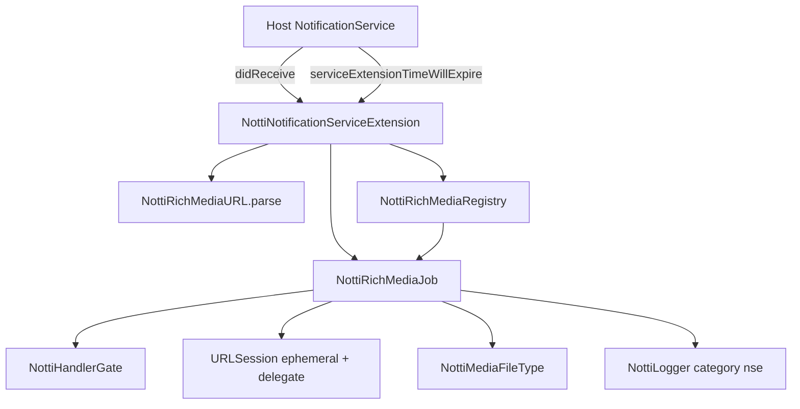

# NSE Rich Media Design

**Spec**: `.specs/features/nse-rich-media/spec.md`
**Status**: Implemented, Verifier pending (spike results re-proved on the Simulator in T5)

---

## Spike results (2026-10-11)

Throwaway scripts in the scratchpad, run with `swiftc` on **macOS Foundation**, not on an iOS simulator or device. Every result below is re-proved by a test in T2/T5 on the simulator before it counts.

| Question | Result |
| --- | --- |
| Can an expiry call be matched to its download, given that it receives only the host's own `bestAttemptContent` and the handler? | `request.content.mutableCopy()` taken twice gives equal `userInfo` under `NSDictionary.isEqual(to:)`; a different `userInfo` does not match. [Certo on macOS, Provável on iOS] |
| Does a delegate-based `URLSessionDownloadTask` report the declared size early, so the cap can abort before the body? | Yes. With a stubbed `URLProtocol` the first `didWriteData` carries `totalBytesExpectedToWrite` (11 MiB from `Content-Length`); `task.cancel()` there stops loading (`stopLoading` called, error `NSURLErrorDomain#-999`). |
| Does `willPerformHTTPRedirection` see an `http` redirect before the body? | Yes. Answering `completionHandler(nil)` alone did NOT complete the task (no callback within 5 s, with a stub that never finishes). Answering `nil` and calling `task.cancel()` completes it with `-999`. So the job must own the outcome and cancel itself. |
| Does the response MIME type keep its case? | A stub sending `Content-Type: Image/PNG` reached the delegate as `image/png`. The file-type code still lowercases (cheap, and a real server may differ). |

---

## Architecture Overview

`didReceive` builds one `NottiRichMediaJob` per notification. The job owns its own `URLSession` (ephemeral, with the job as delegate), a total deadline timer and a once-only handler gate. Every way out (success, drop, deadline, expiry) goes through one `finish` that runs once. A small registry of recent jobs lets `serviceExtensionTimeWillExpire` find the job for its notification.

All new code lives in `Sources/NottiSDKExtension` (extension-safe, `NottiShared` only). Nothing is added to `NottiSDK`.

---

## Code Reuse Analysis

| Component | Location | How to use |
| --- | --- | --- |
| `NottiPayloadKeys.imageUrl` | `Sources/NottiShared/NottiPayloadKeys.swift` | The only definition of `notti_image_url`. Read it, never redefine |
| `NottiLogger` | `Sources/NottiShared/NottiLogger.swift` | All logging, category `nse`. `sink` is the test seam |
| RN NSE helper | `../zeep-notti-react-native/ios/NotificationServiceExtension/NottiNotificationServiceExtension.swift` (`52e4b55`) | Source of the rules (https, 10 MB, 20 s, MIME map). Re-written around a delegate, not copied line by line (see D4) |
| RN NSE tests | `.../Tests/NottiNotificationServiceExtensionTests.swift` | 9 cases ported by intent (missing key, `file://`, `http://`, non-2xx, success, expiry with and without content, 3 extension cases) |
| `StubURLProtocol` | `Tests/NottiSDKTests/Support/StubURLProtocol.swift` | Copied into `NottiSDKExtensionTests` and extended (redirect, declared length, never-finishing). A test target cannot import another's helper |
| `NottiSDKObjCTests` | `Tests/NottiSDKObjCTests` | Pattern for the new Objective-C test target |
| `check-launch-hook-purity.sh` | `scripts/` | Pattern (comment stripping) for the new `check-nse-logging.sh` |
| `PrivacyManifestTests` | `Tests/NottiSDKExtensionTests` | Keep; manifest unchanged (D9) |

Note: this repo's M1 rule "port, not rewrite" (AD-002) covers behavior. The RN NSE helper has no state and no `NottiCore` link, and the spec lists each place the behavior changes (D1 to D9), so a delegate-based rewrite of the download is inside the rule.

---

## Components

### NottiNotificationServiceExtension (public)

- **Purpose**: the two forwarding entry points the host calls.
- **Location**: `Sources/NottiSDKExtension/NottiNotificationServiceExtension.swift` (replaces `NottiSDKExtension.swift`).
- **Interfaces** (`@objc(NottiNotificationServiceExtension) public final class ...: NSObject`, `private override init()`):
  - `public static func didReceive(_ request: UNNotificationRequest, withContentHandler contentHandler: @escaping (UNNotificationContent) -> Void)`. ObjC selector `didReceive:withContentHandler:`
  - `public static func serviceExtensionTimeWillExpire(for content: UNNotificationContent?, contentHandler: @escaping (UNNotificationContent) -> Void)`. ObjC selector `serviceExtensionTimeWillExpireFor:contentHandler:` (the spec's NSE-16 text names it wrongly; fixed with this design)
  - `static func didReceive(_:withContentHandler:environment:)` and the matching expiry overload: `internal`, used by tests
- **Dependencies**: the components below. No `NottiSDK`, no UIKit.

### NottiRichMediaEnvironment (internal)

- **Purpose**: everything a test needs to replace.
- **Fields**: `makeConfiguration: () -> URLSessionConfiguration` (default `.ephemeral`, `requestCachePolicy = .reloadIgnoringLocalCacheData`, `waitsForConnectivity = false`), `limits: NottiRichMediaLimits`, `directory: URL` (default `temporaryDirectory/notti-media`), `registry: NottiRichMediaRegistry`.
- **Static**: `.live` for production. The facade's public methods call the internal overloads with `.live`.

### NottiRichMediaLimits (internal)

- `maxBytes = 10 * 1024 * 1024`, `deadline: TimeInterval = 20`. Tests build a short deadline. NSE-18 asserts both default values as literals.

### NottiRichMediaURL (internal)

- **Purpose**: NSE-02/03 in one pure function.
- `static func parse(_ userInfo: [AnyHashable: Any]) -> Parsed` with `enum Parsed { case absent, invalid, valid(URL) }`. `absent`: key missing or not a `String`. `invalid`: empty, unparsable, or scheme (lowercased) not `https`, or no host. `valid(URL)` otherwise.

### NottiMediaFileType (internal)

- **Purpose**: NSE-07.
- `static func fileExtension(mimeType: String?, url: URL) -> String`. MIME lowercased and matched against the five types; else the URL extension (lowercased) if in `jpg, png, gif, mp4, mp3`; else `jpg`.

### NottiHandlerGate (internal)

- **Purpose**: the handler is called at most once, from any thread.
- `init(_ handler:)`, `func fire(_ content: UNNotificationContent) -> Bool` (lock plus a `fired` flag, calls the handler outside the lock). Every path, including expiry, goes through the gate, so "exactly one call" does not depend on ordering.

### NottiRichMediaJob (internal, `NSObject`, `URLSessionDownloadDelegate`)

- **Purpose**: one download for one notification, with one exit.
- **State**: `content` (the mutable copy), `userInfo` (`NSDictionary` snapshot of the request's, for correlation), `gate`, `finished` flag, session, task, deadline `DispatchWorkItem`, all under one `NSLock`. Delegate queue: a private serial `OperationQueue`.
- **Interfaces**:
  - `start(url:)`: creates the session (delegate = self), schedules the deadline on a private queue, starts the task.
  - `finish(_ outcome: Outcome)`: first caller wins (`finished` set under the lock). It then cancels the timer and the task, invalidates the session (`invalidateAndCancel`, which breaks the session to delegate cycle), removes any file it owns on a drop, logs a drop, and fires the gate. `Outcome` is `.attached(UNNotificationAttachment)` or `.dropped(DropReason)`; a drop fires the gate with the untouched copy, an attach sets `content.attachments` first.
  - `expire(with content: UNNotificationContent)`: if not yet finished, marks finished, cancels, cleans, logs `expired`, and fires the gate with the host's `content`. If already finished the gate has fired and nothing happens.
- **Delegate callbacks** (all end in `finish` or are ignored once finished):
  - `willPerformHTTPRedirection`: a target whose scheme is not `https` answers `nil`, then `finish(.dropped(.redirectNotHTTPS))` (which cancels the task, spike result 3). Otherwise continue.
  - `didWriteData`: if `totalBytesExpectedToWrite > maxBytes` or `totalBytesWritten > maxBytes` then `finish(.dropped(.oversize))` (NSE-17).
  - `didFinishDownloadingTo`: runs synchronously (the system deletes the file after the call returns). In order: status in 200..<300, else `.httpStatus(code)`; final `response.url` scheme is `https`, else `.redirectNotHTTPS`; file size from `URLResourceKey.fileSizeKey` at most `maxBytes`, else `.oversize`; move to `directory/<uuid>.<ext>` (`.moveFailed(domain#code)`); `UNNotificationAttachment(identifier: UUID().uuidString, url:, options: nil)` (`.attachmentRejected(domain#code)`, deleting the moved file); `finish(.attached)`.
  - `didCompleteWithError`: ignored if finished. With an error: `.transport(domain#code)`. With none and no file seen: `.noFile`.
  - Deadline item: `finish(.dropped(.deadline))`.
- **Reuses**: none from `NottiSDK`.

### NottiRichMediaRegistry (internal)

- **Purpose**: correlate the expiry call with its job (the stateless public signature, Q1).
- **Interfaces**: `add(_ job:)` (lock; keeps the 16 most recent jobs, finished ones included), `jobs(matching userInfo: [AnyHashable: Any]) -> [NottiRichMediaJob]` (linear scan, `NSDictionary.isEqual(to:)`).
- Finished jobs stay (bounded) so an expiry that races a just-finished job still finds the job, hits `finished`, and the gate refuses a second call. A job holds no session, task or file after `finish`, only the content, the `userInfo` snapshot and the gate.
- Expiry flow: `jobs(matching: content.userInfo)`; for each, `job.expire(with: content)`. No match: call the host's `contentHandler(content)` directly (RN behavior; only reachable when `didReceive` never made a job).

### DropReason (internal enum)

Log codes, fixed strings, no URL: `invalid_url`, `redirect_not_https`, `http_<status>`, `oversize`, `no_file`, `deadline`, `expired`, and `transport:<domain>#<code>`, `move_failed:<domain>#<code>`, `attachment_rejected:<domain>#<code>`. One line per drop: `NottiLogger.log(.error, "rich media dropped: <code>", category: "nse")`. The `absent` case logs nothing.

---

## Decisions and deviations from RN 0.6.0

| ID | Decision | Why | Spec |
| --- | --- | --- | --- |
| D1 | Public `didReceive` and expiry lose `session:` and `logger:` | `logger:` default is `NSLog` plus `localizedDescription`; a public closure is a new contract. Source-compatible for callers that omit them | NSE-13, Q2 |
| D2 | A timer enforces 20 s for the whole download | `URLRequest.timeoutInterval` is an inactivity timeout, so a trickling response outlives the OS budget | NSE-10 |
| D3 | Expiry cancels the job and a gate guarantees one handler call | RN could call the handler a second time on a late completion | NSE-11 |
| D4 | Delegate-based `URLSessionDownloadTask` (completion-handler tasks cannot cancel on size or refuse a redirect early) | Needed by NSE-04 and NSE-17. The post-download checks stay as the second barrier | NSE-04/06/17 |
| D5 | MIME match is case-insensitive | Cheap hardening; the allowlist is unchanged | NSE-07 |
| D6 | The class is an `NSObject` subclass with `@objc` names | Objective-C hosts can call it (Q4). `init` stays private | NSE-16 |
| D7 | `NottiLogger` only, `.error`, codes instead of messages | AGENTS.md privacy rules | NSE-13 |
| D8 | `.ephemeral` configuration, no cache | The NSE container should not keep media or cookies on disk | NSE-09 |
| D9 | Size via `fileSizeKey`, not `attributesOfItem` | Avoids the file-timestamp API where possible. `PrivacyInfo.xcprivacy` is left as is (C617.1 declared), a harmless over-declaration; whether Apple still classes any remaining call as file-timestamp is [Incerto] | PKG-13 |
| D10 | Correlation key = full `userInfo` equality, or a shared non-empty `delivery_id` | Spike result 1. A second, identical push in the same process would be cancelled together, which is acceptable (a push carries a unique `delivery_id`) | NSE-11 |

---

## Impact on guards and packaging

- **`scripts/check-nse-logging.sh` (new, in the CI `checks` job)**: bans `NSLog|\bprint\(|debugPrint|\bdump\(|os_log|localizedDescription` in `Sources/NottiSDKExtension` (comments stripped, same approach as `check-launch-hook-purity.sh`). It makes NSE-13 a grep rule instead of a review rule. Documented in `AGENTS.md` and `TESTING.md`.
- **`Package.swift`**: new Objective-C test target `NottiSDKExtensionObjCTests` (depends on `NottiSDKExtension`) for NSE-16. `check-package-graph.sh` must stay green (no product change).
- **`PUBLIC_SURFACE.txt`**: `NottiNotificationServiceExtension` and its two methods, via `scripts/check-public-surface.sh --update`. `NottiSDKExtensionModule` (placeholder) is deleted with the file; its only reference is the placeholder itself.
- **Podspec**: the `Extension` subspec already globs `Sources/NottiSDKExtension/**/*.swift`; no change. `pod lib lint` (all and Extension only) stays in the gate.
- **Device build**: the strict extension device build (`APPLICATION_EXTENSION_API_ONLY=YES`) is in every gate.

---

## Test Strategy

All in `Tests/NottiSDKExtensionTests`, XCTest, synthetic values only (`example.invalid`, `fixture`). The helper is called directly (the OS does not run an NSE in the simulator).

| Area | Tests | Reqs |
| --- | --- | --- |
| `NottiRichMediaURL.parse` | absent, non-string, empty, unparsable, `file:`, `http:`, `ftp:`, `HTTPS://`, valid | NSE-02/03 |
| `NottiMediaFileType` | the five MIME types, mixed case, unknown MIME with allowlisted and unlisted URL extension, nothing known | NSE-07 |
| Job success | PNG, JPG, GIF, MP4, MP3 each give one attachment, other content fields equal, one handler call | NSE-01 |
| Job drops | non-2xx, transport error, no file, redirect to `http` (refused before the body and, with a stub that ignores the refusal, after), oversize by declared length (stub serves under 2 MiB) and by bytes without a header, post-download oversize, attachment rejected (unsupported bytes with a bad extension) | NSE-03..06, 08, 17 |
| Handler count | after releasing every stub, wait and assert the count is exactly 1 for every path | goal "never twice" |
| Temp files | `directory` listing is empty after every drop path and holds only the attachment's file after success | NSE-09 |
| Deadline | stub that never finishes plus a 0.2 s deadline: one call, task cancelled, no file. A stub that trickles bytes keeps the deadline | NSE-10 |
| Expiry | in-flight job plus `expire`: one call with the host content, late completion adds none. nil content: no call. Two jobs with different `userInfo`: only the matching one is cancelled. Expiry racing a finished job: no second call | NSE-11/12, D10 |
| PII | a sentinel in the URL (host, path, query), title and body, on every failure path: absent from every `NottiLogger.sink` line | NSE-13 |
| Contract literals | `notti_image_url`, `10 * 1024 * 1024`, `20`, the five types, each as a literal | NSE-18 |
| ObjC | `NottiSDKExtensionObjCTests`: both selectors exist, a nil-content expiry is a no-op, a missing key calls the handler | NSE-16 |
| Guards | scripts run on a fixture with and without a banned token, in the CI `checks` job | NSE-13/14/15 |

Mutants for the Verifier: remove the deadline, remove `expire` cancellation, drop the gate, log the URL, change the cap, accept `http`, skip the redirect check, skip the post-download size check.

---

## Requirement mapping

| Req | Component | Test |
| --- | --- | --- |
| NSE-01 | `NottiRichMediaJob.didFinishDownloadingTo` | Job success |
| NSE-02, 03 | `NottiRichMediaURL` | `parse`, Job drops |
| NSE-04 | `willPerformHTTPRedirection`, final-URL check | Job drops |
| NSE-05 | `didCompleteWithError`, status check | Job drops |
| NSE-06 | `fileSizeKey` check | Job drops |
| NSE-07 | `NottiMediaFileType` | file-type tests |
| NSE-08 | attachment creation | Job drops |
| NSE-09 | `finish` cleanup, `directory` | Temp files |
| NSE-10 | deadline item | Deadline |
| NSE-11, 12 | `expire`, registry, gate | Expiry |
| NSE-13 | `DropReason`, `NottiLogger` | PII, `check-nse-logging.sh` |
| NSE-14, 15 | package layout, scripts | CI scripts |
| NSE-16 | `@objc` facade | ObjC |
| NSE-17 | `didWriteData` | Job drops (oversize) |
| NSE-18 | `NottiRichMediaLimits`, `NottiPayloadKeys` | Contract literals |

---

## Risks

- **Spike was macOS, not iOS.** [Provável] Each result is re-proved by a simulator test; a failing one reopens the design (most likely D10 or D4).
- **Correlation by `userInfo` equality.** If the host mutates `userInfo` on its best-attempt copy, the match fails and expiry falls back to calling the handler directly, which leaves the job to finish alone (handler could then be called twice). Mitigation: the registry also matches on `delivery_id` when both sides have it (task T10, with a test where only a non-`aps` key changed).
- **Orphan files.** A process killed mid-download leaves a file in `directory`. The OS purges the temp area; no cleanup sweep (it would need file dates). Known limit.
- **iOS attachment limits.** The OS rejects audio over ~5 MB and video over ~50 MB; the 10 MiB cap means an MP3 between 5 and 10 MiB falls back to plain content. That is the intended fallback.
- **Session retain cycle.** A session keeps its delegate until invalidated. `finish` must always invalidate; a test asserts the job is released after each path.
- **No end-to-end proof.** An NSE does not run in the simulator. Real device, real push and the `@objc(NotificationService)` wiring stay unproven until `example-and-release`.

---

## Open items for Julio

None blocking. For awareness: D9 leaves `PrivacyInfo.xcprivacy` unchanged; confirm at `example-and-release` (App Store validation on a real build) that it is accepted.
