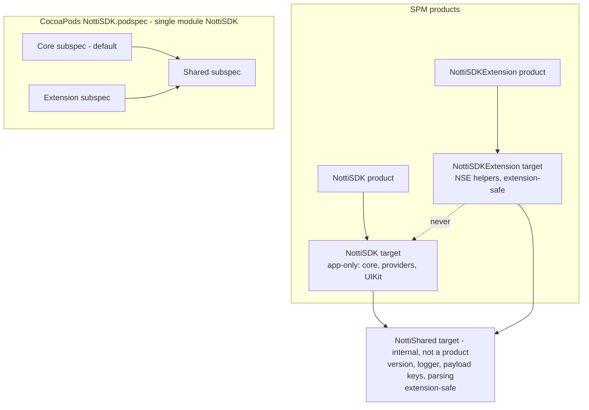

# Package Foundation Design

**Spec**: `.specs/features/package-foundation/spec.md`
**Status**: Approved (2026-10-09)

---

## Architecture Overview

One repo, one Swift package `NottiSDK`, and three source targets: two products plus one internal target. The SPM layout is the source of truth. The podspec maps the same folders onto subspecs.



Host app: links `NottiSDK`. NSE target: links `NottiSDKExtension`. Static linking (SPM default `.automatic`) gives each binary its own copy of `NottiShared`. That is fine because app and appex are separate processes with no shared in-memory state (L: shared state would need an App Group, which is deferred to M3).

---

## Repo Layout

```
Package.swift
NottiSDK.podspec
Sources/
  NottiShared/            # extension-safe, internal
    NottiSDKVersion.swift
    NottiLogger.swift
    NottiPayloadKeys.swift
    NottiNotificationParsing.swift   # moved here by core-port (used by app; NSE in M3)
  NottiSDK/               # app-only
    NottiSDK.swift        # placeholder until public-api
    Resources/PrivacyInfo.xcprivacy
  NottiSDKExtension/      # extension-safe
    NottiSDKExtension.swift          # placeholder until nse-rich-media
    Resources/PrivacyInfo.xcprivacy
Tests/
  NottiSharedTests/
  NottiSDKTests/
  NottiSDKExtensionTests/
scripts/
  check-version.sh
  check-extension-safety.sh
.github/workflows/ci.yml
.swiftlint.yml  .gitignore  LICENSE  README.md  CHANGELOG.md
```

---

## Code Reuse Analysis

| Source | Location | Use |
| --- | --- | --- |
| RN privacy manifests | `../zeep-notti-react-native/ios/PrivacyInfo.xcprivacy`, `ios/NotificationServiceExtension/PrivacyInfo.xcprivacy` | Copy declarations as the baseline (PKG-11/12) |
| RN podspec | `../zeep-notti-react-native/Notti.podspec` | Subspec shape, `exclude_files` lesson, Swift 5.9 |
| RN CI job `build-ios` | `../zeep-notti-react-native/.github/workflows/ci.yml` | `-retry-tests-on-failure -test-iterations 2` + flaky grep (PKG-09) |
| RN LICENSE | `../zeep-notti-react-native/LICENSE` | MIT text, holder updated |
| Alamofire / Firebase / Realm podspecs | GitHub | `resource_bundles` privacy bundle, `pod_target_xcconfig` patterns |

---

## Components

### Package.swift

- **Purpose**: SPM manifest (PKG-01..04).
- **Shape**:
  - `swift-tools-version:5.9`, `platforms: [.iOS(.v15)]`, `swiftLanguageVersions: [.v5]`
  - products: `.library(name: "NottiSDK", targets: ["NottiSDK"])`, `.library(name: "NottiSDKExtension", targets: ["NottiSDKExtension"])`
  - targets: `NottiShared` (no deps), `NottiSDK` (deps `NottiShared`, `resources: [.process("Resources/PrivacyInfo.xcprivacy")]`), `NottiSDKExtension` (deps `NottiShared`, same resources pattern), and three `.testTarget`s. `NottiSDKTests` declares `resources: [.copy("Fixtures")]` for core-port's continuity fixture.
  - No `unsafeFlags` (they make the package unusable remotely), no SwiftLint plugin (it would leak into consumers' resolution).

### Cross-target visibility (`NottiShared`)

- **Problem**: SPM sees three modules (`import NottiShared`); CocoaPods compiles one module `NottiSDK`, where `import NottiShared` doesn't exist.
- **Choice**:
  - Shared declarations use the `package` access level (SE-0386, Swift 5.9). SPM passes `-package-name` automatically.
  - Imports are guarded: `#if canImport(NottiShared)` / `import NottiShared` / `#endif`.
  - The podspec passes the package name explicitly: `pod_target_xcconfig = { 'OTHER_SWIFT_FLAGS' => '$(inherited) -package-name NottiSDK' }`.
- **Risk** [Incerto]: CocoaPods support for `-package-name` via `OTHER_SWIFT_FLAGS` is not documented. **Task 1 is a spike** that proves `pod lib lint` passes with one `package` symbol used across subspecs.
- **Fallback** if the spike fails: shared declarations become `public` but are hidden behind `@_spi(NottiInternal)`, and consumers inside the SDK use `@_spi(NottiInternal) import NottiShared`. That is an underscored attribute, but OneSignal-scale SDKs (e.g. Firebase) use SPI. Record the result as an AD in STATE.

### NottiSDKVersion (PKG-14/15)

- **Location**: `Sources/NottiShared/NottiSDKVersion.swift`
- **Interface**: `package enum NottiSDKVersion { package static let current = "0.1.0" }`
- **Check**: `scripts/check-version.sh` extracts `current` from the Swift file and `s.version` from the podspec, and fails on mismatch. On tag builds (`refs/tags/*`) it also compares against the tag name.

### NottiLogger (used by core-port CORE-12/13)

- **Location**: `Sources/NottiShared/NottiLogger.swift`
- **Interface**:
  - `package enum NottiLogLevel: Int { case none, error, warn, info, debug, verbose }`
  - `package enum NottiLogger { static var level: NottiLogLevel /* default .error */; static func log(_ level: NottiLogLevel, _ message: @autoclosure () -> String, category: String) }`
  - Test seam: `static var sink: ((NottiLogLevel, String) -> Void)?`, used instead of `os.Logger` when set.
- **Backend**: `os.Logger(subsystem: "app.notti.sdk", category:)`. Messages are emitted with `privacy: .public` because the rule is that messages never contain PII (CORE-12). Thread-safe via a lock around `level` and `sink`.
- **Why here**: needed by both the app and the NSE (the NSE has 9 log sites in RN).

### NottiPayloadKeys

- **Location**: `Sources/NottiShared/NottiPayloadKeys.swift`
- **Interface**: constants such as `notificationId = "notification_id"`, `deliveryId = "delivery_id"` and `imageUrl = "notti_image_url"`, plus the internal-key filter lists now in `NottiNotificationParsing.swift:50-51`. This removes the RN duplication of `"notti_image_url"` (NSE:56 vs Parsing:57).

### Privacy manifests (PKG-11/12/13)

- `Sources/NottiSDK/Resources/PrivacyInfo.xcprivacy`: copy of RN Core. `NSPrivacyTracking=false`; accessed API UserDefaults `CA92.1`; collected Email and Phone (linked, no tracking, App Functionality).
- `Sources/NottiSDKExtension/Resources/PrivacyInfo.xcprivacy`: copy of RN NSE (FileTimestamp).
- `NottiShared` has no required-reason API (os.Logger does not need one), so it has no manifest.
- **Beyond RN parity (AD-005, Julio 2026-10-09)**: the `NottiSDK` manifest also declares
  - `NSPrivacyCollectedDataTypeCoarseLocation` (opt-in country derived from CoreLocation): linked to user, not tracking, purpose App Functionality + Analytics
  - `NSPrivacyCollectedDataTypeProductInteraction` (session telemetry: first/last session, count, time): linked to user, not tracking, purpose Analytics
  The smoke test in `NottiSDKTests` parses the manifest and asserts all four collected data types (Email, Phone, CoarseLocation, ProductInteraction) plus UserDefaults `CA92.1`.

### NottiSDK.podspec (PKG-05..07)

```ruby
Pod::Spec.new do |s|
  s.name = 'NottiSDK'; s.version = '0.1.0'; s.license = { :type => 'MIT' }
  s.ios.deployment_target = '15.0'; s.swift_versions = ['5']
  s.source = { :git => 'https://github.com/zeeplabs/zeep-notti-ios-sdk.git', :tag => s.version.to_s }
  s.cocoapods_version = '>= 1.12'          # resource bundle signing bug #11402
  s.pod_target_xcconfig = { 'OTHER_SWIFT_FLAGS' => '$(inherited) -package-name NottiSDK' }
  s.default_subspecs = 'Core'
  s.subspec 'Shared' do |ss| ss.source_files = 'Sources/NottiShared/**/*.swift' end
  s.subspec 'Core' do |ss|
    ss.dependency 'NottiSDK/Shared'
    ss.source_files = 'Sources/NottiSDK/**/*.swift'
    ss.resource_bundles = { 'NottiSDK_Privacy' => ['Sources/NottiSDK/Resources/PrivacyInfo.xcprivacy'] }
  end
  s.subspec 'Extension' do |ss|
    ss.dependency 'NottiSDK/Shared'
    ss.source_files = 'Sources/NottiSDKExtension/**/*.swift'
    ss.resource_bundles = { 'NottiSDKExtension_Privacy' => ['Sources/NottiSDKExtension/Resources/PrivacyInfo.xcprivacy'] }
  end
end
```

The globs only cover `Sources/`, so tests are excluded by construction (PKG-07). There is no `test_spec`: tests run through SPM only. CocoaPods auto-applies `APPLICATION_EXTENSION_API_ONLY` to pod targets used by an appex (`installer/analyzer.rb`), which is our extension guard on the CocoaPods side.

### Extension safety (PKG-03)

SPM has no `APPLICATION_EXTENSION_API_ONLY` setting. Three layers:

1. **Convention**: `NottiShared` and `NottiSDKExtension` import only Foundation, UserNotifications, os and Network. Every `NottiSDK` API that touches `UIApplication.shared` is marked `@available(iOSApplicationExtension, unavailable)` (enforced from core-port onwards).
2. **CI guard**: `scripts/check-extension-safety.sh` greps `Sources/NottiShared` and `Sources/NottiSDKExtension` for `UIApplication`, `import UIKit`, `beginBackgroundTask`, `registerForRemoteNotifications` and `CLLocationManager`, and fails on any match.
3. **Real appex build**: deferred to `example-and-release`. The example app has an NSE target that links `NottiSDKExtension`, and CI builds it. Noted in that feature's spec.

### CI workflow (PKG-08..10)

`.github/workflows/ci.yml`, triggered on `pull_request` and on `push` to `main`:

| Job | Runner | Steps |
| --- | --- | --- |
| `lint` | `ubuntu-latest`, container `ghcr.io/realm/swiftlint:<pinned>` | `swiftlint --strict --reporter github-actions-logging` |
| `checks` | `ubuntu-latest` | `scripts/check-version.sh`, `scripts/check-extension-safety.sh` |
| `test` | `macos-26` | `sudo xcode-select -s /Applications/Xcode_26.<pinned>.app`; `xcodebuild -list` sanity; `xcodebuild test -scheme NottiSDK-Package -destination 'platform=iOS Simulator,name=iPhone 17' -retry-tests-on-failure -test-iterations 2 CODE_SIGNING_ALLOWED=NO`; flaky-warning grep (ported from RN); `xcodebuild build -scheme NottiSDKExtension -destination 'generic/platform=iOS'` (device arm64 build, PKG-04) |
| `pod-lint` | `macos-26` | `pod lib lint NottiSDK.podspec --platforms=ios` and `--subspec=Extension` |

The Xcode minor and simulator name are pinned in one `env:` block. Runner images change weekly, so the first task verifies the values with `xcodebuild -showsdks` / `xcrun simctl list` on the runner.

### Smoke tests (PKG-10)

One XCTest per target. Each asserts something real, not `XCTAssertTrue(true)`:

- `NottiSharedTests`: version is semver; the logger sink receives a message at or above the current level and drops one below it.
- `NottiSDKTests`: the bundled privacy manifest resource is present in the target bundle.
- `NottiSDKExtensionTests`: the same for the extension bundle.

### SwiftLint config (PKG-17)

`.swiftlint.yml`: `included: [Sources, Tests]`.

- Raise `file_length` (error at 2000) and `type_body_length` / `function_body_length` thresholds, because `NottiCore.swift` (1439 lines) is ported verbatim, and splitting it is deferred so that the port doesn't change behavior.
- Disable `identifier_name` for test files.
- The thresholds are revisited after M1.

---

## Error Handling Strategy

| Scenario | Handling | Impact |
| --- | --- | --- |
| `-package-name` not honored by CocoaPods | Spike (task 1) detects it; switch to the `@_spi` fallback and log an AD | Podspec flags change, code visibility keyword changes |
| Runner Xcode/simulator name drifts | Pinned `env` values + `xcodebuild -list` / `simctl` sanity step prints what is available | CI red with an actionable log, not a mystery |
| Version mismatch | `check-version.sh` exits 1 with both values printed | PR blocked |

---

## Tech Decisions

| Decision | Choice | Rationale |
| --- | --- | --- |
| Shared code across products | Internal `NottiShared` target with `package` access | Keeps the NSE free of app code (PKG-02) without making internals public |
| Privacy manifest resource rule | `.process` | Apple's documented example; same output as `.copy` for this file type |
| SwiftLint runner | Pinned Docker image on Linux | Cheap, reproducible, no plugin leak to consumers |
| Tests via | SPM `NottiSDK-Package` scheme on the iOS Simulator | UIKit dependency rules out `swift test` |
| No podspec `test_spec` | Single test path (SPM) | Avoids maintaining two test configurations; lint uses `--skip-tests` implicitly by having none |
