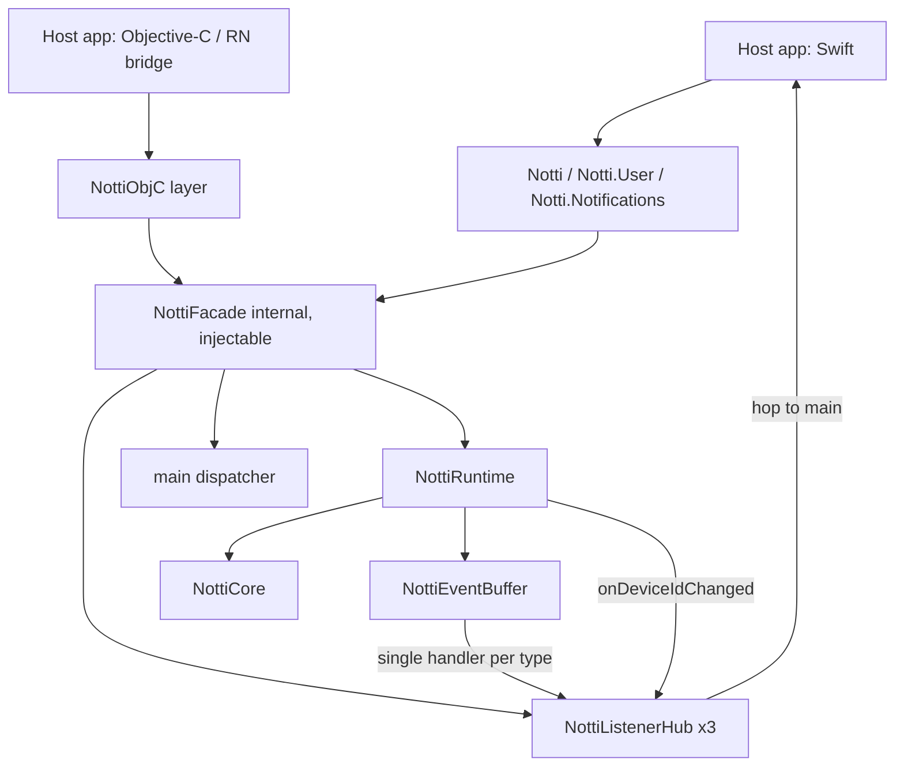

# Public API Design

**Spec**: `.specs/features/public-api/spec.md`
**Status**: Draft (awaiting Julio's review)

---

## Research notes (codebase only, 2026-10-11)

Facts verified in the code, not assumed:

- **No public symbol exists.** `Sources/NottiSDK/NottiSDK.swift` is a placeholder. `NottiRuntime` and `NottiCore` are `internal`; `NottiShared` uses `package`.
- **The core owns its threading.** Every `NottiCore` method returns at once and works on the serial `workQueue`. Callbacks (`requestPermission`, `onDeviceIdChanged`, the event buffer's handlers when emitted from the core path) arrive off the main thread.
- **RN builds its core eagerly.** `NottiImpl` creates `core` at module load, so RN's `getDeviceId()`, `setEmail()` and `setPhone()` work before `initialize` (email and phone are persisted before the initialize guard, DPF-19). The native `NottiRuntime.core` is `nil` until `start`. This is a real gap for the facade: without a fix, `Notti.User.setEmail` before `initialize` would be silently lost, and `Notti.deviceId` would be `nil` for an already-registered device. This resolves the spec's `getDeviceId` open row: **return the persisted id** (AD-002 parity).
- **Constructing a core registers nothing.** The `NotificationCenter` observers are added in the post-initialize path (`NottiCore.swift:953`, `:972`), so an uninitialized core is cheap and side-effect free.
- **Replay semantics.** `NottiEventBuffer.setHandler(.received, h)` replays buffered `received` events to `h` synchronously, outside the buffer lock. `.clicked` is never replayed; clicks wait for `takeInitialClick()` (one-shot). `setHandler(_, nil)` detaches, and later events are buffered again.
- **Core validation.** `NottiApiClient.validatedBaseUrl(_:)` trims, requires `https` (`http` in DEBUG only), requires a host and strips trailing `/`. `NottiCore.initializeOnQueue` already no-ops on identical normalized args, but `NottiRuntime.start` replaces the core first, so that check never fires across `start` calls.
- **Log level.** `NottiLogger.level` is thread-safe, default `.error`. `NottiLogLevel` is `package`.

Not verified (say so, do not guess): whether SPM can import a Swift module from an Objective-C test target in this package, whether a Swift `enum` nested in an `enum` namespace can be `@objc`, and whether `swift-api-digester` is usable in CI. Each has a spike in `tasks.md` with a fallback.

---

## Architecture Overview



Principles:

1. **Thin public shell, testable internal facade.** `Notti`'s static methods forward to `NottiFacade.shared` (built on `NottiRuntime.shared`). Tests construct `NottiFacade(runtime:dispatcher:)` with an isolated runtime, as every other component is tested (TESTING.md: never `.shared`, except the one F1 test).
2. **The facade owns only what the core cannot:** listener multiplexing, main-thread delivery, initialize idempotency, the pre-initialize core, log level, payload typing. Everything else is a one-line forward.
3. **No new threading model.** The core keeps its `workQueue`. The facade adds exactly one hop (`DispatchQueue.main.async`) on the way out, never `sync`, so emission order equals delivery order.

---

## Code Reuse Analysis

| Component | Location | How to use |
| --- | --- | --- |
| `NottiRuntime` | `Sources/NottiSDK/Runtime/NottiRuntime.swift` | Facade's only dependency. Add `ensureCore()`; everything else reused |
| `NottiCore` mutators and `getDeviceId` | `Sources/NottiSDK/Core/NottiCore.swift` | Forwarded as is |
| `NottiEventBuffer.setHandler` / `takeInitialClick` | `Sources/NottiSDK/Events/NottiEventBuffer.swift` | Facade registers one multiplexing handler per type |
| `NottiRuntime.sanitizeTags` | same file | ObjC tag input |
| `NottiApiClient.validatedBaseUrl` | `Sources/NottiSDK/Network/NottiApiClient.swift:114` | Normalizes `baseUrl` for the idempotency key, so the facade and the core agree on "same config" |
| `NottiLogger`, `NottiPayloadKeys` | `Sources/NottiShared/` | Log level mapping, payload key names |
| Test helpers | `Tests/NottiSDKTests/Support/` (`StubURLProtocol`, `LogSink`, fakes) | Facade tests reuse them |
| Sentinel PII test | `NottiLoggingPrivacyTests` | Extended to run through the facade at `.verbose` |

### Integration points

| System | Method |
| --- | --- |
| `delegate-integration` (next feature) | Calls `NottiRuntime.eventBuffer.emit`, `NottiNotificationHandler` and `onApnsToken`. The facade does not change; its listeners start receiving real events once that feature wires the delegates |
| `rn-consumes-native-sdk` | Calls the `@objc` layer |
| CI | New `scripts/check-public-surface.sh` and an ObjC compile check (or its fallback) |

---

## Components

### NottiRuntime additions (internal, small)

- **Purpose**: let the facade work before `initialize`, as RN does.
- **Location**: `Sources/NottiSDK/Runtime/NottiRuntime.swift`
- **Interfaces**:
  - `ensureCore() -> NottiCore`: returns the live core, or builds an uninitialized one and stores it as the current core. Takes `lifecycleLock`. `start` still invalidates and rebuilds, so `ensureCore` never changes `start`'s contract.
  - `core` keeps its meaning for existing tests (`nil` until `start` or `ensureCore`).
- **Dependencies**: `makeCore()`.
- **Reuses**: existing locks. No change to ported core code (AD-002).
- **Effect**: `Notti.deviceId`, `setEmail`/`setPhone` before initialize, `login`/tags (dropped by the core, as RN) and `requestPermission` (core logs a warning and returns `false`) all behave as the core already specifies. `onApnsToken` before initialize reaches the uninitialized core, which discards it, as RN does.

### NottiListenerHub<Payload> (internal)

- **Purpose**: multiplex many host listeners over one source handler.
- **Location**: `Sources/NottiSDK/Facade/NottiListenerHub.swift`
- **Interfaces**:
  - `init(attach: @escaping (_ handler: @escaping (Payload) -> Void) -> Void, detach: @escaping () -> Void, dispatcher: @escaping NottiMainDispatcher)`
  - `add(_ handler: @escaping (Payload) -> Void) -> NottiSubscription`
  - `remove(id:)` (idempotent, called by the subscription)
  - `receive(_ payload: Payload)`: source side. Hops to main, snapshots the listener list at execution time, calls each in registration order.
- **Behavior**:
  - An `attachLock` serializes list mutation together with the `attach`/`detach` call, so a concurrent add/remove can never leave the source handler attached to an empty list (which would drop events instead of buffering them). No callback runs while `attachLock` is held, so re-entrant add/remove from a listener cannot deadlock.
  - 0 to 1 listeners calls `attach` (replay, if any, goes to that first listener). 1 to 0 calls `detach`.
  - The list is updated **before** `attach`, because the buffer replays synchronously inside `setHandler`.
- **Dependencies**: `NottiMainDispatcher` (`(@escaping () -> Void) -> Void`, default `DispatchQueue.main.async`; tests inject a recording executor).

### NottiSubscription (public)

- **Purpose**: handle returned by every `add...Listener`.
- **Interfaces**: `public final class NottiSubscription { public func remove() }`. `remove()` is idempotent and thread-safe, and releases the handler closure. No auto-remove on `deinit`: a listener lives until removed (RN parity); documented in the type doc.

### NottiFacade (internal, `final class`)

- **Purpose**: all facade logic, injectable.
- **Location**: `Sources/NottiSDK/Facade/NottiFacade.swift`
- **Interfaces** (all forward to `runtime.ensureCore()` unless noted):
  - `initialize(appId:clientKey:baseUrl:)`: see Initialization below.
  - `login`, `logout`, `addTags`, `removeTags`, `setEmail`, `clearEmail`, `setPhone`, `clearPhone`, `setSubscription`: one-line forwards.
  - `setLocationSharingEnabled(_:)`: forward on the caller's thread (LGPD B1).
  - `deviceId: String?`: `ensureCore().getDeviceId()`.
  - `requestPermission(completion:)` and `requestPermission() async -> Bool`: wraps the core callback with a once-guard (a second invocation is ignored, never a continuation double-resume) and hops to main.
  - `takeInitialClick() -> NottiNotificationPayload?`
  - `addReceivedListener`, `addClickedListener`, `addDeviceIdChangedListener`
  - `logLevel` get/set.
- **State** (under one lock): `activeConfig: Config?` where `Config` is `(appId, clientKey, normalizedBaseUrl)`.
- **Dependencies**: `NottiRuntime`, `NottiMainDispatcher`.

### Initialization and idempotency (inside `NottiFacade.initialize`)

1. Resolve `baseUrl`: `options.baseUrl ?? "https://app.zeepnotti.app"` (the RN default; the constant lives in one place, `NottiFacade.defaultBaseUrl`).
2. Normalize with `NottiApiClient.validatedBaseUrl`; also reject empty `appId` or `clientKey`.
3. **Invalid**: log at `.error` ("initialize ignored: invalid appId, clientKey or baseUrl", no values) and return. A running core is left alone. Rationale: replacing a working core with an invalid config would turn a typo in a second `initialize` into a silent outage. This is a refinement of spec API-01 (see "Spec deltas").
4. **Same as `activeConfig`**: return, no `start`, no registration.
5. **Otherwise**: set `activeConfig`, call `runtime.start(...)`.

The decision and the `start` call happen under the facade lock, and `start` itself is serialized by `lifecycleLock`, so two racing different inits end with one consistent core.

### Public types (Swift)

- **Location**: `Sources/NottiSDK/Public/`
- `public enum Notti` marked `@available(iOSApplicationExtension, unavailable)`:
  - `static func initialize(appId: String, clientKey: String, options: Options = Options())`
  - `struct Options { var baseUrl: String? }` (nested `Notti.Options`)
  - `static func login(_:)`, `static func logout()`, `static var deviceId: String?`
  - `static func addDeviceIdChangedListener(_ handler: @escaping (String) -> Void) -> NottiSubscription` (`@discardableResult`)
  - `static func setLocationSharingEnabled(_:)`
  - `static var logLevel: Notti.LogLevel { get set }`; `enum LogLevel: Int { none, error, warn, info, debug, verbose }` mapped to `NottiLogLevel` (a distinct name avoids the clash with the `package` type inside the module)
  - `enum User`: `addTag(_:value:)`, `addTags(_:)`, `removeTag(_:)`, `removeTags(_:)`, `setEmail`, `clearEmail`, `setPhone`, `clearPhone`, `setSubscription(_:)`
  - `enum Notifications`: `requestPermission() async -> Bool`, `requestPermission(completion:)`, `addReceivedListener`, `addClickedListener`, `takeInitialClick() -> NottiNotificationPayload?`
- `public struct NottiNotificationPayload: Equatable, Sendable { title: String?; body: String?; data: [String: String] }`, built from the core's `[String: Any]` using `NottiPayloadKeys`. Missing `data` becomes `[:]`. Non-string `data` values are dropped, as in RN.
- `Sendable` is declared only on pure value types, which is valid in Swift 5 mode and adds no concurrency rewrite.

### Objective-C layer

- **Location**: `Sources/NottiSDK/Public/ObjC/`
- Three `@objc` classes, because Swift namespaces are invisible to ObjC: `Notti` (initialize, login/logout, deviceId, location sharing, log level, listeners, permission, initial click), `NottiUser`, `NottiNotifications`. Swift names are suffixed (`NottiObjC` and so on) and the ObjC runtime names are set with `@objc(Notti)`, `@objc(NottiUser)`, `@objc(NottiNotifications)`. The ObjC and RN bridge calls use `NSDictionary` payloads and completion blocks.
- `addTags:` takes `[AnyHashable: Any]` and goes through `NottiRuntime.sanitizeTags` (non-string values dropped).
- **Risk**: an ObjC name `Notti` next to a Swift `enum Notti` in one module. Spike in the first task. Fallback: ObjC names `NottiSDKClient`, `NottiSDKUser`, `NottiSDKNotifications`, chosen with Julio before v0.1.0 because they are public.

### Public surface guard

- **Location**: `scripts/check-public-surface.sh`, `.specs/codebase/PUBLIC_SURFACE.txt`
- **Behavior**: lists every `public`/`open` declaration under `Sources/NottiSDK` (declaration line only, sorted, attributes kept), diffs it against the committed file, and fails with the diff on drift. Also fails if a `public` declaration appears in `Sources/NottiShared` (it must stay `package`) or in `Sources/NottiSDKExtension` when it is not in the file.
- **Why a script and not `swift-api-digester`**: it runs on the Linux lint/checks job with no toolchain dependency, and its failure mode is trivial to mutate-test. Limitation: it is a textual check, so a public symbol hidden behind an unusual declaration form could escape. The digester is a post-M1 improvement if it proves available.
- Run in the existing `checks` job.

### Compile check for Objective-C

- First choice: a small ObjC test target in `Package.swift` that imports `NottiSDK` and calls each ObjC entry point. Spike first, because SPM's support for importing a Swift module from an ObjC target is unverified here.
- Fallback if the spike fails: an ObjC source file compiled in the `pod lib lint` run via a test spec, and the full ObjC host check moves to `example-and-release` (record as a todo and note the weaker guarantee in `validation.md`).

---

## Data Models

```swift
// Internal
struct Config: Equatable { let appId: String; let clientKey: String; let baseUrl: String } // baseUrl normalized

// Public
public struct NottiNotificationPayload: Equatable, Sendable {
    public let title: String?
    public let body: String?
    public let data: [String: String]
}
```

No new persisted keys. No change to the `notti_prefs` suite (CORE-09 stays).

---

## Error Handling Strategy

| Scenario | Handling | User impact |
| --- | --- | --- |
| Invalid `initialize` args | Log `.error` without values, keep any running core | SDK stays as it was, no crash |
| Call before `initialize` | Core behavior: dropped with a warning, or persisted (email, phone) and converged at registration | Same as RN |
| `requestPermission` before `initialize` | `false`, no prompt | Host sees `false` |
| Core calls the permission callback twice | Second call ignored (once-guard) | No crash |
| Listener added or removed inside a callback | Applies from the next event, no deadlock | None |
| Payload with unexpected types | Dropped field by field, never thrown | Missing field in payload |

---

## Tech Decisions

| Decision | Choice | Rationale |
| --- | --- | --- |
| Pre-initialize behavior | `ensureCore()` on the runtime, not a second store accessor | Reuses the core's coalescing and persist-before-guard logic (DPF-19) instead of duplicating it |
| Idempotency location | Facade compares normalized config | `start` is a verified port, so changing it would be M1-forbidden. The facade is new code |
| Invalid re-init | Ignore and keep the running core | Avoids silent outage; a refinement of API-01 |
| Listener API shape | Three typed methods | Payload types differ (`NottiNotificationPayload` vs `String`); one generic `addListener(event)` would need `Any` |
| Main hop | Always `async`, never inline | Preserves order; mixing inline and async delivery can reorder |
| Subscription lifetime | Explicit `remove()`, no auto-remove | RN parity and predictable for multi-module hosts |
| Surface guard | Textual script | Cross-platform, mutation-testable, no toolchain dependency |
| Concurrency | Swift 5 mode, `Sendable` on value types only | AD-002 |

---

## Spike results (T1, 2026-10-11)

Scratch copy of the package (outside the repo), Xcode 27.0, iPhone 17 Pro simulator, Swift 5 mode. Nothing from the spike is in the repo.

**(a) `@objc(Notti) final class NottiObjC: NSObject` next to `public enum Notti`: works.** Both compile in the `NottiSDK` module (`xcodebuild build -scheme NottiSDK`: BUILD SUCCEEDED). The generated `NottiSDK-Swift.h` contains `SWIFT_CLASS_NAMED("NottiObjC") ... @interface Notti : NSObject`. From Swift, `Notti.hello()` resolves to the enum; from ObjC, `[Notti hello]` resolves to the class. Both asserted in a test run.

**(b) `@objc enum` nested in the non-`@objc` `public enum Notti`: compiles, but is silently not exported to ObjC.** `Notti.LogLevel` declared as `@objc public enum LogLevel: Int` inside the namespace builds without error or warning, yet `NottiSDK-Swift.h` has no `SWIFT_ENUM` for it and an ObjC file fails with `use of undeclared identifier 'NottiLogLevel'` (also with the nested default name). Minimal alternative that keeps the Swift name: a top-level `@objc(NottiLogLevel) public enum NottiLogLevelObjC: Int` plus `extension Notti { public typealias LogLevel = NottiLogLevelObjC }` (or the typealias inside the enum). Verified: Swift test `let l: Notti.LogLevel = .error` passes, and ObjC sees `NottiLogLevelNone`/`NottiLogLevelError` through `NSInteger` casts and a settable property. Cost: one extra top-level public type (`NottiLogLevelObjC`), listed in `PUBLIC_SURFACE.txt`. Note for T9/T10: declare the level enum at the top level with `@objc(NottiLogLevel)` and expose `Notti.LogLevel` as a typealias, not as a nested enum.

**(c) SPM ObjC test target importing `NottiSDK`: works.** `.testTarget(name: "NottiSDKObjCTests", dependencies: ["NottiSDK"])` with `Tests/NottiSDKObjCTests/*.m` using `@import XCTest; @import NottiSDK;` compiled and ran under `xcodebuild test -scheme NottiSDK-Package -only-testing:NottiSDKObjCTests` (TEST SUCCEEDED, 2 ObjC tests executed). No `include/` directory or umbrella header was needed. `scripts/check-package-graph.sh` and `scripts/check-extension-safety.sh` still pass with the new target in the manifest.

### Decision

| Item | Choice |
| --- | --- |
| ObjC class names | Original: `Notti`, `NottiUser`, `NottiNotifications` (via `@objc(...)` on `NottiObjC` and so on). The fallback `NottiSDKClient`/`NottiSDKUser`/`NottiSDKNotifications` is NOT needed. Julio is still asked to confirm the original names, since they are public (T12) |
| ObjC log level | Top-level `@objc(NottiLogLevel) public enum NottiLogLevelObjC: Int` + `Notti.LogLevel` typealias (the nested `@objc` enum is not exported) |
| Compile check | SPM ObjC test target `NottiSDKObjCTests` (first choice holds); the pod-lint fallback is not needed |
| Fallback | Only if a later Xcode drops this behavior: ObjC file in a CocoaPods test spec |

---

## Spec deltas found in Design (already applied to `spec.md`, 2026-10-11)

| Spec item | Change | Reason |
| --- | --- | --- |
| API-05, Assumptions row `getDeviceId` before initialize | Returns the **persisted** id (not `nil`) | RN builds its core eagerly, so it returns the persisted id. Verified in `NottiImpl.swift:377` and the eager `core` |
| API-01 AC 2 | Invalid args never replace a running core; they leave an uninitialized SDK uninitialized | Facade-level pre-validation (design above) |
| API-10 AC 2 | `addListener(_:handler:)` becomes `addReceivedListener`, `addClickedListener`, `addDeviceIdChangedListener` | Typed payloads |
| API-07 and the Assumptions row "Before initialize" | Needs `ensureCore()` on the runtime, otherwise email and phone are lost before initialize | Native core is `nil` before `start` |
| Log level row | Stays `.error`. Julio proceeded without objecting; treated as accepted | CORE-13 |

---

## Test strategy (feeds Tasks)

- Facade tests use an isolated `NottiRuntime` (`startObservers: false`), `StubURLProtocol`, and a recording dispatcher; one test class per component, plus `NottiFacadeTests` for the flows in the spec.
- **F1 (API-03)**: the single test that touches `NottiRuntime.shared`: it writes a device id into the `notti_prefs` suite directly, asserts `Notti.deviceId` reads it, then removes the key. A mutant that changes the suite name in `shared` fails it.
- **Mutation targets for the Verifier**: replace the idempotency comparison, drop the `attachLock`, attach before updating the list, make the main hop inline, drop the once-guard, skip `sanitizeTags`, change the default `baseUrl`, break the level mapping, and add an unlisted `public` symbol.
- Expected counts: baseline 252; every task states its cumulative number.
